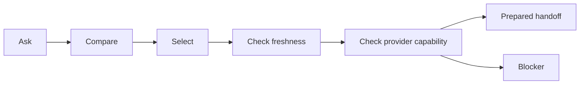

# The Buyer Journey From Question To Prepared Purchase Handoff

> **Update, 20 October 2026.** Since this post was written, Grantex signs every OACP artifact
> (ES256 detached JWS) and AgenticOrg's `main` branch verifies each one before caching it. A
> deterministic commerce arbiter decides every purchase handoff, POS handoff and checkout
> completion (allow or refuse, never waiting for a person), and every commerce change is written
> to the commerce ledger. UCP and ACP checkout surfaces exist behind flags that default to off,
> and no payment executor is registered yet. The AgenticOrg changes are not in its production
> deployment yet. Current state: [OACP explained](oacp-one-trust-layer-under-ucp-acp-ap2.md) and
> the [truth inventory](../oacp/truth-inventory.md).

## Summary

OACP lets a buyer journey move from discovery to prepared purchase handoff without faking checkout, payment, order, or mandate success.

## Target Audience

Buyer-experience teams, operators, and merchant success.

## Architecture Diagram

## End-To-End Flow

The buyer asks about products. AgenticOrg answers from OACP cache. The buyer asks to buy. AgenticOrg checks required artifacts, product and variant selection, price and inventory freshness, policy, and Plural/Pine capability evidence. The output is a prepared handoff or a blocker.

## What Is Implemented Now

Buyer Q&A, product listing, protocol adapters, provider capability verification, and purchase preparation are implemented.

## What Requires External Approval Or Config

Provider rail execution, merchant order integration, channel approvals, and rollback evidence.

## Failure Modes

- Product no longer fresh.
- Price/inventory record missing.
- Provider capability stale.
- Buyer asks for final payment/order success.

## Safe User Wording Examples

- "I can prepare this for review."
- "No payment was attempted."
- "The merchant/provider system remains the source of final order status."
