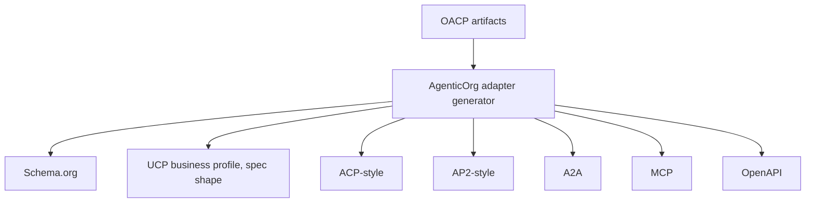

# How OACP Maps To Schema.org, UCP, ACP, AP2, A2A, MCP

> **Update, 20 October 2026.** Since this post was written, Grantex signs every OACP artifact
> (ES256 detached JWS) and AgenticOrg's `main` branch verifies each one before caching it. A
> deterministic commerce arbiter decides every purchase handoff, POS handoff and checkout
> completion (allow or refuse, never waiting for a person), and every commerce change is written
> to the commerce ledger. UCP and ACP checkout, server-verified Grantex mandates and a Plural
> payment executor exist behind flags that default to off, so with the defaults nothing moves money. The AgenticOrg changes are not in its production
> deployment yet. Current state: [OACP explained](oacp-one-trust-layer-under-ucp-acp-ap2.md) and
> the [truth inventory](../oacp/truth-inventory.md).
> The earlier UCP-style capability list was replaced by the merchant's UCP business profile in
> the published shape; the diagram and text below are corrected accordingly.

## Summary

AgenticOrg verifies and consumes Grantex OACP artifacts and generates compatibility adapter payloads for web, MCP, OpenAPI, A2A, and partner-style clients. For UCP it renders the merchant's business profile in the published shape; the UCP and ACP checkout routes are served separately, behind flags.

## Target Audience

Developers and protocol partners.

## Architecture Diagram

## End-To-End Flow

Grantex issues protocol adapter artifacts. AgenticOrg verifies each one (ES256 detached JWS, scope, TTL, status list), caches it, and generates channel payloads from canonical source, freshness, policy, and blocked-capability fields.

## What Is Implemented Now

`/api/v1/commerce/runtime/protocol-adapters` and `/protocol-adapters/{surface}` return generated payloads. OpenAPI and A2A bridge metadata routes also exist. The UCP profile, catalog and checkout and the ACP feed and checkout sessions are separate routes on `main`, each behind a flag that defaults to off; see `docs/oacp/explainers/protocol-partner-mappings.md`.

## What Requires External Approval Or Config

External program review, public client acceptance, channel policy approval, and any partner claims outside internal compatibility mapping.

## Failure Modes

- Adapter generated without source labels.
- Unsupported execution fields included.
- Client treats metadata as payment/order authority.

## Safe User Wording Examples

- "This is a compatibility mapping derived from OACP artifacts."
- "The adapter does not create checkout or payment."
- "Unsupported execution fields are blocked."
