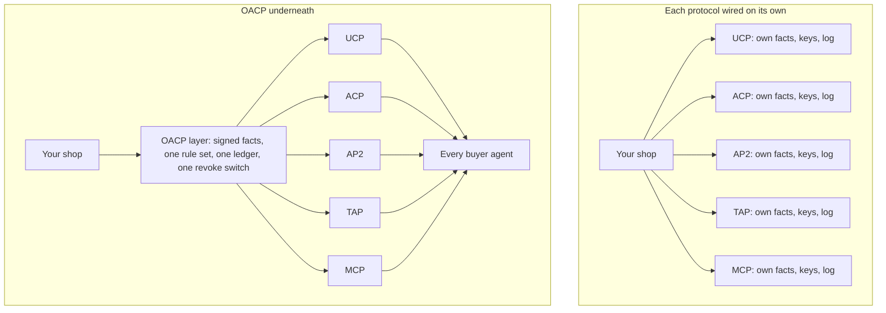
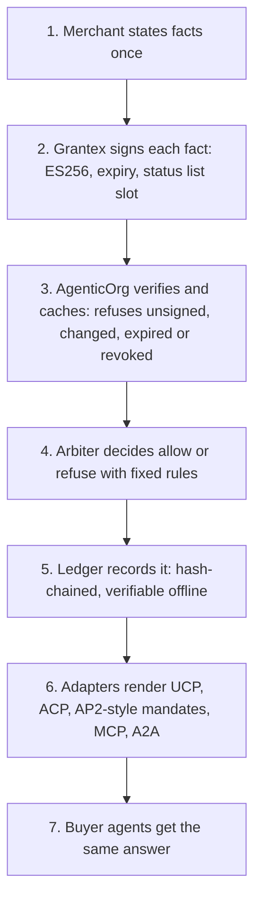
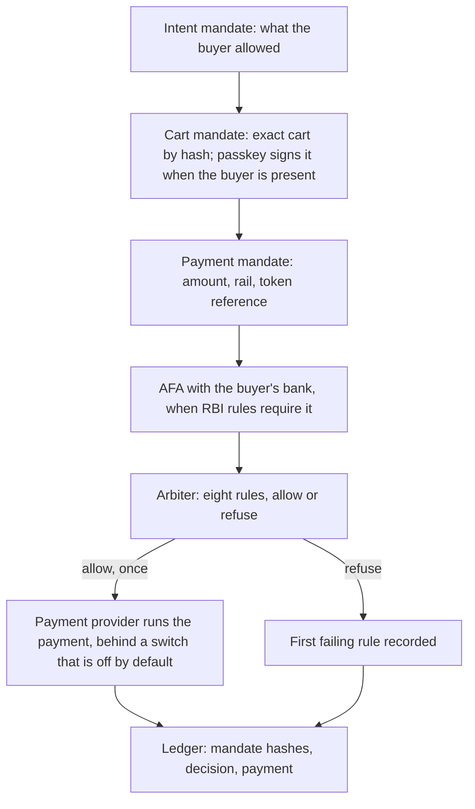
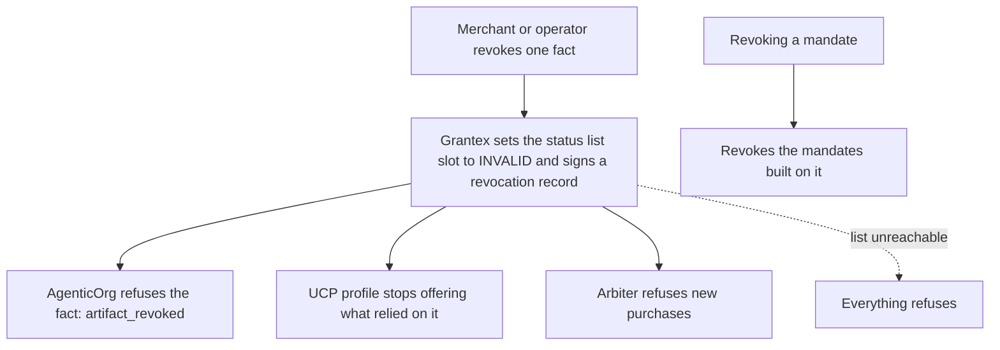

# OACP Explained: One Trust Layer Under UCP, ACP And AP2

Published on the AgenticOrg blog at `/blog/oacp-one-trust-layer-under-ucp-acp-ap2`. The page
renders from `ui/src/pages/blog/blogData.ts`; this file is the reviewable source of the same
story. Examples use synthetic shops and amounts.

## In 30 Seconds

- AI shopping agents use several protocols. UCP covers discovery and checkout, ACP covers agent
  checkout, AP2 covers payment mandates, and Visa TAP and Mastercard Agent Pay identify agents.
- Each one covers one slice. Wire them one by one and you keep several copies of your facts,
  several trust set-ups and several logs.
- OACP is a layer underneath them. You state your facts once. Grantex signs them. AgenticOrg
  checks them, decides each purchase with fixed rules and records it. Adapters then speak each
  protocol.
- Revoke a fact once and every protocol stops using it.
- OACP does not replace UCP, ACP or AP2. It feeds them.

## Target Audience

Merchants, platform teams and protocol partners. No engineering background needed.

## Without OACP, And With It

Wiring each protocol separately gives four problems: several sources of truth, several trust
models, several audit trails, and no common off switch, so an agent can act on a stale or revoked
fact that one integration missed.

## OACP In One Sentence

OACP, the Open Agentic Commerce Protocol, is one set of signed, revocable commerce facts, one
rule-based decision before any money moves, and one tamper-evident record, rendered into every
agent protocol.

## How It Works

## Side By Side

| What you need | Each protocol wired on its own | With OACP underneath |
| --- | --- | --- |
| Product facts | A copy per protocol, updated separately | Stated once, signed once, rendered into each protocol |
| Trust | A different key and check per integration | One signature profile and one published key set |
| Who may buy | Each integration has its own idea | Intent, Cart and Payment mandates, checked the same way everywhere |
| Before money moves | Up to each integration | No allow decision, no payment |
| Revocation | Revoke in each place and hope none is missed | One status list that every protocol checks |
| Audit | Several logs in several formats | One hash-chained ledger you can verify offline |
| New protocol versions | Rework each integration | Add a renderer; facts and rules stay the same |
| India rails | Build UPI AutoPay and AFA handling yourself | UPI AutoPay mandates and the AFA step are part of checkout |

## A Purchase, Start To Finish

The arbiter's rules for checkout: a valid mandate, active consent, the amount within the buyer's
cap, verified buyer authority, facts still valid, merchant limits, stricter limits when the buyer
is not present, and AFA evidence when required. Nobody at the merchant approves anything by hand.

## When Something Is Revoked

A cached copy of the status list lasts 30 seconds by default.

## Why The Layer Underneath

- Write once, publish everywhere.
- Consistency across agents.
- Revocation everywhere at once.
- One audit trail, verifiable offline and witnessed by Grantex.
- Protocol changes stay small: UCP 2026-04-08 publishes signing keys in `signing_keys`, while
  2026-08-25 uses `keys` and adds policies and locations. One renderer per release absorbs it.
- Safety rails every time: no allow decision, no payment.
- India rails included: UPI AutoPay mandates, RBI AFA thresholds and the Plural rail.

## What Is Switched On Today

Status on 20 October 2026.

- **In Grantex production:** every artifact is signed with ES256 under Grantex's first OACP
  issuer key, the key is published, and the public revocation list is served.
- **Merged in AgenticOrg's main branch:** signature checks before caching (strict in
  production), the arbiter and ledger for every commerce handoff and checkout completion, the UCP
  profile, catalog and checkout, the ACP feed and checkout sessions, MCP checkout tools, Intent,
  Cart and Payment mandates from Grantex, and the Plural payment executor with UPI AutoPay and
  AFA. Everything that touches checkout, payment, mandates or public discovery ships behind
  switches that default to off, so with the defaults no checkout completes and no money moves.
- **Still in review for AgenticOrg:** agent request signatures (checked and logged by default;
  refusing unsigned requests is a separate switch).
- **Not yet in AgenticOrg production:** the AgenticOrg release described here. It goes to
  production after the remaining work is merged, with each switch turned on separately.

## What OACP Is Not

Not a certification and not endorsed by the groups behind UCP, ACP, AP2 or TAP. Mandates are
signed JWTs mapped to AP2 field names, not AP2's SD-JWT format; passkey signing of the cart is a
Grantex extension. OACP does not establish regulatory compliance on its own.

## Related

- [How OACP artifacts keep buyer agents honest](how-oacp-artifacts-keep-buyer-agents-honest.md)
- [How OACP maps to Schema.org, UCP, ACP, AP2, A2A, MCP](how-oacp-maps-to-schemaorg-ucp-acp-ap2-a2a-mcp.md)
- [Why Grantex is not a transaction toll booth](why-grantex-is-not-a-transaction-toll-booth.md)
- Grantex post: <https://docs.grantex.dev/blog/oacp-one-trust-layer-under-ucp-acp-ap2>
