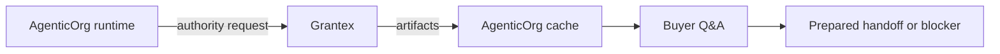

# Why Grantex Is Not A Transaction Toll Booth

> **Update, 20 October 2026.** Since this post was written, Grantex signs every OACP artifact
> (ES256 detached JWS) and AgenticOrg's `main` branch verifies each one before caching it. A
> deterministic commerce arbiter decides every purchase handoff, POS handoff and checkout
> completion (allow or refuse, never waiting for a person), and every commerce change is written
> to the commerce ledger. UCP and ACP checkout, server-verified Grantex mandates and a Plural
> payment executor exist behind flags that default to off, so with the defaults nothing moves money. The AgenticOrg changes are not in its production
> deployment yet. Current state: [OACP explained](oacp-one-trust-layer-under-ucp-acp-ap2.md) and
> the [truth inventory](../oacp/truth-inventory.md).

## Summary

Grantex is the OACP authority, not a relay for every buyer message. AgenticOrg can answer non-binding questions from valid cached artifacts, while merchant/provider/POS systems remain responsible for execution.

## Target Audience

Architects, merchant success teams, and operators.

## Architecture Diagram

## End-To-End Flow

AgenticOrg asks Grantex for authority artifacts after source sync. Buyer Q&A then uses valid cache. A request that commits the buyer requires fresh artifacts, provider or bank capability evidence, POS or merchant confirmation where applicable, and merchant/provider approval.

## What Is Implemented Now

AgenticOrg has authority request, cache, Q&A, bridge, adapter, and purchase preparation paths. Grantex has the C6Z authority endpoint.

## What Requires External Approval Or Config

Tenant allowlists, channel approvals, provider or bank configuration, POS callback verification, and any execution path.

## Failure Modes

- Cache used past freshness window.
- Commitment treated as discovery.
- Grantex outage misunderstood as permission to proceed.

## Safe User Wording Examples

- "This answer came from a valid cached OACP artifact."
- "A cached artifact is not payment authority."
- "I need fresh authority evidence before preparing that request."
