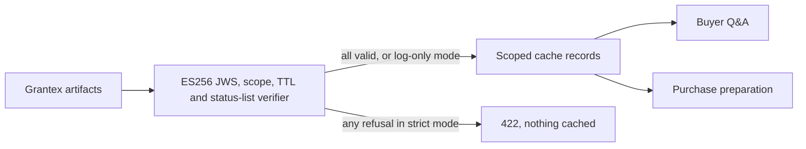

# Artifact Cache Guide

Canonical end-to-end flow: [OACP end-user flow](end-user-flow.md).

AgenticOrg caches Grantex OACP artifacts as public-safe refs scoped by tenant, merchant, seller agent, buyer agent, artifact family, and source refs. `POST /api/v1/commerce/runtime/artifacts/cache` verifies every artifact before it opens a database session; what "verified" means, and what happens when verification fails, is set out below.

## Verification Before Caching

The verifier is `core/commerce/oacp_grantex_trust.py` (network and caching) over `core/commerce/oacp_jws.py` and `verify_oacp_artifact` in `core/commerce/oacp_artifacts.py` (no I/O). It applies the OACP artifact JWS profile v1 in this order, and the first failure is the refusal code:

| Step | Check | Refusal code |
| --- | --- | --- |
| 1 | `envelope.signature` is a detached compact JWS (RFC 7515 Appendix F): three parts, empty middle, unpadded base64url | `signature_missing_or_placeholder` |
| 2 | `envelope.signature_alg` is `ES256` | `signature_algorithm_unsupported` |
| 3 | SHA-256 of the RFC 8785 canonical payload equals `envelope.payload_hash` | `payload_hash_mismatch` |
| 4 | Protected header is exactly `{"alg":"ES256","kid":<issuer_key_id>,"typ":"oacp-artifact+jws"}` | `detached_jws_verification_failed` |
| 5 | `envelope.issuer` is the pinned Grantex issuer, the kid starts with `oacp-`, and exactly one usable ES256 P-256 signing key with that kid is in the Grantex JWKS | `issuer_key_untrusted` |
| 6 | ES256 signature (64-byte `r || s`) verifies over `BASE64URL(header) + "." + BASE64URL(JCS(envelope without "signature"))` | `detached_jws_verification_failed` |
| 7 | Artifact type, public-safe safety metadata, no private or enabling payload fields, `issued_at` and `not_before` (60 s clock-skew tolerance, as Grantex applies), expiry (no tolerance), TTL within the pinned default (`revocation` artifacts up to 24 h), scope (authenticated tenant, payload merchant and seller agent, no buyer agent), schema and policy versions | `artifact_missing_or_invalid`, `artifact_not_yet_valid`, `artifact_expired_or_stale`, `artifact_ttl_exceeds_default`, `artifact_scope_mismatch` |
| 8 | Token Status List (draft-ietf-oauth-status-list) entry at `envelope.status.status_list` is VALID | `artifact_revoked`, `artifact_suspended`, `revocation_status_unavailable` |

Because the whole envelope is signed, a changed expiry, scope, payload hash or status reference fails step 6. The shared vectors in `tests/fixtures/oacp/oacp-artifact-jws-v1.json` pin the codes for steps 1-6.

Trust inputs come from configuration, never from the artifact:

- **Issuer**: `AGENTICORG_GRANTEX_ISSUER`, or the issuer derived from `GRANTEX_BASE_URL` (the same resolver grant-token verification uses). With no issuer configured every artifact is refused.
- **JWKS**: `<Grantex API origin>/.well-known/jwks.json`, fetched with an async client over the DNS-pinning egress transport, 5 s timeout, cached for 300 s, failures and unknown kids negatively cached for 60 s. A kid missing from a cached JWKS triggers one refresh, so a key rotated in since the last fetch is found. A key Grantex has withdrawn (revoked, or retired after every artifact it signed expired) is not in the JWKS and its artifacts are refused.
- **Status list**: Grantex serves it at `/status/oacp/<list>` only when its `OACP_STATUS_LIST_PUBLIC_ENABLED` flag is on; while it is off the list returns 404 and every artifact is refused with `revocation_status_unavailable` (cached only in log-only mode). It is fetched only when its origin is the issuer origin or the Grantex API origin, and only over https. The `statuslist+jwt` token must verify against the same JWKS (ES256 or RS256), its `sub` must equal the referenced URI and it must be unexpired. It is cached no longer than its `ttl`, its `exp` or 600 s. An unreachable or invalid list refuses the artifact.

## Strict And Log-Only Modes

`AGENTICORG_OACP_VERIFY_STRICT` selects what a failure does. Unset, it is on in strict runtimes (production, staging, preview and any unrecognised `AGENTICORG_ENV`) and off in `local`, `dev`, `development`, `test` and `ci`.

- **Strict**: if any artifact in a request fails, the request returns `422` with `status: artifact_verification_refused`, `records_stored: 0` and one refusal per failed artifact. Nothing from that issuance is cached, including the artifacts that passed: a partly verified issuance is never stored.
- **Log-only**: verification still runs; each failure is logged as `oacp_artifact_verification_irregularity` and returned under `verification.refused`, and the artifact is cached without a `verifier_result_ref`. A record without one cannot back a final commitment.

The response's `verification` object reports the mode, the number of artifacts verified and the refusals.

## `verifier_result_ref`

A verified artifact's cache record carries `oacp-artifact-jws-v1;kid=<kid>;payload_hash=<hex>;status=valid;verified_at=<time>`. It is written only by the verifier: a `verifier_result_ref` sent in the request body is ignored, and no record is given a default.

Every runtime read of the cache (buyer answers, bridge answers, protocol adapters, purchase preparation, Offline POS handoffs) goes through `evaluate_runtime_cache_record` in `core/commerce/c6z_runtime_vertical.py`, which counts a record as verified only when its ref has that form:

| Record | Strict runtime | Log-only runtime |
| --- | --- | --- |
| `oacp-artifact-jws-v1;kid=oacp-…` ref | used | used |
| Legacy `<artifact_id>:verified` ref (stamped before verification existed) | refused `artifact_unverified_legacy` | used, `oacp_cache_record_unverified_irregularity` logged |
| No ref (cached in log-only mode) | refused `artifact_unverified` | used, irregularity logged |

## Refresh From Grantex Replay

`POST /api/v1/commerce/runtime/artifacts/refresh` with `{merchant_id, seller_agent_id, buyer_agent_id?}` reads every issued artifact for the authenticated tenant and that scope from Grantex replay (`GET /v1/commerce/oacp/artifacts`, following `next_cursor`, with the same service token as the authority request), skips expired ones, and caches the rest through the same verification as `/artifacts/cache`. It is the operator path for rows refused as `artifact_unverified_legacy` or `artifact_unverified`. Missing Grantex settings return `blocked_missing_grantex_env`; an unreachable replay returns `502 grantex_replay_unavailable` and changes nothing.

## Grantex SDK Verifier

`verify_oacp_artifact_jws` has the inputs (envelope, payload, JWKS, pinned issuer) and refusal codes of the `verify_oacp_artifact` function the Grantex Python SDK is adding. `grantex` is pinned at 0.7.2, which does not have it; when an SDK release with it is published, the cache switches to the SDK function and this local copy is deleted. The canonicalization already comes from `grantex.canonical` (RFC 8785).

## Cache Inputs

- Grantex artifact envelope and payload.
- Source refs and evidence refs.
- Issued/expires timestamps.
- Freshness summary.
- Risk tier and revocation posture (the Token Status List check above).
- Blocked capabilities.
- `no_checkout_payment_enablement`.

## Cache And Buyer Q&A

## Grantex Unavailable

Valid cached artifacts can support non-binding answers. Stale, revoked, missing, ambiguous, or commitment-bound requests must refresh or refuse.

## Do Not Cache

Raw Shopify payloads, Shopify tokens, provider tokens, card data, bank data, checkout URLs, payment URLs, private merchant payloads, or executable provider targets.
