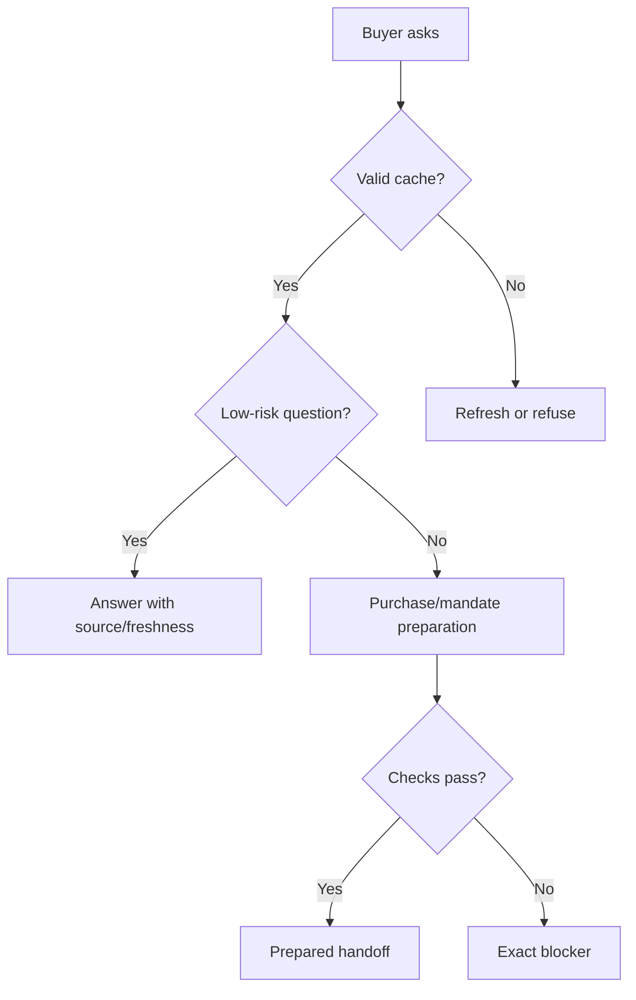

# Buyer Agent Flow Guide

Canonical end-to-end flow: [OACP end-user flow](end-user-flow.md).

Buyer agents answer from cached OACP artifacts. They do not query raw Shopify or provider secrets during buyer Q&A.

## Signed Buyer Requests

With `AGENTICORG_HTTPSIG_SIGN_OUTBOUND=true`, AgenticOrg's buyer agent signs each request its
Grantex Commerce connector sends with the tenant agent key, under the Visa Trusted Agent Protocol
profile of RFC 9421: `agent-browser-auth` for catalog, inventory, cart, consent and status calls,
`agent-payer-auth` for payment intents and checkouts, a fresh nonce per request, and optionally a
Web Bot Auth signature with `Signature-Agent`. A payment intent or checkout made with a granted
Grantex consent also carries the TAP payment container and the Grantex consent record object,
bound to the signature's nonce. With signing on and no usable key the call is refused, never sent
unsigned. Off (the default), requests are unchanged. See
[agent request signing](agent-request-signing.md).

## What Buyers Can Ask

- Product discovery and comparison.
- Availability and source/freshness.
- Merchant policy questions from valid artifacts.
- Prepared handoff requests.

## What Must Be Blocked

Paid-state claims, stock holds, mandate setup, refunds, returns, shipment, and private merchant-system mutation must be blocked unless an approved execution path confirms the result.

Checkout and order creation go through the checkout session routes, and only there: UCP
([UCP checkout, cart and order](ucp-checkout.md), also reachable through the
`agenticorg-mcp-server` UCP checkout tools) and ACP
([ACP feed and sessions](acp-feed-and-sessions.md)), which share one session table, one
arbiter decision and one executor:

- With `AGENTICORG_UCP_CHECKOUT_ENABLED` and `AGENTICORG_ACP_CHECKOUT_ENABLED` off (the default) a buyer agent cannot create a checkout or an order at all.
- With a flag on, a buyer agent can create and update checkout sessions (and UCP carts), but a checkout is `completed` (and an order exists) only after the commerce arbiter sealed an `allow` decision for that exact session and a registered executor consumed it. The Plural executor is registered only while `PLURAL_PINE_LIVE_EXECUTION_ENABLED=true` (off by default) and runs only for a merchant whose `provider_policy.ucp.executor` names it; otherwise UCP Complete returns `executor_unavailable` and ACP Complete an `unsupported` message. A UPI AutoPay payment also needs the buyer's RBI AFA step, which the response returns as an action or a `continue_url` ([Mandates](mandates.md)).
- A buyer agent must never describe a session that is not `completed` as an order, or a `complete_in_progress` session as paid.
