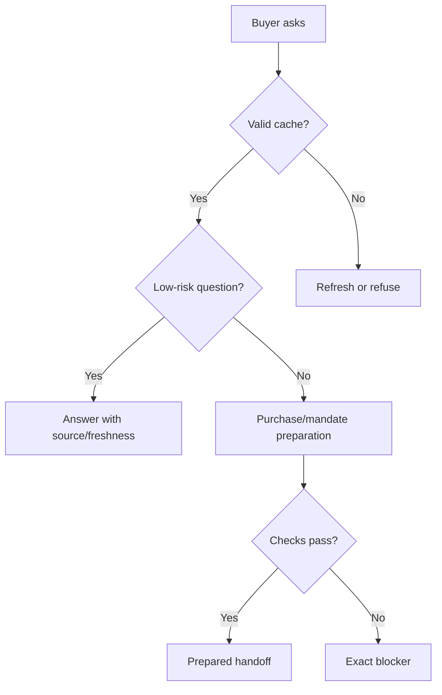

# Buyer Agent Flow Guide

Canonical end-to-end flow: [OACP end-user flow](end-user-flow.md).

Buyer agents answer from cached OACP artifacts. They do not query raw Shopify or provider secrets during buyer Q&A.

## What Buyers Can Ask

- Product discovery and comparison.
- Availability and source/freshness.
- Merchant policy questions from valid artifacts.
- Prepared handoff requests.

## What Must Be Blocked

Paid-state claims, stock holds, mandate setup, refunds, returns, shipment, and private merchant-system mutation must be blocked unless an approved execution path confirms the result.

Checkout and order creation go through the UCP checkout capability ([UCP checkout, cart and order](ucp-checkout.md)), and only there:

- With `AGENTICORG_UCP_CHECKOUT_ENABLED` off (the default) a buyer agent cannot create a checkout or an order at all.
- With it on, a buyer agent can create and update checkout sessions and carts, but a checkout is `completed` (and an order exists) only after the commerce arbiter sealed an `allow` decision for that exact session and a registered executor consumed it. No executor is registered in this release, so Complete returns `executor_unavailable`.
- A buyer agent must never describe a session that is not `completed` as an order, or a `complete_in_progress` session as paid.
