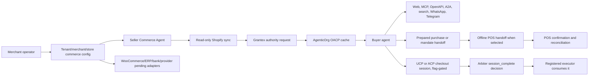

# OACP End-User Flow

This is the canonical AgenticOrg OACP end-to-end flow.

Current runtime status (2026-10-20): Shopify read-only sync, Grantex authority
requests, artifact verification before caching, buyer-safe answers, protocol
payloads, the commerce arbiter and ledger, prepared provider/POS handoffs, and
reconciliation are in source on `main`; the UCP and ACP surfaces are there behind
flags that default to off, and no payment executor is registered. The AgenticOrg
production deployment does not include the verification, arbiter, ledger, UCP or
ACP work yet. Each live tenant still needs its own credentials, scopes, merchant
configuration, channel approval, and provider/POS setup. See
[current product status](../PRODUCT_STATUS.md) and the
[truth inventory](truth-inventory.md).

## Flow

1. Merchant saves tenant/merchant/seller scoped commerce config for source connector, buyer channels, provider-owned payment rails, public publishing, and Offline POS metadata.
2. Merchant creates or updates a Seller Commerce Agent.
3. Merchant connects Shopify through AgenticOrg credential custody.
4. AgenticOrg runs read-only sync for products, variants, price, images, status, and inventory.
5. AgenticOrg requests Grantex OACP authority artifacts.
6. AgenticOrg verifies each Grantex artifact (ES256 detached JWS against the pinned Grantex JWKS, scope, TTL, Token Status List) and caches it with source and freshness labels. In strict runtimes one failure stores nothing from that issuance ([artifact cache guide](artifact-cache-guide.md)).
7. Buyer asks through a configured surface. Web, MCP, OpenAPI, and A2A contracts
   are shipped; external ChatGPT, Claude, Gemini, Perplexity, WhatsApp, and
   Telegram use still depends on client/channel configuration and approval.
8. Buyer agent answers from valid cache, refreshes, prepares a non-executing handoff, or refuses. Every commerce write, answer and refusal is sealed to the commerce ledger ([arbiter and ledger](arbiter-ledger.md)).
9. Purchase preparation and POS handoff are decided by the commerce arbiter: mandate, consent, Commerce Passport cap, verified fresh OACP artifacts and merchant limits. It returns `allow` with a `decision_id` or `refuse` with the failing rule as a blocker; it never waits for a person. Execution (a live provider handoff, a stored POS packet) consumes the `allow` decision once.
10. If the buyer wants in-store pickup or payment, AgenticOrg creates a non-executing Offline POS handoff packet from the prepared purchase against a consumed `allow` decision.
11. A commerce platform (a UCP buyer agent) can instead run the purchase as a UCP checkout at `https://<merchant serving host>/ucp` ([UCP checkout, cart and order](ucp-checkout.md)). With `AGENTICORG_UCP_CHECKOUT_ENABLED` off (the default) those routes answer 404. With it on, sessions and carts are created, priced from the synced catalog, and moved through the UCP status machine; Complete asks the arbiter for a `session_complete` decision on the exact session payload and runs only through a registered executor that consumes it. No executor is registered on `main` (status 2026-10-20), so Complete answers `executor_unavailable` and the session stays `ready_for_complete`; completed sessions (once an executor exists) create an order and send full-snapshot order webhooks signed with the merchant's UCP key (RFC 9421, ES256). An ACP agent platform can do the same at `https://<merchant serving host>/acp/checkout_sessions` behind `AGENTICORG_ACP_CHECKOUT_ENABLED` and the merchant's opt-in ([ACP feed and sessions](acp-feed-and-sessions.md)); ACP sessions run on the same session table, arbiter decision and executor, so the same `executor_unavailable` limit applies. MCP clients reach the UCP routes through the `agenticorg-mcp-server` UCP checkout tools, whose `complete_checkout` always needs `decide_only` or a `decision_id`.
12. POS/provider confirmation intake records `accepted`, `price_changed`, `out_of_stock`, `expired`, `needs_staff_review`, `unsupported`, `payment_pending`, `payment_confirmed`, `payment_failed`, or `receipt_available`.
13. Provider/merchant/POS systems own final payment and order execution. AgenticOrg stores only non-sensitive evidence refs and buyer-safe reconciliation status.

WooCommerce, ERP, PIM, OMS, WMS, custom API, bank-owned rail, fintech rail, and custom provider configs can be saved during this journey. They stay pending-adapter and non-executing until approved adapters, tests, credentials, and rollout approvals exist. A Schema.org, ACP-style, AP2-style, A2A, MCP or OpenAPI adapter payload is a compatibility projection of OACP evidence, and a served UCP profile or ACP feed renders verified facts in the published shape; neither is proof that an external ecosystem has listed or certified the merchant.

## User Labels

Buyer-facing answers must show source and freshness. Example: `Source: Shopify via Grantex artifact`. If a request asks to purchase, the response must say whether it is a prepared handoff, POS accepted pending staff/payment confirmation, or an exact blocker.

## When Grantex Is Unavailable

If cached artifacts remain valid for a non-binding question, AgenticOrg can continue answering with source/freshness labels. Commitment-bound requests must refresh, prepare no execution, or refuse.

## When Artifacts Are Stale

The runtime must stop commitment-bound behavior and ask for Shopify sync plus Grantex refresh. It must not fall back to raw Shopify payloads, guessed prices, or simulated POS success.
