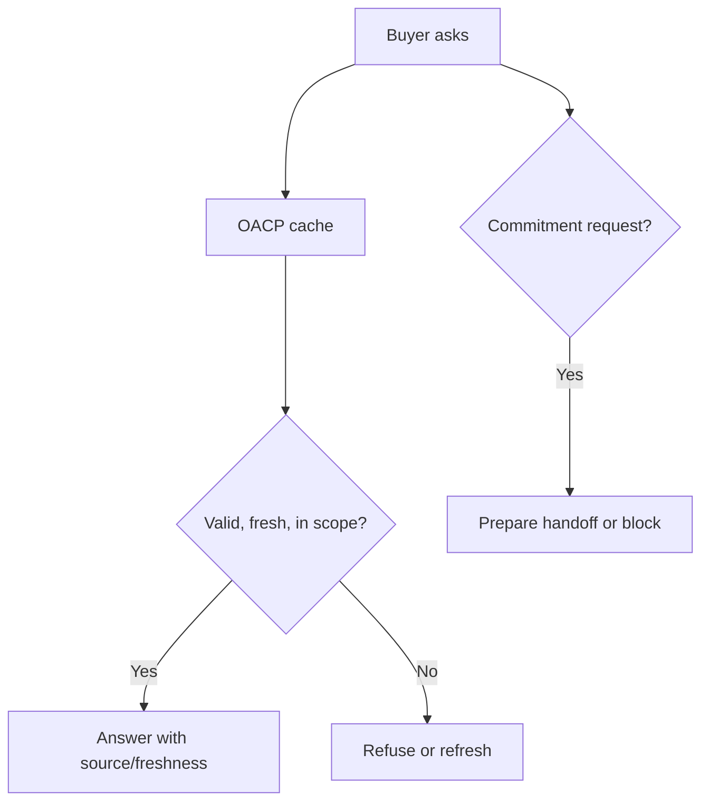

# How Buyer Agents Shop Safely With OACP

Canonical end-to-end flow: [OACP end-user flow](../end-user-flow.md).

Buyer agents shop safely when every answer comes from valid OACP artifacts and every risky action is prepared or refused.

## Can Do

Ask, compare, reason, explain source/freshness, and prepare a non-executing handoff. Where the
merchant has turned on UCP or ACP checkout (both off by default), a buyer agent can also create
and update a checkout session; it completes only after the commerce arbiter sealed an `allow`
decision for that exact session and a registered executor consumed it. No executor is registered
on `main` (status 2026-10-20).

## Cannot Do

Invent paid states, treat a session that is not `completed` as an order, reserve stock, set up a
mandate, or call private merchant systems outside the approved runtime. Nothing a buyer agent
sends approves execution by itself: there is no request field that does.
