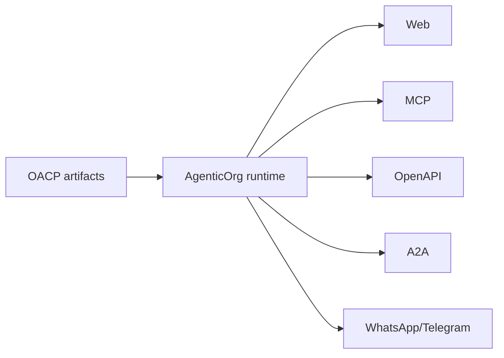

# Build Against OACP Artifacts And Bridges

Canonical end-to-end flow: [OACP end-user flow](../end-user-flow.md).

Developers build against AgenticOrg runtime endpoints and Grantex-authorized artifacts.

## API Surfaces

- `/api/v1/commerce/runtime/buyer-sessions/ask`
- `/api/v1/commerce/runtime/bridges/web/ask`
- `/api/v1/commerce/runtime/bridges/openapi/schema`
- `/api/v1/commerce/runtime/bridges/a2a/agent-card`
- `/api/v1/commerce/runtime/protocol-adapters`
- `/api/v1/commerce/runtime/purchase/prepare`

Flag-gated protocol surfaces on the merchant's verified serving host (off by default):

- UCP: `/.well-known/ucp`, `/ucp/catalog/search`, `/ucp/catalog/lookup`, `/ucp/locations/*`,
  `/ucp/checkout-sessions`, `/ucp/carts`, `/ucp/orders/{id}` ([UCP profile](../ucp-profile.md),
  [UCP checkout](../ucp-checkout.md)).
- ACP: `/acp/checkout_sessions` and the feed export `/api/v1/commerce/runtime/acp/feed`
  ([ACP feed and sessions](../acp-feed-and-sessions.md)).
- MCP: `agenticorg-mcp-server` UCP checkout tools (5.1.0) over the UCP routes.

## Rule

Preserve source and freshness labels. Do not treat adapters as execution authority: execution
consumes a single-use `allow` `decision_id` from the commerce arbiter, bound to the exact payload
([arbiter and ledger](../arbiter-ledger.md)).
