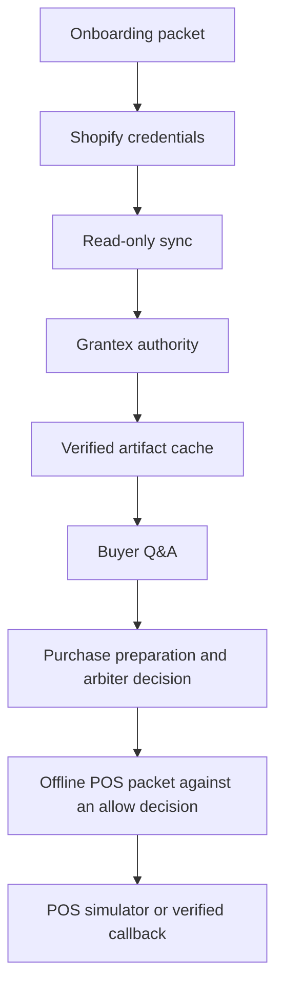

# Launch And Rollback Runbook

Canonical end-to-end flow: [OACP end-user flow](../end-user-flow.md).

## Status On 2026-10-20

- **`main`** carries artifact verification before caching, the commerce arbiter and ledger
  (countersignature, witness, export, retention), the UCP profile, catalog, locations, checkout,
  cart and order routes, the ACP feed and checkout sessions, the MCP UCP checkout tools,
  server-verified Grantex mandates, the Plural executor with refunds and webhook reconciliation,
  UPI AutoPay with RBI AFA, per-fact source precedence, and RFC 9421 agent request signatures
  (TAP and Web Bot Auth; `log` mode by default). With the defaults
  (`PLURAL_PINE_LIVE_EXECUTION_ENABLED` unset) no executor is registered, so no checkout can
  complete and nothing moves money.
- **AgenticOrg production** does not run this release yet; its deployment is the next step. Every flag below is at its default
  there only once the release is deployed; check the deployed commit first.
- **Grantex production** issues ES256-signed OACP artifacts under its first OACP issuer key
  (`oacp-20261020-12b09be0ba65bd14`), serves its public Token Status List
  (`OACP_STATUS_LIST_PUBLIC_ENABLED=true`), and runs the arbiter-decision, witness, mandate and
  agent registry routes. That satisfies the Grantex prerequisites for strict artifact
  verification and for countersigned arbiter decisions.

## Launch Smoke



## Flag Reference

Every OACP-related setting, its default, when to turn it on and how to roll it back. "Strict
runtimes" are production, staging, preview and any unrecognised `AGENTICORG_ENV`; local, dev,
development, test and ci are not strict. Every rollback below is a recorded operator decision:
set the value, redeploy (settings are read at start-up), and unset it once the cause is fixed.

| Flag | Default | Turn on | Rollback |
| --- | --- | --- | --- |
| `AGENTICORG_OACP_VERIFY_STRICT` | On in strict runtimes; log-only elsewhere | After the Grantex environment issues ES256 artifacts, lists an `oacp-` key and serves its status list (true in Grantex production on 2026-10-20); then `POST /api/v1/commerce/runtime/artifacts/refresh` per live scope. Detail: [runtime operations runbook](../runtime-operations-runbook.md#deploy-order-for-strict-oacp-verification). | `false`: verification still runs and logs `oacp_artifact_verification_irregularity`; refused artifacts are cached without a `verifier_result_ref`. |
| `AGENTICORG_ROUTE_ENFORCEMENT_MODE` | `enforce` | Stays `enforce` in production. Staging runs `log` first (see below) to find commerce write routes that return without their ledger event. | `log`: a missing ledger event (`commerce_ledger_event_missing`) is logged instead of answering 500. `log` also turns route-metadata scope denials into warnings, so use it only for a short, recorded window. |
| `AGENTICORG_ARBITER_REQUIRE_VERIFIED_AUTHORITY` | On in strict runtimes | On by default. Purchase and POS handoffs carry caller-asserted authority, so strict runtimes refuse them (`buyer_authority_verified`); a UCP or ACP Complete passes only with server-verified Grantex mandates (`AGENTICORG_GRANTEX_MANDATES_ENABLED`). | `false`: caller-asserted authority is accepted and recorded as `buyer_authority_source: caller_asserted`. |
| `AGENTICORG_ARBITER_REQUIRE_GRANTEX_GRANT` | On in strict runtimes | After Grantex's arbiter-decision route, the service token and the tenant allowlist are live, and staging shows `grantex_countersignature.status: granted` on allows. | `false`: an allow is consumable without a countersignature; posting continues while the post flag is unset or true. |
| `AGENTICORG_ARBITER_GRANTEX_POST_ENABLED` | Unset: follows the grant flag | Set `true` in staging with the grant flag `false` to prove countersignatures before requiring them. | `false`: stop posting decisions to Grantex (only with the grant flag `false`, or every allow is refused `grantex_grant_missing`). |
| `AGENTICORG_AUDIT_CHAIN_DEFAULT_ON` | Off | After `v6z88_commerce_ledger`: seals the audit chain of every tenant with a commerce merchant config (or use the global `AGENTICORG_AUDIT_CHAIN_ENABLED`). | `false`: sealing stops for those tenants; sealed rows stay sealed. |
| `AGENTICORG_AUDIT_WITNESS_ENABLED` | Off | After sealing runs: posts each sealed chain head to Grantex; verify an export with `scripts/verify_ledger.py`. | `false`: witnessing stops; sealing is unaffected. |
| `AGENTICORG_OACP_RETENTION_APPLY_ENABLED` | Off | After checking `GET /api/v1/commerce/runtime/ledger/retention/due`. | `false`: the daily task deletes nothing more; deletions already made are on the ledger (`commerce.oacp.retention.manifest_deleted`). |
| `AGENTICORG_UCP_PROFILE_ENABLED` | Off | After a merchant's serving host is DNS-attested, a signing key exists and Grantex issues an enabled `public_discovery_state` artifact. | `false`: `/.well-known/ucp`, `/ucp/catalog/*` and `/ucp/locations/*` answer 404 for every merchant; for one merchant use `POST /api/v1/commerce/runtime/merchant-configs/{merchant_id}/ucp/unpublish`. |
| `AGENTICORG_UCP_VERSIONS` | `2026-04-08` | Add `2026-08-25` once platforms read it; the newest release is served at `/.well-known/ucp`, older ones as leaf profiles. | Remove the newer release. |
| `AGENTICORG_UCP_KEY_ROTATION_GRACE_DAYS` | `7` (minimum 7) | Raise only if platforms cache profiles longer. | Lower back to `7`. |
| `AGENTICORG_OACP_DEMO_MERCHANT_ENABLED` | Off | Only to show OACP with the one synthetic demo merchant ([OACP demo merchant runbook](../../runbooks/oacp-demo-merchant.md)): accepts the `synthetic_demo` connector source for the demo tenant, whose artifacts are cached for no other tenant. | `false`: the synthetic source and its artifacts are refused again; tear the demo down with `scripts/seed_oacp_demo_merchant.py --teardown --apply`. |
| `AGENTICORG_UCP_CHECKOUT_ENABLED` | Off | Production step 3 below, after the profile is served and staging passes the UCP smoke. | `false`: every `/ucp` checkout, cart and order route answers 404 and the order-webhook sweep stops; sessions, orders and undelivered webhooks are kept. One platform: revoke its API key. One merchant's webhooks: `PATCH /api/v1/commerce/runtime/ucp/order-webhook-subscriptions/{id}`. |
| `AGENTICORG_ACP_FEED_ENABLED` | Off | After verified, fresh catalog, price and inventory artifacts exist for the merchant. | `false`: the feed export answers 404. |
| `AGENTICORG_ACP_CHECKOUT_ENABLED` | Off | After the UCP checkout step, with the merchant's `provider_policy.acp.checkout_enabled` and an API key holding `acp:write` for the agent platform. | `false`: every `/acp` route answers 404 (an ACP `Error`); sessions, orders and undelivered webhooks are kept. One merchant: `provider_policy.acp.checkout_enabled=false`. One platform: revoke its API key. One receiver: disable its `acp_hmac` subscription. |
| `AGENTICORG_ACP_SIGNATURE_MODE` | `log` | Keep `log`: ACP publishes no signing algorithm, so no platform verifier ships and `enforce` refuses every request. | `log`. |
| `PLURAL_PINE_LIVE_EXECUTION_ENABLED` | Unset (off) | Production step 4 below, after the [Plural execution launch order](#plural-execution-launch-order). `true` registers the Plural executor (`plural_pine`): a UCP or ACP Complete then charges through Plural on a consumed `allow` for a merchant whose `provider_policy.ucp.executor` names it, and order refunds go through Plural. It also releases a prepared purchase handoff (`prepared_provider_handoff`); that route never calls Plural. | Unset or `false` and restart: the executor is not registered, Complete answers `executor_unavailable`, refunds answer 409; captured orders and journal rows are kept. One merchant: remove its `provider_policy.ucp.executor`. |
| `AGENTICORG_GRANTEX_MANDATES_ENABLED` | Off | After the Grantex mandate release, a live OACP key and the public status list (all live in Grantex production on 2026-10-20) and the merchant's `provider_policy.ucp.grantex_mandates`: see the [Grantex mandates launch order](#grantex-mandates-launch-order). A Complete with `mandate_request` then decides on server-verified Intent, Cart and Payment mandates. | `false` and restart: `mandates.status: unavailable`, the authority is caller-asserted again and strict runtimes refuse it. One merchant: remove its `grantex_mandates`. |
| `AGENTICORG_GRANTEX_MANDATE_CAPABILITY_EVIDENCE_ENABLED` | Off | After the Grantex release that accepts `mandate_capability_evidence` on the authority request (live in Grantex production on 2026-10-20). | `false`: nothing is sent; Grantex marks the capability `unverified`. |
| `AGENTICORG_RBI_EMANDATE_AFA_LIMIT_MINOR_UNITS` / `AGENTICORG_RBI_EMANDATE_AFA_HIGHER_LIMIT_MINOR_UNITS` | `1500000` / `10000000` (paise) | Change only when the RBI e-mandate limits change. Subsequent UPI AutoPay debits above the limit need AFA; registration and first debit always do. | Restore the defaults. |
| `AGENTICORG_HTTPSIG_VERIFY_MODE` | `log` | Production step 2 below, after the [agent request signature rollout](#agent-request-signature-rollout). `log` verifies and records signatures on the public commerce reads and the A2A routes and refuses nothing; `enforce` answers 401 to unsigned or invalid requests (503 while the Redis nonce store is down) on the commerce API surfaces only (catalog and product JSON, A2A), never the public pages. | `log`: requests are answered again; signatures are still verified and logged. An unknown value is treated as `log`. |
| `AGENTICORG_HTTPSIG_AUTHORITIES` | Empty (uses the `Host` header) | Set to the public hosts before `enforce`. | Empty. |
| `AGENTICORG_HTTPSIG_TAP_KEY_STORE_URLS` / `AGENTICORG_HTTPSIG_SIGNATURE_AGENT_ORIGINS` | Empty (no key resolves) | TAP key-store URL templates (`{keyid}`) and the Web Bot Auth directory origins (include the Grantex origin to trust registry keys). | Empty: every signature is unverifiable (refused only in `enforce`). |
| `AGENTICORG_HTTPSIG_REGISTRY_LOOKUP_ENABLED` | Off | Records the DID and scheme agent ids of verified agents from the Grantex registry. | `false`: no lookups. |
| `AGENTICORG_HTTPSIG_SIGN_OUTBOUND` | Off | After the tenant agent key is stored on the `grantex_commerce` connector: the buyer connector signs its requests (TAP); with no usable key the call is refused, never sent unsigned. | `false`: requests go unsigned again. |
| `AGENTICORG_A2A_SCHEME_AGENT_IDS` | Empty | AgenticOrg's own scheme agent ids in the A2A agent card. | Empty: the card is unchanged. |
| mcp-server `AGENTICORG_UCP_PROFILE_URL`, `AGENTICORG_UCP_AGENT_PROFILE` | Unset (no UCP tools) | Set per MCP installation to the merchant's `https://<serving host>/.well-known/ucp` and the platform profile URL. | Unset: no UCP tools are registered at the next start. |
| Merchant `provider_policy.arbiter.escalate_to_human` | `false` | Optional: copies a refusal into `hitl_queue` (needs `review_agent_id`); never changes or delays an outcome. | `false`. |

## Staging-Equivalent Run

Before any production change, run the release in staging (or a production-equivalent stack)
with:

```
AGENTICORG_ROUTE_ENFORCEMENT_MODE=log
AGENTICORG_HTTPSIG_VERIFY_MODE=log
AGENTICORG_UCP_CHECKOUT_ENABLED=false
PLURAL_PINE_LIVE_EXECUTION_ENABLED=false
```

Check:

1. Migrations ran on start-up to a single Alembic head (`v6z90_mandates_rails` on `main`), and
   `scripts/create_app_role.sql` converged.
2. The launch smoke above, `POST /artifacts/refresh` for the smoke merchant with
   `verification.mode: strict` and `verification.refused` empty.
3. No `commerce_ledger_event_missing` warning in the logs for the run (in `enforce` mode each
   would have been a 500).
4. Arbiter decisions carry `grantex_countersignature.status: granted` on allows (or the
   recorded opt-out), and `scripts/verify_ledger.py` verifies an export.
5. With `AGENTICORG_UCP_PROFILE_ENABLED=true` for a test merchant: `/.well-known/ucp` answers
   with the merchant's profile and no checkout capability (checkout is off).

## Production Turn-On Order

Deploy with `bash scripts/deploy_cloud_run.sh` (migrations run on start-up) only after CI is
green on `main` and the owner has approved this runbook. Then change one setting at a time, in
this order, each followed by its smoke and with its rollback written down before the change:

1. **Route enforcement: `enforce`** (the default). Rollback: `AGENTICORG_ROUTE_ENFORCEMENT_MODE=log`
   for a short, recorded window.
2. **Agent request signatures: `log`** (the default) first, **then `enforce`** only after the
   rollout below shows the expected callers `verified` and the owner records the decision. Rollback:
   `AGENTICORG_HTTPSIG_VERIFY_MODE=log`.
3. **UCP checkout: `AGENTICORG_UCP_CHECKOUT_ENABLED=true`** for a published merchant; run the UCP
   smoke. Rollback: `false`.
4. **Plural execution: `PLURAL_PINE_LIVE_EXECUTION_ENABLED=true`** only after the
   [Plural execution launch order](#plural-execution-launch-order) passed in staging, with
   production Plural credentials, merchant by merchant through `provider_policy.ucp.executor`.
   Rollback: unset and restart.

The remaining flags (UCP profile, ACP feed and checkout, Grantex mandates, mandate-capability
evidence, witness, retention, audit-chain default) follow the "Turn on" column above, one at a
time, each with its rollback. Grantex mandates come before Plural execution: without them strict
runtimes refuse every checkout decision (`buyer_authority_verified`).

## Commerce Ledger Launch Order

1. Grantex: migration `134_commerce_ledger.sql`, the arbiter-decision and witness routes, the
   AgenticOrg service token, and the tenant in `COMMERCE_C6Z_AUTHORITY_SERVICE_TENANTS`.
2. AgenticOrg migration `v6z88_commerce_ledger` (tables, triggers, the retention function).
3. AgenticOrg release in staging with `AGENTICORG_ARBITER_GRANTEX_POST_ENABLED=true` and
   `AGENTICORG_ARBITER_REQUIRE_GRANTEX_GRANT=false`; confirm `grantex_countersignature.status:
   granted` on allows. Then unset the grant flag (on in strict runtimes).
4. Switch on `AGENTICORG_AUDIT_CHAIN_DEFAULT_ON` (or the global chain flag), then
   `AGENTICORG_AUDIT_WITNESS_ENABLED`; verify an export with `scripts/verify_ledger.py`.
5. Switch on `AGENTICORG_OACP_RETENTION_APPLY_ENABLED` after checking
   `GET /api/v1/commerce/runtime/ledger/retention/due`.

`AGENTICORG_ARBITER_REQUIRE_VERIFIED_AUTHORITY` stays on in production. Purchase and POS handoffs
have no server-verified mandate path, so they are refused there unless the owner records the
decision to set it to `false`; UCP and ACP Complete pass with Grantex mandates.

## Rollback

1. Disable buyer surfaces for the merchant.
2. Mark affected cache records stale.
3. Stop Shopify sync.
4. Remove Grantex tenant allowlist or rotate service token if needed.
5. Disable POS handoff for the merchant if callback evidence or store metadata is stale.
6. Commerce ledger: set the flag of the misbehaving part as in the flag reference above.
   Migrations `v6z88_commerce_ledger`, `v6z89_commerce_sessions_orders` and `v6z90_mandates_rails`
   are not rolled back in production: their tables are append-only evidence, stored sessions and
   orders, and payment journal rows.
7. Stop public UCP discovery, UCP checkout, ACP checkout or the ACP feed with their flags or the
   per-merchant and per-platform steps in the flag reference.
8. Agent request signatures: if `AGENTICORG_HTTPSIG_VERIFY_MODE=enforce` refuses legitimate
   callers, set it back to `log` (requests are answered again; signatures are still verified and
   logged). Set `AGENTICORG_HTTPSIG_SIGN_OUTBOUND=false` if a merchant edge refuses the buyer
   agent's signatures; `AGENTICORG_HTTPSIG_REGISTRY_LOOKUP_ENABLED=false` stops registry lookups.
9. Re-enable only after smoke tests pass.

## Agent Request Signature Rollout

`AGENTICORG_HTTPSIG_VERIFY_MODE` is `log` by default. Roll out in this order:

1. Configure `AGENTICORG_HTTPSIG_AUTHORITIES` (the public hosts), the TAP key-store URL templates
   (`AGENTICORG_HTTPSIG_TAP_KEY_STORE_URLS`) and the allowed Web Bot Auth directory origins
   (`AGENTICORG_HTTPSIG_SIGNATURE_AGENT_ORIGINS`, including the Grantex origin to trust registry
   keys). Redis must be reachable from every API instance (the nonce store).
2. Staging, `log` mode: send a TAP-signed `message:send` from a test agent whose key is in the
   configured key store; confirm a 200, an `a2a.agent_signature` ledger row with `outcome:
   success`, and `agent_request_signature` log lines with `status: verified`. Send the same
   request again: the log shows `nonce_replayed`. Send an unsigned request: 200 and
   `status: unsigned` in the log.
3. Watch the `agent_request_signature` logs in staging until the expected callers are `verified`.
   `enforce` applies only to the commerce API surfaces (the catalog and product JSON reads and
   the A2A routes); the public HTML pages, schema.org JSON-LD, sitemap and `llms.txt` are never
   refused for a signature.
4. Staging, `enforce`: the unsigned request gets 401 with `Accept-Signature`; the signed one is
   accepted; with Redis stopped a signed request gets 503.
5. Production in `log`, then `enforce` only with the owner's recorded decision.

## UCP Smoke

With `AGENTICORG_UCP_CHECKOUT_ENABLED=true` on staging and a merchant published on the staging host (attested serving host, active key, live `public_discovery` artifact):

- `POST /ucp/checkout-sessions` with `UCP-Agent` and the platform's tenant API key (`X-API-Key`, scope `ucp:write`) returns 201 and `ready_for_complete` once fulfillment is selected.
- A repeat with the same `Idempotency-Key` and body returns the same session; a different body returns 409.
- Complete without a registered executor returns `executor_unavailable` and the session stays `ready_for_complete` (with Plural execution on, follow the Plural execution launch order instead).
- The commerce ledger shows `commerce.ucp.checkout.create` and `commerce.ucp.checkout.complete` rows for the tenant.

## ACP Smoke

With `AGENTICORG_ACP_CHECKOUT_ENABLED=true` on staging, a published merchant opted in (`provider_policy.acp.checkout_enabled`) and an API key with `acp:write`:

- `POST /acp/checkout_sessions` with `API-Version: 2026-04-17` and `Idempotency-Key` returns 201; without `API-Version` it returns 400 `missing_api_version`.
- `POST /acp/checkout_sessions/{id}` selecting a shipping option returns `ready_for_payment` once a Commerce Passport allowance was issued (`capabilities.payment.handlers[0].config.delegate_payment`).
- The same key with another body returns 422 `idempotency_conflict`.
- Complete without a registered executor returns an `unsupported` message; the ledger shows `commerce.acp.checkout.*` rows.
- With `AGENTICORG_ACP_FEED_ENABLED=true`, `GET /api/v1/commerce/runtime/acp/feed?merchant_id=...&format=csv` returns the CSV, or 409 when verified artifacts are missing.


## Plural Execution Launch Order

1. Migration `v6z90_mandates_rails` (payment operation records, AFA evidence, the `refund`
   arbiter action). Re-run `scripts/create_app_role.sql` so the two new append-only tables are
   classified.
2. Plural credentials in the secret manager: `PLURAL_PINE_CLIENT_ID`,
   `PLURAL_PINE_CLIENT_SECRET`, `PLURAL_PINE_ENVIRONMENT=sandbox`, `PLURAL_PINE_WEBHOOK_SECRET`.
3. Staging: `PLURAL_PINE_LIVE_EXECUTION_ENABLED=true` with `AGENTICORG_UCP_CHECKOUT_ENABLED=true`.
   Set one test merchant's `provider_policy.ucp.executor` to `plural_pine`. Run
   `tests/integration/test_plural_executor_sandbox.py` and the UCP smoke below. Then check the
   ledger: `commerce.arbiter.decision.consumed` comes before each run of
   `commerce.plural.create_order`, `commerce.plural.create_payment` and
   `commerce.plural.capture`.
4. Production: only after the owner approves the runbook, with
   `PLURAL_PINE_ENVIRONMENT=production` and production credentials. Enable merchants one at a
   time through their `executor` setting.

Rolling back Plural execution: unset `PLURAL_PINE_LIVE_EXECUTION_ENABLED` (or set it to `false`)
and restart.

- The executor is no longer registered.
- UCP Complete answers `executor_unavailable` and the session stays `ready_for_complete`.
- Refunds answer `409 executor_unavailable`.
- Captured orders, journal rows and AFA evidence are kept: they are append-only payment evidence
  and `v6z90_mandates_rails` is not rolled back.

To stop one merchant only, remove its `provider_policy.ucp.executor`. Refunds of captured
orders while execution is off are made in the Plural dashboard and recorded on the order with
`POST /api/v1/commerce/runtime/ucp/orders/{id}/events` (a `refund` adjustment).

## Grantex Mandates Launch Order

1. Grantex first: the mandate release (migration `135_oacp_mandates.sql`, the five mandate routes
   and their service-token scopes), an active OACP issuer key, and
   `OACP_STATUS_LIST_PUBLIC_ENABLED=true` (without it every mandate fails closed with
   `revocation_status_unavailable`). The AgenticOrg tenant and each merchant's Grantex commerce
   tenant are in `COMMERCE_C6Z_AUTHORITY_SERVICE_TENANTS`.
2. Merchant config: `provider_policy.ucp.grantex_mandates {tenant_id, merchant_id}` naming the
   Grantex commerce tenant and merchant its passports name, and
   `provider_policy.arbiter.human_not_present.max_order_amount_minor_units` for autonomous
   purchases (without it every `human_not_present` purchase is refused
   `not_present_limits_missing`).
3. Staging: `AGENTICORG_GRANTEX_MANDATES_ENABLED=true`. A Complete with `mandate_request` answers
   `ai.agenticorg.commerce.mandates.status: verified`; the decision has
   `buyer_authority_source: server_verified` and a `grantex_countersignature` of `granted`; the
   ledger shows `commerce.ucp.checkout.mandates` before `commerce.arbiter.decision`; the Plural
   order metadata carries the three mandate hashes. Run
   `tests/integration/test_grantex_mandates_live.py` against the staging Grantex.
4. Production after the owner approves, merchant by merchant through `grantex_mandates`.

Rolling back: set `AGENTICORG_GRANTEX_MANDATES_ENABLED=false` and restart. Complete then answers
`mandates.status: unavailable` and the authority is caller-asserted: refused in strict runtimes
(`buyer_authority_verified`) unless `AGENTICORG_ARBITER_REQUIRE_VERIFIED_AUTHORITY=false`.
Decisions, ledger rows and payment journal rows already written are kept. To stop one merchant,
remove its `grantex_mandates`.
## POS Smoke

- Create a handoff packet from prepared purchase output (two calls: the decision, then the packet with its `decision_id`).
- Run simulator `accepted` and verify buyer wording still requires staff/payment confirmation.
- Submit unverified `payment_confirmed` and verify it becomes staff review.
- Confirm fake packet ids return safe auth/404 responses, not server errors.
