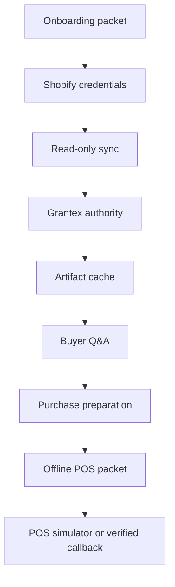

# Launch And Rollback Runbook

Canonical end-to-end flow: [OACP end-user flow](../end-user-flow.md).

## Launch Smoke

## Flags

| Flag | Default | Launch | Rollback |
| --- | --- | --- | --- |
| `AGENTICORG_OACP_VERIFY_STRICT` | On in production, staging, preview and unrecognised environments; off (log-only) in local, dev, test and ci | Turn on only after the Grantex OACP signing release, a first OACP issuer key and `OACP_STATUS_LIST_PUBLIC_ENABLED=true` are live for the same environment, then run `POST /api/v1/commerce/runtime/artifacts/refresh` for each live merchant and seller agent. Order and detail: [runtime operations runbook](../runtime-operations-runbook.md#deploy-order-for-strict-oacp-verification). | Set `AGENTICORG_OACP_VERIFY_STRICT=false` and redeploy. Verification keeps running and logs `oacp_artifact_verification_irregularity`; record the opt-out as an operator decision and unset it once Grantex is healthy and the refresh has run. |

## Rollback

1. Disable buyer surfaces for the merchant.
2. Mark affected cache records stale.
3. Stop Shopify sync.
4. Remove Grantex tenant allowlist or rotate service token if needed.
5. Disable POS handoff for the merchant if callback evidence or store metadata is stale.
6. Re-enable only after smoke tests pass.

## POS Smoke

- Create a handoff packet from prepared purchase output.
- Run simulator `accepted` and verify buyer wording still requires staff/payment confirmation.
- Submit unverified `payment_confirmed` and verify it becomes staff review.
- Confirm fake packet ids return safe auth/404 responses, not server errors.
