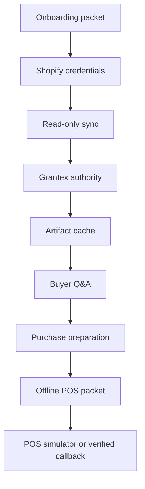

# Launch And Rollback Runbook

Canonical end-to-end flow: [OACP end-user flow](../end-user-flow.md).

## Launch Smoke

## Commerce Ledger Flags And Launch Order

| Flag | Default | What it does |
| --- | --- | --- |
| `AGENTICORG_ARBITER_REQUIRE_VERIFIED_AUTHORITY` | Unset: on in strict runtimes, off in local/dev/test/ci | Refuses caller-asserted buyer authority (rule `buyer_authority_verified`). |
| `AGENTICORG_ARBITER_REQUIRE_GRANTEX_GRANT` | Unset: on in strict runtimes | An allow decision is consumable only with a verified Grantex countersignature (`grantex_grant_missing`). |
| `AGENTICORG_ARBITER_GRANTEX_POST_ENABLED` | Unset: follows the grant flag | Posts every arbiter decision to Grantex. |
| `AGENTICORG_AUDIT_WITNESS_ENABLED` | Off | Posts each sealed chain head to Grantex for a witness countersignature. |
| `AGENTICORG_OACP_RETENTION_APPLY_ENABLED` | Off | The daily task deletes review manifests whose retention disposition is due. |
| `AGENTICORG_AUDIT_CHAIN_DEFAULT_ON` | Off | Seals the audit chain of every tenant with a commerce merchant config. |

Launch order:

1. Grantex: migration `134_commerce_ledger.sql`, the arbiter-decision and witness routes, the
   AgenticOrg service token, and the tenant in `COMMERCE_C6Z_AUTHORITY_SERVICE_TENANTS`.
2. AgenticOrg migration `v6z88_commerce_ledger` (tables, triggers, the retention function).
3. AgenticOrg release in staging with `AGENTICORG_ARBITER_GRANTEX_POST_ENABLED=true` and
   `AGENTICORG_ARBITER_REQUIRE_GRANTEX_GRANT=false`; confirm `grantex_countersignature.status:
   granted` on allows. Then unset the grant flag (on in strict runtimes).
4. Switch on `AGENTICORG_AUDIT_CHAIN_DEFAULT_ON` (or the global chain flag), then
   `AGENTICORG_AUDIT_WITNESS_ENABLED`; verify an export with `scripts/verify_ledger.py`.
5. Switch on `AGENTICORG_OACP_RETENTION_APPLY_ENABLED` after checking
   `GET /api/v1/commerce/runtime/ledger/retention/due`.

`AGENTICORG_ARBITER_REQUIRE_VERIFIED_AUTHORITY` stays on in production until Phase 4 mandates
are verified server-side; every handoff there is refused until then unless the owner records the
decision to set it to `false`.

## Rollback

1. Disable buyer surfaces for the merchant.
2. Mark affected cache records stale.
3. Stop Shopify sync.
4. Remove Grantex tenant allowlist or rotate service token if needed.
5. Disable POS handoff for the merchant if callback evidence or store metadata is stale.
6. Commerce ledger: set the flag of the misbehaving part as a recorded operator decision:
   `AGENTICORG_ARBITER_REQUIRE_GRANTEX_GRANT=false` (Grantex down; decisions still post),
   `AGENTICORG_ARBITER_GRANTEX_POST_ENABLED=false` (stop posting),
   `AGENTICORG_AUDIT_WITNESS_ENABLED=false`, `AGENTICORG_OACP_RETENTION_APPLY_ENABLED=false`.
   Migration `v6z88_commerce_ledger` is not rolled back in production: its tables are
   append-only evidence.
7. Re-enable only after smoke tests pass.

## POS Smoke

- Create a handoff packet from prepared purchase output.
- Run simulator `accepted` and verify buyer wording still requires staff/payment confirmation.
- Submit unverified `payment_confirmed` and verify it becomes staff review.
- Confirm fake packet ids return safe auth/404 responses, not server errors.
