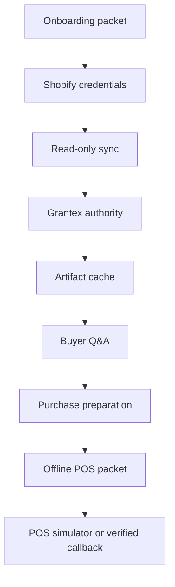

# Launch And Rollback Runbook

Canonical end-to-end flow: [OACP end-user flow](../end-user-flow.md).

## Launch Smoke

## Commerce Ledger Flags And Launch Order

| Flag | Default | What it does |
| --- | --- | --- |
| `AGENTICORG_ARBITER_REQUIRE_VERIFIED_AUTHORITY` | Unset: on in strict runtimes, off in local/dev/test/ci | Refuses caller-asserted buyer authority (rule `buyer_authority_verified`). |
| `AGENTICORG_ARBITER_REQUIRE_GRANTEX_GRANT` | Unset: on in strict runtimes | An allow decision is consumable only with a verified Grantex countersignature (`grantex_grant_missing`). |
| `AGENTICORG_ARBITER_GRANTEX_POST_ENABLED` | Unset: follows the grant flag | Posts every arbiter decision to Grantex. |
| `AGENTICORG_AUDIT_WITNESS_ENABLED` | Off | Posts each sealed chain head to Grantex for a witness countersignature. |
| `AGENTICORG_OACP_RETENTION_APPLY_ENABLED` | Off | The daily task deletes review manifests whose retention disposition is due. |
| `AGENTICORG_AUDIT_CHAIN_DEFAULT_ON` | Off | Seals the audit chain of every tenant with a commerce merchant config. |

Launch order:

1. Grantex: migration `134_commerce_ledger.sql`, the arbiter-decision and witness routes, the
   AgenticOrg service token, and the tenant in `COMMERCE_C6Z_AUTHORITY_SERVICE_TENANTS`.
2. AgenticOrg migration `v6z88_commerce_ledger` (tables, triggers, the retention function).
3. AgenticOrg release in staging with `AGENTICORG_ARBITER_GRANTEX_POST_ENABLED=true` and
   `AGENTICORG_ARBITER_REQUIRE_GRANTEX_GRANT=false`; confirm `grantex_countersignature.status:
   granted` on allows. Then unset the grant flag (on in strict runtimes).
4. Switch on `AGENTICORG_AUDIT_CHAIN_DEFAULT_ON` (or the global chain flag), then
   `AGENTICORG_AUDIT_WITNESS_ENABLED`; verify an export with `scripts/verify_ledger.py`.
5. Switch on `AGENTICORG_OACP_RETENTION_APPLY_ENABLED` after checking
   `GET /api/v1/commerce/runtime/ledger/retention/due`.

`AGENTICORG_ARBITER_REQUIRE_VERIFIED_AUTHORITY` stays on in production until Phase 4 mandates
are verified server-side; every handoff there is refused until then unless the owner records the
decision to set it to `false`.

## Flags

| Flag | Default | Launch | Rollback |
| --- | --- | --- | --- |
| `AGENTICORG_OACP_VERIFY_STRICT` | On in production, staging, preview and unrecognised environments; off (log-only) in local, dev, test and ci | Turn on only after the Grantex OACP signing release, a first OACP issuer key and `OACP_STATUS_LIST_PUBLIC_ENABLED=true` are live for the same environment, then run `POST /api/v1/commerce/runtime/artifacts/refresh` for each live merchant and seller agent. Order and detail: [runtime operations runbook](../runtime-operations-runbook.md#deploy-order-for-strict-oacp-verification). | Set `AGENTICORG_OACP_VERIFY_STRICT=false` and redeploy. Verification keeps running and logs `oacp_artifact_verification_irregularity`; record the opt-out as an operator decision and unset it once Grantex is healthy and the refresh has run. |

## Rollback

1. Disable buyer surfaces for the merchant.
2. Mark affected cache records stale.
3. Stop Shopify sync.
4. Remove Grantex tenant allowlist or rotate service token if needed.
5. Disable POS handoff for the merchant if callback evidence or store metadata is stale.
6. Commerce ledger: set the flag of the misbehaving part as a recorded operator decision:
   `AGENTICORG_ARBITER_REQUIRE_GRANTEX_GRANT=false` (Grantex down; decisions still post),
   `AGENTICORG_ARBITER_GRANTEX_POST_ENABLED=false` (stop posting),
   `AGENTICORG_AUDIT_WITNESS_ENABLED=false`, `AGENTICORG_OACP_RETENTION_APPLY_ENABLED=false`.
   Migration `v6z88_commerce_ledger` is not rolled back in production: its tables are
   append-only evidence.
7. Stop public UCP discovery: `AGENTICORG_UCP_PROFILE_ENABLED=false` makes `/.well-known/ucp`
   and `/ucp/*` answer 404 for every merchant (default off); for one merchant use
   `POST /api/v1/commerce/runtime/merchant-configs/{merchant_id}/ucp/unpublish`.
8. Set `AGENTICORG_UCP_CHECKOUT_ENABLED=false` to stop UCP checkout, cart and order traffic (every `/ucp` route answers 404 and the order-webhook sweep stops; stored sessions, orders and undelivered webhooks are kept). To stop one platform only, revoke the API key the merchant issued to it; to stop one merchant's webhooks, disable its subscriptions (`PATCH /api/v1/commerce/runtime/ucp/order-webhook-subscriptions/{id}`).
9. Set `AGENTICORG_ACP_CHECKOUT_ENABLED=false` to stop ACP checkout traffic (every `/acp` route answers 404; stored sessions, orders and undelivered webhooks are kept) and `AGENTICORG_ACP_FEED_ENABLED=false` to stop feed exports. For one merchant set `provider_policy.acp.checkout_enabled` to false; for one agent platform revoke its API key; for one receiver disable its `acp_hmac` subscription. If `AGENTICORG_ACP_SIGNATURE_MODE=enforce` refuses a platform unexpectedly, set it back to `log`.
10. Agent request signatures: if `AGENTICORG_HTTPSIG_VERIFY_MODE=enforce` refuses legitimate
    callers, set it back to `log` (requests are answered again; signatures are still verified and
    logged). Set `AGENTICORG_HTTPSIG_SIGN_OUTBOUND=false` if a merchant edge refuses the buyer
    agent's signatures; `AGENTICORG_HTTPSIG_REGISTRY_LOOKUP_ENABLED=false` stops registry lookups.
11. Re-enable only after smoke tests pass.

## Agent Request Signature Rollout

`AGENTICORG_HTTPSIG_VERIFY_MODE` is `log` by default. Roll out in this order:

1. Configure `AGENTICORG_HTTPSIG_AUTHORITIES` (the public hosts), the TAP key-store URL templates
   (`AGENTICORG_HTTPSIG_TAP_KEY_STORE_URLS`) and the allowed Web Bot Auth directory origins
   (`AGENTICORG_HTTPSIG_SIGNATURE_AGENT_ORIGINS`, including the Grantex origin to trust registry
   keys). Redis must be reachable from every API instance (the nonce store).
2. Staging, `log` mode: send a TAP-signed `message:send` from a test agent whose key is in the
   configured key store; confirm a 200, an `a2a.agent_signature` ledger row with `outcome:
   success`, and `agent_request_signature` log lines with `status: verified`. Send the same
   request again: the log shows `nonce_replayed`. Send an unsigned request: 200 and
   `status: unsigned` in the log.
3. Watch the `agent_request_signature` logs in staging until the expected callers are `verified`.
   `enforce` applies only to the commerce API surfaces (the catalog and product JSON reads and
   the A2A routes); the public HTML pages, schema.org JSON-LD, sitemap and `llms.txt` are never
   refused for a signature.
4. Staging, `enforce`: the unsigned request gets 401 with `Accept-Signature`; the signed one is
   accepted; with Redis stopped a signed request gets 503.
5. Production in `log`, then `enforce` only with the owner's recorded decision.

## UCP Smoke

With `AGENTICORG_UCP_CHECKOUT_ENABLED=true` on staging and a merchant published on the staging host (attested serving host, active key, live `public_discovery` artifact):

- `POST /ucp/checkout-sessions` with `UCP-Agent` and the platform's tenant API key (`X-API-Key`, scope `ucp:write`) returns 201 and `ready_for_complete` once fulfillment is selected.
- A repeat with the same `Idempotency-Key` and body returns the same session; a different body returns 409.
- Complete without a registered executor returns `executor_unavailable` and the session stays `ready_for_complete`.
- The commerce ledger shows `commerce.ucp.checkout.create` and `commerce.ucp.checkout.complete` rows for the tenant.

## ACP Smoke

With `AGENTICORG_ACP_CHECKOUT_ENABLED=true` on staging, a published merchant opted in (`provider_policy.acp.checkout_enabled`) and an API key with `acp:write`:

- `POST /acp/checkout_sessions` with `API-Version: 2026-04-17` and `Idempotency-Key` returns 201; without `API-Version` it returns 400 `missing_api_version`.
- `POST /acp/checkout_sessions/{id}` selecting a shipping option returns `ready_for_payment` once a Commerce Passport allowance was issued (`capabilities.payment.handlers[0].config.delegate_payment`).
- The same key with another body returns 422 `idempotency_conflict`.
- Complete without a registered executor returns an `unsupported` message; the ledger shows `commerce.acp.checkout.*` rows.
- With `AGENTICORG_ACP_FEED_ENABLED=true`, `GET /api/v1/commerce/runtime/acp/feed?merchant_id=...&format=csv` returns the CSV, or 409 when verified artifacts are missing.

## Flags

| Flag | Default | Effect |
| --- | --- | --- |
| `AGENTICORG_UCP_PROFILE_ENABLED` | `false` | UCP profile, catalog and location routes; UCP signing key at onboarding; enabled `public_discovery_state` artifacts accepted. |
| `AGENTICORG_UCP_VERSIONS` | `2026-04-08` | UCP releases served; the newest is `/.well-known/ucp`, older ones are leaf profiles. |
| `AGENTICORG_UCP_KEY_ROTATION_GRACE_DAYS` | `7` | Days a rotated-out UCP signing key stays published (minimum 7). |
| `AGENTICORG_UCP_CHECKOUT_ENABLED` | `false` | UCP checkout, cart and order routes (`/ucp/checkout-sessions`, `/ucp/carts`, `/ucp/orders`) and the order-webhook sweep. |
| `AGENTICORG_ACP_CHECKOUT_ENABLED` | `false` | ACP checkout session routes (`/acp/checkout_sessions`); also runs the order-webhook sweep. |
| `AGENTICORG_ACP_FEED_ENABLED` | `false` | ACP product feed export (`/api/v1/commerce/runtime/acp/feed`). |
| `AGENTICORG_ACP_SIGNATURE_MODE` | `log` | `enforce` refuses ACP requests no registered platform verifier accepts. |
| `AGENTICORG_HTTPSIG_VERIFY_MODE` | `log` | RFC 9421 agent signatures, verified and recorded on every public commerce route and the A2A routes; `enforce` refuses unsigned or invalid requests (401) on the commerce API surfaces only (catalog and product JSON, A2A), never on the public pages, and answers 503 there while the Redis nonce store is down. |
| `AGENTICORG_HTTPSIG_AUTHORITIES` | empty | Authorities a signature may cover; empty uses the `Host` header. |
| `AGENTICORG_HTTPSIG_TAP_KEY_STORE_URLS` | empty | TAP key-store URL templates (`{keyid}`); empty resolves no TAP key. |
| `AGENTICORG_HTTPSIG_SIGNATURE_AGENT_ORIGINS` | empty | Web Bot Auth directory origins that may be fetched. |
| `AGENTICORG_HTTPSIG_REGISTRY_LOOKUP_ENABLED` | `false` | Grantex registry lookup of verified agents (DID, scheme agent ids). |
| `AGENTICORG_HTTPSIG_SIGN_OUTBOUND` | `false` | The buyer connector signs its requests with the tenant agent key (TAP). |
| `AGENTICORG_A2A_SCHEME_AGENT_IDS` | empty | AgenticOrg's scheme agent ids in the A2A agent card. |

## POS Smoke

- Create a handoff packet from prepared purchase output.
- Run simulator `accepted` and verify buyer wording still requires staff/payment confirmation.
- Submit unverified `payment_confirmed` and verify it becomes staff review.
- Confirm fake packet ids return safe auth/404 responses, not server errors.
