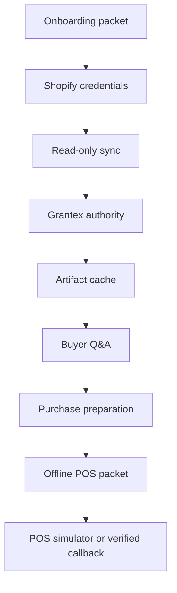

# Launch And Rollback Runbook

Canonical end-to-end flow: [OACP end-user flow](../end-user-flow.md).

## Launch Smoke

## Rollback

1. Disable buyer surfaces for the merchant.
2. Mark affected cache records stale.
3. Stop Shopify sync.
4. Remove Grantex tenant allowlist or rotate service token if needed.
5. Disable POS handoff for the merchant if callback evidence or store metadata is stale.
6. Stop public UCP discovery: `AGENTICORG_UCP_PROFILE_ENABLED=false` makes `/.well-known/ucp`
   and `/ucp/*` answer 404 for every merchant (default off); for one merchant use
   `POST /api/v1/commerce/runtime/merchant-configs/{merchant_id}/ucp/unpublish`.
7. Re-enable only after smoke tests pass.

## Flags

| Flag | Default | Effect |
| --- | --- | --- |
| `AGENTICORG_UCP_PROFILE_ENABLED` | `false` | UCP profile, catalog and location routes; UCP signing key at onboarding; enabled `public_discovery_state` artifacts accepted. |
| `AGENTICORG_UCP_VERSIONS` | `2026-04-08` | UCP releases served; the newest is `/.well-known/ucp`, older ones are leaf profiles. |
| `AGENTICORG_UCP_KEY_ROTATION_GRACE_DAYS` | `7` | Days a rotated-out UCP signing key stays published (minimum 7). |

## POS Smoke

- Create a handoff packet from prepared purchase output.
- Run simulator `accepted` and verify buyer wording still requires staff/payment confirmation.
- Submit unverified `payment_confirmed` and verify it becomes staff review.
- Confirm fake packet ids return safe auth/404 responses, not server errors.
