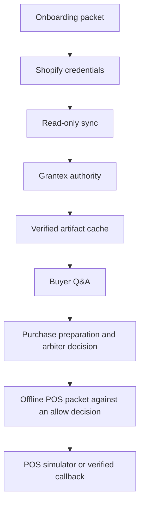

# Launch And Rollback Runbook

Canonical end-to-end flow: [OACP end-user flow](../end-user-flow.md).

## Status On 2026-10-20

- **`main`** carries artifact verification before caching, the commerce arbiter and ledger
  (countersignature, witness, export, retention), the UCP profile, catalog, locations, checkout,
  cart and order routes, the ACP feed and checkout sessions, and the MCP UCP checkout tools. No
  payment executor is registered, so no checkout can complete and nothing on `main` moves money.
- **AgenticOrg production** does not run this release yet. Every flag below is at its default
  there only once the release is deployed; check the deployed commit first.
- **Grantex production** issues ES256-signed OACP artifacts under its first OACP issuer key
  (`oacp-20261020-12b09be0ba65bd14`), serves its public Token Status List
  (`OACP_STATUS_LIST_PUBLIC_ENABLED=true`), and runs the arbiter-decision, witness, mandate and
  agent registry routes. That satisfies the Grantex prerequisites for strict artifact
  verification and for countersigned arbiter decisions.

## Launch Smoke



## Flag Reference

Every OACP-related setting, its default, when to turn it on and how to roll it back. "Strict
runtimes" are production, staging, preview and any unrecognised `AGENTICORG_ENV`; local, dev,
development, test and ci are not strict. Every rollback below is a recorded operator decision:
set the value, redeploy (settings are read at start-up), and unset it once the cause is fixed.

| Flag | Default | Turn on | Rollback |
| --- | --- | --- | --- |
| `AGENTICORG_OACP_VERIFY_STRICT` | On in strict runtimes; log-only elsewhere | After the Grantex environment issues ES256 artifacts, lists an `oacp-` key and serves its status list (true in Grantex production on 2026-10-20); then `POST /api/v1/commerce/runtime/artifacts/refresh` per live scope. Detail: [runtime operations runbook](../runtime-operations-runbook.md#deploy-order-for-strict-oacp-verification). | `false`: verification still runs and logs `oacp_artifact_verification_irregularity`; refused artifacts are cached without a `verifier_result_ref`. |
| `AGENTICORG_ROUTE_ENFORCEMENT_MODE` | `enforce` | Stays `enforce` in production. Staging runs `log` first (see below) to find commerce write routes that return without their ledger event. | `log`: a missing ledger event (`commerce_ledger_event_missing`) is logged instead of answering 500. `log` also turns route-metadata scope denials into warnings, so use it only for a short, recorded window. |
| `AGENTICORG_ARBITER_REQUIRE_VERIFIED_AUTHORITY` | On in strict runtimes | On by default. On `main` purchase and POS handoffs carry caller-asserted authority, so strict runtimes refuse them (`buyer_authority_verified`); checkout Complete does not apply this rule on `main`. | `false`: caller-asserted authority is accepted and recorded as `buyer_authority_source: caller_asserted`. |
| `AGENTICORG_ARBITER_REQUIRE_GRANTEX_GRANT` | On in strict runtimes | After Grantex's arbiter-decision route, the service token and the tenant allowlist are live, and staging shows `grantex_countersignature.status: granted` on allows. | `false`: an allow is consumable without a countersignature; posting continues while the post flag is unset or true. |
| `AGENTICORG_ARBITER_GRANTEX_POST_ENABLED` | Unset: follows the grant flag | Set `true` in staging with the grant flag `false` to prove countersignatures before requiring them. | `false`: stop posting decisions to Grantex (only with the grant flag `false`, or every allow is refused `grantex_grant_missing`). |
| `AGENTICORG_AUDIT_CHAIN_DEFAULT_ON` | Off | After `v6z88_commerce_ledger`: seals the audit chain of every tenant with a commerce merchant config (or use the global `AGENTICORG_AUDIT_CHAIN_ENABLED`). | `false`: sealing stops for those tenants; sealed rows stay sealed. |
| `AGENTICORG_AUDIT_WITNESS_ENABLED` | Off | After sealing runs: posts each sealed chain head to Grantex; verify an export with `scripts/verify_ledger.py`. | `false`: witnessing stops; sealing is unaffected. |
| `AGENTICORG_OACP_RETENTION_APPLY_ENABLED` | Off | After checking `GET /api/v1/commerce/runtime/ledger/retention/due`. | `false`: the daily task deletes nothing more; deletions already made are on the ledger (`commerce.oacp.retention.manifest_deleted`). |
| `AGENTICORG_UCP_PROFILE_ENABLED` | Off | After a merchant's serving host is DNS-attested, a signing key exists and Grantex issues an enabled `public_discovery_state` artifact. | `false`: `/.well-known/ucp`, `/ucp/catalog/*` and `/ucp/locations/*` answer 404 for every merchant; for one merchant use `POST /api/v1/commerce/runtime/merchant-configs/{merchant_id}/ucp/unpublish`. |
| `AGENTICORG_UCP_VERSIONS` | `2026-04-08` | Add `2026-08-25` once platforms read it; the newest release is served at `/.well-known/ucp`, older ones as leaf profiles. | Remove the newer release. |
| `AGENTICORG_UCP_KEY_ROTATION_GRACE_DAYS` | `7` (minimum 7) | Raise only if platforms cache profiles longer. | Lower back to `7`. |
| `AGENTICORG_UCP_CHECKOUT_ENABLED` | Off | Production step 3 below, after the profile is served and staging passes the UCP smoke. | `false`: every `/ucp` checkout, cart and order route answers 404 and the order-webhook sweep stops; sessions, orders and undelivered webhooks are kept. One platform: revoke its API key. One merchant's webhooks: `PATCH /api/v1/commerce/runtime/ucp/order-webhook-subscriptions/{id}`. |
| `AGENTICORG_ACP_FEED_ENABLED` | Off | After verified, fresh catalog, price and inventory artifacts exist for the merchant. | `false`: the feed export answers 404. |
| `AGENTICORG_ACP_CHECKOUT_ENABLED` | Off | After the UCP checkout step, with the merchant's `provider_policy.acp.checkout_enabled` and an API key holding `acp:write` for the agent platform. | `false`: every `/acp` route answers 404 (an ACP `Error`); sessions, orders and undelivered webhooks are kept. One merchant: `provider_policy.acp.checkout_enabled=false`. One platform: revoke its API key. One receiver: disable its `acp_hmac` subscription. |
| `AGENTICORG_ACP_SIGNATURE_MODE` | `log` | Keep `log`: ACP publishes no signing algorithm, so no platform verifier ships and `enforce` refuses every request. | `log`. |
| `PLURAL_PINE_LIVE_EXECUTION_ENABLED` | Unset (off) | Production step 4 below. On `main` it only releases a prepared purchase handoff (`prepared_provider_handoff`) after a consumed `allow`; no executor is registered and no route calls Plural to take a payment. | Unset or `false`: purchase preparation returns `prepared_handoff_blocked_live_execution_disabled` again. |
| `AGENTICORG_HTTPSIG_VERIFY_MODE` | `log` | Not read by `main` yet: inbound agent request-signature verification is in review. Once on the deployed commit, production step 2 below. | `log`. |
| mcp-server `AGENTICORG_UCP_PROFILE_URL`, `AGENTICORG_UCP_AGENT_PROFILE` | Unset (no UCP tools) | Set per MCP installation to the merchant's `https://<serving host>/.well-known/ucp` and the platform profile URL. | Unset: no UCP tools are registered at the next start. |
| Merchant `provider_policy.arbiter.escalate_to_human` | `false` | Optional: copies a refusal into `hitl_queue` (needs `review_agent_id`); never changes or delays an outcome. | `false`. |

## Staging-Equivalent Run

Before any production change, run the release in staging (or a production-equivalent stack)
with:

```
AGENTICORG_ROUTE_ENFORCEMENT_MODE=log
AGENTICORG_HTTPSIG_VERIFY_MODE=log
AGENTICORG_UCP_CHECKOUT_ENABLED=false
PLURAL_PINE_LIVE_EXECUTION_ENABLED=false
```

Check:

1. Migrations ran on start-up to a single Alembic head (`v6z89_commerce_sessions_orders` on
   `main`), and `scripts/create_app_role.sql` converged.
2. The launch smoke above, `POST /artifacts/refresh` for the smoke merchant with
   `verification.mode: strict` and `verification.refused` empty.
3. No `commerce_ledger_event_missing` warning in the logs for the run (in `enforce` mode each
   would have been a 500).
4. Arbiter decisions carry `grantex_countersignature.status: granted` on allows (or the
   recorded opt-out), and `scripts/verify_ledger.py` verifies an export.
5. With `AGENTICORG_UCP_PROFILE_ENABLED=true` for a test merchant: `/.well-known/ucp` answers
   with the merchant's profile and no checkout capability (checkout is off).

## Production Turn-On Order

Deploy with `bash scripts/deploy_cloud_run.sh` (migrations run on start-up) only after CI is
green on `main` and the owner has approved this runbook. Then change one setting at a time, in
this order, each followed by its smoke and with its rollback written down before the change:

1. **Route enforcement: `enforce`** (the default). Rollback: `AGENTICORG_ROUTE_ENFORCEMENT_MODE=log`
   for a short, recorded window.
2. **Agent request signatures: `log`, then `enforce`** once inbound verification is on the
   deployed commit and the owner records the decision. Rollback:
   `AGENTICORG_HTTPSIG_VERIFY_MODE=log`.
3. **UCP checkout: `AGENTICORG_UCP_CHECKOUT_ENABLED=true`** for a published merchant; run the UCP
   smoke. Rollback: `false`.
4. **Plural execution: `PLURAL_PINE_LIVE_EXECUTION_ENABLED=true`** only once a payment executor is
   on the deployed commit and its own launch order is complete. Rollback: unset.

The remaining flags (UCP profile, ACP feed and checkout, witness, retention, audit-chain default)
follow the "Turn on" column above, one at a time, each with its rollback.

## Commerce Ledger Launch Order

1. Grantex: migration `134_commerce_ledger.sql`, the arbiter-decision and witness routes, the
   AgenticOrg service token, and the tenant in `COMMERCE_C6Z_AUTHORITY_SERVICE_TENANTS`.
2. AgenticOrg migration `v6z88_commerce_ledger` (tables, triggers, the retention function).
3. AgenticOrg release in staging with `AGENTICORG_ARBITER_GRANTEX_POST_ENABLED=true` and
   `AGENTICORG_ARBITER_REQUIRE_GRANTEX_GRANT=false`; confirm `grantex_countersignature.status:
   granted` on allows. Then unset the grant flag (on in strict runtimes).
4. Switch on `AGENTICORG_AUDIT_CHAIN_DEFAULT_ON` (or the global chain flag), then
   `AGENTICORG_AUDIT_WITNESS_ENABLED`; verify an export with `scripts/verify_ledger.py`.
5. Switch on `AGENTICORG_OACP_RETENTION_APPLY_ENABLED` after checking
   `GET /api/v1/commerce/runtime/ledger/retention/due`.

`AGENTICORG_ARBITER_REQUIRE_VERIFIED_AUTHORITY` stays on in production. While the deployed commit
has no server-verified mandate path, every handoff there is refused unless the owner records the
decision to set it to `false`.

## Rollback

1. Disable buyer surfaces for the merchant.
2. Mark affected cache records stale.
3. Stop Shopify sync.
4. Remove Grantex tenant allowlist or rotate service token if needed.
5. Disable POS handoff for the merchant if callback evidence or store metadata is stale.
6. Commerce ledger: set the flag of the misbehaving part as in the flag reference above.
   Migrations `v6z88_commerce_ledger` and `v6z89_commerce_sessions_orders` are not rolled back in
   production: their tables are append-only evidence and stored sessions and orders.
7. Stop public UCP discovery, UCP checkout, ACP checkout or the ACP feed with their flags or the
   per-merchant and per-platform steps in the flag reference.
8. Re-enable only after smoke tests pass.

## UCP Smoke

With `AGENTICORG_UCP_CHECKOUT_ENABLED=true` on staging and a merchant published on the staging host (attested serving host, active key, live `public_discovery` artifact):

- `POST /ucp/checkout-sessions` with `UCP-Agent` and the platform's tenant API key (`X-API-Key`, scope `ucp:write`) returns 201 and `ready_for_complete` once fulfillment is selected.
- A repeat with the same `Idempotency-Key` and body returns the same session; a different body returns 409.
- Complete without a registered executor returns `executor_unavailable` and the session stays `ready_for_complete`.
- The commerce ledger shows `commerce.ucp.checkout.create` and `commerce.ucp.checkout.complete` rows for the tenant.

## ACP Smoke

With `AGENTICORG_ACP_CHECKOUT_ENABLED=true` on staging, a published merchant opted in (`provider_policy.acp.checkout_enabled`) and an API key with `acp:write`:

- `POST /acp/checkout_sessions` with `API-Version: 2026-04-17` and `Idempotency-Key` returns 201; without `API-Version` it returns 400 `missing_api_version`.
- `POST /acp/checkout_sessions/{id}` selecting a shipping option returns `ready_for_payment` once a Commerce Passport allowance was issued (`capabilities.payment.handlers[0].config.delegate_payment`).
- The same key with another body returns 422 `idempotency_conflict`.
- Complete without a registered executor returns an `unsupported` message; the ledger shows `commerce.acp.checkout.*` rows.
- With `AGENTICORG_ACP_FEED_ENABLED=true`, `GET /api/v1/commerce/runtime/acp/feed?merchant_id=...&format=csv` returns the CSV, or 409 when verified artifacts are missing.

## POS Smoke

- Create a handoff packet from prepared purchase output (two calls: the decision, then the packet with its `decision_id`).
- Run simulator `accepted` and verify buyer wording still requires staff/payment confirmation.
- Submit unverified `payment_confirmed` and verify it becomes staff review.
- Confirm fake packet ids return safe auth/404 responses, not server errors.
