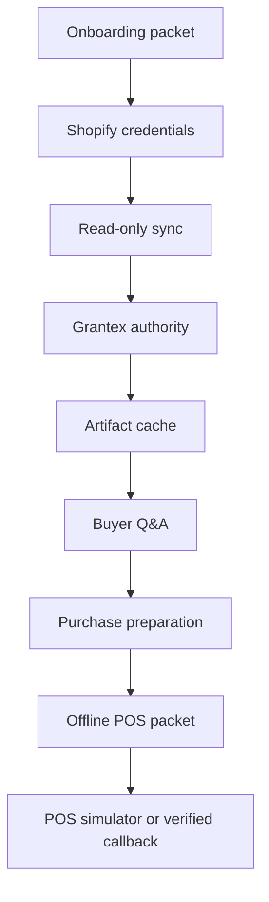

# Launch And Rollback Runbook

Canonical end-to-end flow: [OACP end-user flow](../end-user-flow.md).

## Launch Smoke

## Commerce Ledger Flags And Launch Order

| Flag | Default | What it does |
| --- | --- | --- |
| `AGENTICORG_ARBITER_REQUIRE_VERIFIED_AUTHORITY` | Unset: on in strict runtimes, off in local/dev/test/ci | Refuses caller-asserted buyer authority (rule `buyer_authority_verified`). |
| `AGENTICORG_ARBITER_REQUIRE_GRANTEX_GRANT` | Unset: on in strict runtimes | An allow decision is consumable only with a verified Grantex countersignature (`grantex_grant_missing`). |
| `AGENTICORG_ARBITER_GRANTEX_POST_ENABLED` | Unset: follows the grant flag | Posts every arbiter decision to Grantex. |
| `AGENTICORG_AUDIT_WITNESS_ENABLED` | Off | Posts each sealed chain head to Grantex for a witness countersignature. |
| `AGENTICORG_OACP_RETENTION_APPLY_ENABLED` | Off | The daily task deletes review manifests whose retention disposition is due. |
| `AGENTICORG_AUDIT_CHAIN_DEFAULT_ON` | Off | Seals the audit chain of every tenant with a commerce merchant config. |

Launch order:

1. Grantex: migration `134_commerce_ledger.sql`, the arbiter-decision and witness routes, the
   AgenticOrg service token, and the tenant in `COMMERCE_C6Z_AUTHORITY_SERVICE_TENANTS`.
2. AgenticOrg migration `v6z88_commerce_ledger` (tables, triggers, the retention function).
3. AgenticOrg release in staging with `AGENTICORG_ARBITER_GRANTEX_POST_ENABLED=true` and
   `AGENTICORG_ARBITER_REQUIRE_GRANTEX_GRANT=false`; confirm `grantex_countersignature.status:
   granted` on allows. Then unset the grant flag (on in strict runtimes).
4. Switch on `AGENTICORG_AUDIT_CHAIN_DEFAULT_ON` (or the global chain flag), then
   `AGENTICORG_AUDIT_WITNESS_ENABLED`; verify an export with `scripts/verify_ledger.py`.
5. Switch on `AGENTICORG_OACP_RETENTION_APPLY_ENABLED` after checking
   `GET /api/v1/commerce/runtime/ledger/retention/due`.

`AGENTICORG_ARBITER_REQUIRE_VERIFIED_AUTHORITY` stays on in production until Phase 4 mandates
are verified server-side; every handoff there is refused until then unless the owner records the
decision to set it to `false`.

## Rollback

1. Disable buyer surfaces for the merchant.
2. Mark affected cache records stale.
3. Stop Shopify sync.
4. Remove Grantex tenant allowlist or rotate service token if needed.
5. Disable POS handoff for the merchant if callback evidence or store metadata is stale.
6. Commerce ledger: set the flag of the misbehaving part as a recorded operator decision:
   `AGENTICORG_ARBITER_REQUIRE_GRANTEX_GRANT=false` (Grantex down; decisions still post),
   `AGENTICORG_ARBITER_GRANTEX_POST_ENABLED=false` (stop posting),
   `AGENTICORG_AUDIT_WITNESS_ENABLED=false`, `AGENTICORG_OACP_RETENTION_APPLY_ENABLED=false`.
   Migration `v6z88_commerce_ledger` is not rolled back in production: its tables are
   append-only evidence.
7. Stop public UCP discovery: `AGENTICORG_UCP_PROFILE_ENABLED=false` makes `/.well-known/ucp`
   and `/ucp/*` answer 404 for every merchant (default off); for one merchant use
   `POST /api/v1/commerce/runtime/merchant-configs/{merchant_id}/ucp/unpublish`.
8. Set `AGENTICORG_UCP_CHECKOUT_ENABLED=false` to stop UCP checkout, cart and order traffic (every `/ucp` route answers 404 and the order-webhook sweep stops; stored sessions, orders and undelivered webhooks are kept). To stop one platform only, revoke the API key the merchant issued to it; to stop one merchant's webhooks, disable its subscriptions (`PATCH /api/v1/commerce/runtime/ucp/order-webhook-subscriptions/{id}`).
9. Re-enable only after smoke tests pass.

## UCP Smoke

With `AGENTICORG_UCP_CHECKOUT_ENABLED=true` on staging and a merchant published on the staging host (attested serving host, active key, live `public_discovery` artifact):

- `POST /ucp/checkout-sessions` with `UCP-Agent` and the platform's tenant API key (`X-API-Key`, scope `ucp:write`) returns 201 and `ready_for_complete` once fulfillment is selected.
- A repeat with the same `Idempotency-Key` and body returns the same session; a different body returns 409.
- Complete without a registered executor returns `executor_unavailable` and the session stays `ready_for_complete`.
- The commerce ledger shows `commerce.ucp.checkout.create` and `commerce.ucp.checkout.complete` rows for the tenant.

## Flags

| Flag | Default | Effect |
| --- | --- | --- |
| `AGENTICORG_UCP_PROFILE_ENABLED` | `false` | UCP profile, catalog and location routes; UCP signing key at onboarding; enabled `public_discovery_state` artifacts accepted. |
| `AGENTICORG_UCP_VERSIONS` | `2026-04-08` | UCP releases served; the newest is `/.well-known/ucp`, older ones are leaf profiles. |
| `AGENTICORG_UCP_KEY_ROTATION_GRACE_DAYS` | `7` | Days a rotated-out UCP signing key stays published (minimum 7). |
| `AGENTICORG_UCP_CHECKOUT_ENABLED` | `false` | UCP checkout, cart and order routes (`/ucp/checkout-sessions`, `/ucp/carts`, `/ucp/orders`) and the order-webhook sweep. |
| `PLURAL_PINE_LIVE_EXECUTION_ENABLED` | unset (off) | `true` registers the Plural executor (`plural_pine`); UCP Complete then charges through Plural on a consumed `allow`, and order refunds go through Plural. Also gates the purchase handoff's live mode, unchanged. |
| `AGENTICORG_GRANTEX_MANDATE_CAPABILITY_EVIDENCE_ENABLED` | `false` | Sends the latest Plural capability result as `mandate_capability_evidence` on the Grantex authority request. Enable after the Grantex release that accepts it; disable to stop sending (Grantex then marks the capability `unverified`). |
| `AGENTICORG_GRANTEX_MANDATES_ENABLED` | `false` | UCP Complete honours `ai.agenticorg.commerce.mandate_request`: Intent, Cart and Payment mandates from Grantex, verified locally, become the arbiter's buyer authority. Off: a `mandate_request` is answered `unavailable` and the authority stays caller-asserted (refused in strict runtimes). |
| `AGENTICORG_RBI_EMANDATE_AFA_LIMIT_MINOR_UNITS` / `..._HIGHER_LIMIT_MINOR_UNITS` | `1500000` / `10000000` | RBI e-mandate no-AFA limits (paise) for subsequent UPI AutoPay debits. |

## Plural Execution Launch Order

1. Migration `v6z90_mandates_rails` (payment operation records, AFA evidence, the `refund`
   arbiter action). Re-run `scripts/create_app_role.sql` so the two new append-only tables are
   classified.
2. Plural credentials in the secret manager: `PLURAL_PINE_CLIENT_ID`,
   `PLURAL_PINE_CLIENT_SECRET`, `PLURAL_PINE_ENVIRONMENT=sandbox`, `PLURAL_PINE_WEBHOOK_SECRET`.
3. Staging: `PLURAL_PINE_LIVE_EXECUTION_ENABLED=true` with `AGENTICORG_UCP_CHECKOUT_ENABLED=true`.
   Set one test merchant's `provider_policy.ucp.executor` to `plural_pine`. Run
   `tests/integration/test_plural_executor_sandbox.py` and the UCP smoke below. Then check the
   ledger: `commerce.arbiter.decision.consumed` comes before each run of
   `commerce.plural.create_order`, `commerce.plural.create_payment` and
   `commerce.plural.capture`.
4. Production: only after the owner approves the runbook, with
   `PLURAL_PINE_ENVIRONMENT=production` and production credentials. Enable merchants one at a
   time through their `executor` setting.

Rolling back Plural execution: unset `PLURAL_PINE_LIVE_EXECUTION_ENABLED` (or set it to `false`)
and restart.

- The executor is no longer registered.
- UCP Complete answers `executor_unavailable` and the session stays `ready_for_complete`.
- Refunds answer `409 executor_unavailable`.
- Captured orders, journal rows and AFA evidence are kept: they are append-only payment evidence
  and `v6z90_mandates_rails` is not rolled back.

To stop one merchant only, remove its `provider_policy.ucp.executor`. Refunds of captured
orders while execution is off are made in the Plural dashboard and recorded on the order with
`POST /api/v1/commerce/runtime/ucp/orders/{id}/events` (a `refund` adjustment).

## Grantex Mandates Launch Order

1. Grantex first: the mandate release (migration `135_oacp_mandates.sql`, the five mandate routes
   and their service-token scopes), an active OACP issuer key, and
   `OACP_STATUS_LIST_PUBLIC_ENABLED=true` (without it every mandate fails closed with
   `revocation_status_unavailable`). The AgenticOrg tenant and each merchant's Grantex commerce
   tenant are in `COMMERCE_C6Z_AUTHORITY_SERVICE_TENANTS`.
2. Merchant config: `provider_policy.ucp.grantex_mandates {tenant_id, merchant_id}` naming the
   Grantex commerce tenant and merchant its passports name, and
   `provider_policy.arbiter.human_not_present.max_order_amount_minor_units` for autonomous
   purchases (without it every `human_not_present` purchase is refused
   `not_present_limits_missing`).
3. Staging: `AGENTICORG_GRANTEX_MANDATES_ENABLED=true`. A Complete with `mandate_request` answers
   `ai.agenticorg.commerce.mandates.status: verified`; the decision has
   `buyer_authority_source: server_verified` and a `grantex_countersignature` of `granted`; the
   ledger shows `commerce.ucp.checkout.mandates` before `commerce.arbiter.decision`; the Plural
   order metadata carries the three mandate hashes. Run
   `tests/integration/test_grantex_mandates_live.py` against the staging Grantex.
4. Production after the owner approves, merchant by merchant through `grantex_mandates`.

Rolling back: set `AGENTICORG_GRANTEX_MANDATES_ENABLED=false` and restart. Complete then answers
`mandates.status: unavailable` and the authority is caller-asserted: refused in strict runtimes
(`buyer_authority_verified`) unless `AGENTICORG_ARBITER_REQUIRE_VERIFIED_AUTHORITY=false`.
Decisions, ledger rows and payment journal rows already written are kept. To stop one merchant,
remove its `grantex_mandates`.

## POS Smoke

- Create a handoff packet from prepared purchase output.
- Run simulator `accepted` and verify buyer wording still requires staff/payment confirmation.
- Submit unverified `payment_confirmed` and verify it becomes staff review.
- Confirm fake packet ids return safe auth/404 responses, not server errors.
