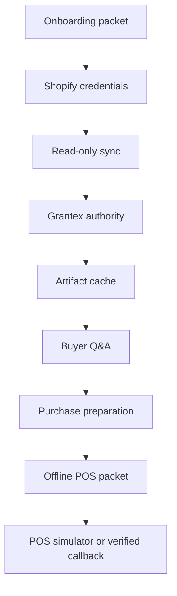

# Launch And Rollback Runbook

Canonical end-to-end flow: [OACP end-user flow](../end-user-flow.md).

## Launch Smoke

## Rollback

1. Disable buyer surfaces for the merchant.
2. Mark affected cache records stale.
3. Stop Shopify sync.
4. Remove Grantex tenant allowlist or rotate service token if needed.
5. Disable POS handoff for the merchant if callback evidence or store metadata is stale.
6. Set `AGENTICORG_UCP_CHECKOUT_ENABLED=false` to stop UCP checkout, cart and order traffic (every `/ucp` route answers 404 and the order-webhook sweep stops; stored sessions, orders and undelivered webhooks are kept). To stop one platform only, revoke the API key the merchant issued to it; to stop one merchant's webhooks, disable its subscriptions (`PATCH /api/v1/commerce/runtime/ucp/order-webhook-subscriptions/{id}`).
7. Re-enable only after smoke tests pass.

## UCP Smoke

With `AGENTICORG_UCP_CHECKOUT_ENABLED=true` on staging and a merchant whose `provider_policy.ucp.serving_host` is the staging host:

- `POST /ucp/checkout-sessions` with `UCP-Agent` and a tenant API key holding `ucp:write` returns 201 and `ready_for_complete` once fulfillment is selected.
- A repeat with the same `Idempotency-Key` and body returns the same session; a different body returns 409.
- Complete without a registered executor returns `executor_unavailable` and the session stays `ready_for_complete`.
- The commerce ledger shows `commerce.ucp.checkout.create` and `commerce.ucp.checkout.complete` rows for the tenant.

## POS Smoke

- Create a handoff packet from prepared purchase output.
- Run simulator `accepted` and verify buyer wording still requires staff/payment confirmation.
- Submit unverified `payment_confirmed` and verify it becomes staff review.
- Confirm fake packet ids return safe auth/404 responses, not server errors.
