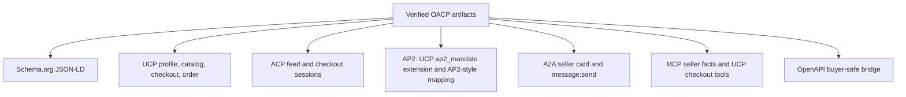

# How OACP Maps To Schema.org, UCP, ACP, AP2, A2A, MCP

Canonical end-to-end flow: [OACP end-user flow](../end-user-flow.md).

OACP is the canonical trust input: Grantex-issued artifacts that AgenticOrg verifies (ES256
detached JWS, scope, TTL, Token Status List) before caching. Two kinds of output come from them:

- **Served in spec shape**, behind flags that default to off: the UCP business profile, catalog,
  locations, checkout, cart and order; the ACP product feed and checkout sessions.
- **Compatibility mappings** in the protocol adapter payloads (`/protocol-adapters`): Schema.org,
  ACP-style and AP2-style profiles, A2A task metadata, MCP tool metadata and an OpenAPI schema.
  They describe facts and limits; they never create checkout, payment or mandates.

Status on 2026-10-20: everything below is on `main`; the AgenticOrg production deployment does
not include the UCP and ACP surfaces yet.

## Schema.org

`schema_org_product_offer_jsonld` and the public catalog pages render `Product` / `Offer` JSON-LD
from verified catalog, price and inventory artifacts, with source and freshness labels, only for
a merchant with public publishing enabled. It is a compatibility mapping
(`certification_status: not_certified_not_published`).

## UCP

UCP is rendered in spec shape, not as a compatibility mapping: the merchant's
`/.well-known/ucp`, catalog search and lookup and (2026-08-25) locations, served
only for a merchant whose serving host is DNS-attested and whose verified
`public_discovery_state` artifact allows publication. Profile capabilities are
the ones actually served; UCP names (`dev.ucp.shopping.catalog.search`, ...)
replace the earlier free-text capability list. See [UCP business profile](../ucp-profile.md).

## ACP

ACP (API version `2026-04-17`) is also rendered in spec shape, behind its own flags:

- **Product feed**: ACP Feed `Product` JSON (validated against the 2026-04-17 feed schema) and the
  merchant-feed CSV (`enable_search`, `enable_checkout`, seller and return columns), built only from
  verified, fresh OACP catalog, price and inventory artifacts; return terms only from the verified
  `policy` artifact.
- **Checkout sessions** at `https://<merchant serving host>/acp/checkout_sessions`, on the UCP
  session table and state engine: one state machine, the same arbiter decision and executor.
  `Idempotency-Key` is a header; `API-Version` is pinned; request signatures are verified per platform
  (log-only by default, no published algorithm).
- **Errors**: internal codes map to ACP `Error` and the closed `MessageError` enum; blocker dicts
  never leave the API.
- **Delegate payment**: the session's allowance comes from Grantex, derived from the buyer's Commerce
  Passport cap, in the `DelegatePaymentRequest` shape.
- **Order events**: `order_create` / `order_update` with `Merchant-Signature`, through the UCP
  webhook outbox.

| OACP / runtime source | ACP field |
| --- | --- |
| `catalog_snapshot` + synced products | Feed `Product`, `Variant` (`id`, `title`, `description`, `media`, `variant_options`, `categories`) |
| `price` (verified) | `Variant.price`, `list_price`; CSV `price`, `sale_price` |
| `inventory` (verified) | `Variant.availability`; CSV `availability` |
| `policy` (verified) | `Seller.links[refund_policy]`; CSV `return_policy`, `accepts_returns`, `return_deadline_in_days` |
| Merchant config links | `Seller.links`, session `links`; CSV `seller_privacy_policy`, `seller_tos` |
| `mandate_capability` | Payment handler config and allowance cap |
| Commerce Passport (Grantex) | `config.delegate_payment.allowance` |
| Order entity | Webhook `Order` |

See [ACP product feed and checkout sessions](../acp-feed-and-sessions.md).

## AP2

AP2 appears in two places:

- **UCP checkout, spec shape.** When a platform negotiates the AP2 mandate extension
  (`dev.ucp.shopping.ap2_mandate` in 2026-04-08, `dev.ucp.common.payment.ap2_mandate` in
  2026-08-25; advertised only with an active merchant signing key), checkout responses carry
  `ap2.merchant_authorization`, a detached ES256 JWS by the merchant's UCP key over the RFC 8785
  JSON of the checkout, and Complete requires an `ap2.checkout_mandate` whose SHA-256 becomes the
  arbiter's mandate hash. The checkout mandate itself is not verified
  ([UCP checkout](../ucp-checkout.md#residual-gaps)).
- **Grantex mandates.** With `AGENTICORG_GRANTEX_MANDATES_ENABLED`, a UCP or ACP Complete obtains
  Intent, Cart and Payment mandates from Grantex: JWTs mapped to AP2 field names (not AP2's
  SD-JWT format), verified locally, whose hashes reach the arbiter, the ledger and the Plural
  order metadata ([Mandates](../mandates.md)).
- **AP2-style mapping.** `ap2_style_mandate_payment_evidence_profile` lists the provider evidence
  a mandate needs (capability status, evidence ref, webhook verification, idempotency,
  reconciliation). It creates no mandate.

## A2A

A merchant-issued buyer credential lets an external A2A v1 HTTP+JSON client read the seller card
and send `message:send`; each answer is non-binding, sourced from the verified cache and recorded
on the commerce ledger ([A2A interoperability](../../a2a-interoperability.md)). The
`a2a_agent_card_task_metadata` adapter is metadata only.

## MCP

`agenticorg-mcp-server` exposes read-only `seller.*` tools over the same cache-backed answers.
From 5.1.0 it also registers the UCP 2026-04-08 MCP binding tools (`create_checkout` ...
`get_order`) when `AGENTICORG_UCP_PROFILE_URL` names a merchant profile that lists checkout;
`complete_checkout` never sends a Complete without `decide_only` or a `decision_id`
([UCP checkout](../ucp-checkout.md#mcp-tools)).

## Compatibility Vs Official Approval

Compatibility means deterministic field lineage from OACP artifacts. Official approval requires external program evidence and is not claimed by these docs.
