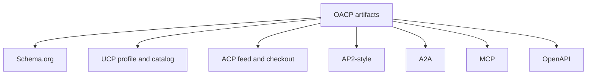

# How OACP Maps To Schema.org, UCP, ACP, AP2, A2A, MCP

Canonical end-to-end flow: [OACP end-user flow](../end-user-flow.md).

OACP is the canonical trust input. Adapter payloads are compatibility mappings for client and partner surfaces.

## UCP

UCP is rendered in spec shape, not as a compatibility mapping: the merchant's
`/.well-known/ucp`, catalog search and lookup and (2026-08-25) locations, served
only for a merchant whose serving host is DNS-attested and whose verified
`public_discovery_state` artifact allows publication. Profile capabilities are
the ones actually served; UCP names (`dev.ucp.shopping.catalog.search`, ...)
replace the earlier free-text capability list. See [UCP business profile](../ucp-profile.md).

## ACP

ACP (API version `2026-04-17`) is also rendered in spec shape, behind its own flags:

- **Product feed**: ACP Feed `Product` JSON (validated against the 2026-04-17 feed schema) and the
  merchant-feed CSV (`enable_search`, `enable_checkout`, seller and return columns), built only from
  verified, fresh OACP catalog, price and inventory artifacts; return terms only from the verified
  `policy` artifact.
- **Checkout sessions** at `https://<merchant serving host>/acp/checkout_sessions`, on the UCP
  session table and state engine: one state machine, the same arbiter decision and executor.
  `Idempotency-Key` is a header; `API-Version` is pinned; request signatures are verified per platform
  (log-only by default, no published algorithm).
- **Errors**: internal codes map to ACP `Error` and the closed `MessageError` enum; blocker dicts
  never leave the API.
- **Delegate payment**: the session's allowance comes from Grantex, derived from the buyer's Commerce
  Passport cap, in the `DelegatePaymentRequest` shape.
- **Order events**: `order_create` / `order_update` with `Merchant-Signature`, through the UCP
  webhook outbox.

| OACP / runtime source | ACP field |
| --- | --- |
| `catalog_snapshot` + synced products | Feed `Product`, `Variant` (`id`, `title`, `description`, `media`, `variant_options`, `categories`) |
| `price` (verified) | `Variant.price`, `list_price`; CSV `price`, `sale_price` |
| `inventory` (verified) | `Variant.availability`; CSV `availability` |
| `policy` (verified) | `Seller.links[refund_policy]`; CSV `return_policy`, `accepts_returns`, `return_deadline_in_days` |
| Merchant config links | `Seller.links`, session `links`; CSV `seller_privacy_policy`, `seller_tos` |
| `mandate_capability` | Payment handler config and allowance cap |
| Commerce Passport (Grantex) | `config.delegate_payment.allowance` |
| Order entity | Webhook `Order` |

See [ACP product feed and checkout sessions](../acp-feed-and-sessions.md).

## Compatibility Vs Official Approval

Compatibility means deterministic field lineage from OACP artifacts. Official approval requires external program evidence and is not claimed by these docs.
