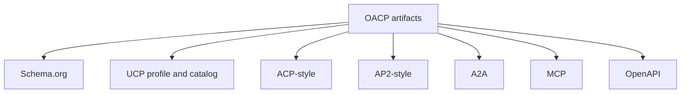

# How OACP Maps To Schema.org, UCP, ACP, AP2, A2A, MCP

Canonical end-to-end flow: [OACP end-user flow](../end-user-flow.md).

OACP is the canonical trust input. Adapter payloads are compatibility mappings for client and partner surfaces.

## UCP

UCP is rendered in spec shape, not as a compatibility mapping: the merchant's
`/.well-known/ucp`, catalog search and lookup and (2026-08-25) locations, served
only for a merchant whose serving host is DNS-attested and whose verified
`public_discovery_state` artifact allows publication. Profile capabilities are
the ones actually served; UCP names (`dev.ucp.shopping.catalog.search`, ...)
replace the earlier free-text capability list. See [UCP business profile](../ucp-profile.md).

## Compatibility Vs Official Approval

Compatibility means deterministic field lineage from OACP artifacts. Official approval requires external program evidence and is not claimed by these docs.
