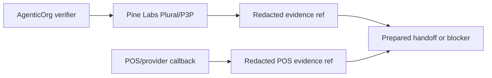

# Provider-Owned Mandate/Payment Evidence In OACP

Canonical end-to-end flow: [OACP end-user flow](../end-user-flow.md).

Pine Labs Plural/P3P owns mandate and payment rail execution. POS/payment providers own in-store payment and receipt confirmation. AgenticOrg verifies capability metadata, accepts verified POS/provider callbacks, and stores redacted evidence refs. Before any handoff or checkout may proceed, the commerce arbiter decides it and seals the decision to the ledger ([arbiter and ledger](../arbiter-ledger.md)).

## No Raw Credential Storage

OACP artifacts and cache records must not contain provider tokens, POS secrets, card data, bank data, checkout URLs, payment URLs, raw POS payloads, or raw provider response bodies.

## ACP Delegated Payment

ACP checkout sessions never receive card data. The agent sends the buyer's payment method to the
vault with the session's delegate-payment allowance, which AgenticOrg obtains from Grantex (derived
from the buyer's Commerce Passport amount cap) and shows in the payment handler's config in the
`DelegatePaymentRequest` shape (`allowance`, `risk_signals`, `metadata`). AgenticOrg sends Grantex
only the tenant, the passport, the session, the merchant and the currency; it keeps the passport as
a SHA-256 and seals each allowance request (with the risk-signal digest) on the commerce ledger. At
completion the agent presents the vault token as a Plural instrument token; a card number is refused.
Payment executes only through an executor that consumes an arbiter `allow` decision: the
[Plural executor](../plural-executor.md), registered only while
`PLURAL_PINE_LIVE_EXECUTION_ENABLED` is on (off by default), creates the Plural order with the
decision id and the three mandate hashes in its metadata, captures, and refunds against a fresh
`refund` decision. See
[ACP product feed and checkout sessions](../acp-feed-and-sessions.md#delegate-payment-allowance-g35).

## Offline POS Evidence

Offline POS Bridge evidence is reference-only. `payment_confirmed` and `receipt_available` require verified callback evidence and a non-sensitive provider/POS evidence ref. Simulator confirmations are useful for tests but must not be described as live paid states.
