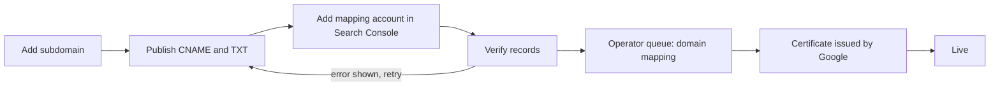

# Merchant Custom Domains

A merchant serves its UCP business profile (`/.well-known/ucp`) and the public
UCP routes (`/ucp/*`) on a host it owns, for example `agent.merchant.example`,
instead of an AgenticOrg host. This page covers the merchant flow, the two ways
a domain reaches the API, the Cloud Run limits, and when a load balancer would
replace them. The recommended way is the [Firebase Hosting front](#firebase-hosting-front-recommended):
the merchant publishes two DNS records and AgenticOrg does the rest. The
original way, a Cloud Run domain mapping per merchant, also needs a Search
Console owner and an operator step.

The custom domain becomes the merchant's UCP serving host. What is served there
is still decided by [the UCP profile rules](ucp-profile.md#when-a-profile-is-served).
Merchants who want the apex domain (`merchant.example`) as well should follow
the [apex domain guide](merchant-apex-domain.md).

**Cost.** Cloud Run domain mappings add no Google Cloud cost: the domain maps
to the existing `agenticorg-api` service, its certificate is Google managed,
and the status checks run on the existing worker and beat services. The
Firebase Hosting front is metered only beyond its free storage and transfer
allowances ([limits and cost](#firebase-hosting-limits-and-cost)).
DNS lookups and the operator email (existing SMTP) are not billed by Google
Cloud. There is no load balancer, no Certificate Manager certificate and no new
instance.

## Turning it on

| Flag | Default | Meaning |
| --- | --- | --- |
| `AGENTICORG_CUSTOM_DOMAINS_ENABLED` | `false` | Off: every custom-domain route answers 404, `/.well-known/agenticorg-host` answers 404 and the status task does nothing. |
| `AGENTICORG_CUSTOM_DOMAIN_CNAME_TARGET` | `ghs.googlehosted.com` | The CNAME target shown to merchants. |
| `AGENTICORG_CUSTOM_DOMAIN_CLOUD_RUN_SERVICE` | `agenticorg-api` | The service the generated command maps. |
| `AGENTICORG_CUSTOM_DOMAIN_CLOUD_RUN_PROJECT` | empty (`GOOGLE_CLOUD_PROJECT`, else `PROJECT_ID`) | The project the generated command names. |
| `AGENTICORG_CUSTOM_DOMAIN_CLOUD_RUN_REGION` | `asia-southeast1` | The region the generated command names. |
| `AGENTICORG_CUSTOM_DOMAIN_MAPPING_ACCOUNT` | empty | The Google account that creates mappings. Merchants add it as a Search Console owner. |
| `AGENTICORG_CUSTOM_DOMAIN_OPERATOR_TENANT_ID` | empty | The tenant whose administrators see the operator queue. Empty: nobody sees it. |
| `AGENTICORG_CUSTOM_DOMAIN_OPERATOR_EMAIL` | empty | Where each new queue item is emailed, with its command. Empty: no email. |
| `AGENTICORG_CUSTOM_DOMAIN_FIREBASE_ENABLED` | `false` | New domains go through the Firebase Hosting site instead of a Cloud Run domain mapping, and a verified `X-Forwarded-Host` names the merchant on the agent paths. See [Firebase Hosting front](#firebase-hosting-front-recommended). |
| `AGENTICORG_CUSTOM_DOMAIN_FIREBASE_SITE` | empty | The Firebase Hosting site id (its CNAME target is `<site>.web.app`). Both this and the flag are needed. |
| `AGENTICORG_CUSTOM_DOMAIN_CLOUD_RUN_AUTOMAP_ENABLED` | `false` | Create mappings through the Cloud Run Admin API instead of the operator. See [automation](#optional-automation-through-the-cloud-run-admin-api). |

Migration `v6z91_merchant_custom_domains` adds the `merchant_custom_domains`
table. It is tenant scoped with ENABLE + FORCE row-level security, a
`USING` + `WITH CHECK` tenant policy, and a SELECT-only platform-context
policy. The status task and the operator queue use that policy to list rows
across tenants. Every write runs in the owning tenant's session.

### Production turn-on

The settings go on `agenticorg-api`, which serves the routes, and on
`agenticorg-worker`, which runs the status task and sends the operator email
over the existing SMTP settings. `agenticorg-beat` only schedules the task.
`scripts/deploy_cloud_run.sh` uses `--update-env-vars`, so these values
survive later deploys.

1. Deploy a commit that contains `v6z91_merchant_custom_domains` with
   `--with-migrations`, so the migrate job creates the table.
2. Find the operator tenant id: sign in to the app as an administrator of your
   own organization and open `/api/v1/auth/me` (the `tenant_id` field).
3. Apply the settings (each command creates a new revision with no image change):

   ```bash
   gcloud run services update agenticorg-api --project=PROJECT_ID --region=asia-southeast1 --update-env-vars=AGENTICORG_CUSTOM_DOMAINS_ENABLED=true,AGENTICORG_CUSTOM_DOMAIN_MAPPING_ACCOUNT=MAPPING_ACCOUNT_EMAIL,AGENTICORG_CUSTOM_DOMAIN_OPERATOR_TENANT_ID=OPERATOR_TENANT_ID,AGENTICORG_CUSTOM_DOMAIN_OPERATOR_EMAIL=OPERATOR_INBOX,AGENTICORG_CUSTOM_DOMAIN_CLOUD_RUN_PROJECT=PROJECT_ID
   ```

   ```bash
   gcloud run services update agenticorg-worker --project=PROJECT_ID --region=asia-southeast1 --update-env-vars=AGENTICORG_CUSTOM_DOMAINS_ENABLED=true,AGENTICORG_CUSTOM_DOMAIN_MAPPING_ACCOUNT=MAPPING_ACCOUNT_EMAIL,AGENTICORG_CUSTOM_DOMAIN_OPERATOR_TENANT_ID=OPERATOR_TENANT_ID,AGENTICORG_CUSTOM_DOMAIN_OPERATOR_EMAIL=OPERATOR_INBOX,AGENTICORG_CUSTOM_DOMAIN_CLOUD_RUN_PROJECT=PROJECT_ID
   ```

4. Move traffic to the new revisions. `scripts/deploy_cloud_run.sh` pins
   traffic to named revisions, so the new revision from step 3 is Ready but
   gets 0% until traffic moves. Check `spec.traffic` and move it per service:

   ```bash
   gcloud run services describe agenticorg-api --project=PROJECT_ID --region=asia-southeast1 --format='value(status.latestReadyRevisionName,status.traffic)'
   ```

   ```bash
   gcloud run services update-traffic agenticorg-api --project=PROJECT_ID --region=asia-southeast1 --to-revisions=NEW_API_REVISION=100
   ```

   Do the same for `agenticorg-worker`. Note the previous revisions first:
   they are the rollback targets. Use `--update-env-vars`, never
   `--set-env-vars`, which would drop every other setting. Do not roll while a
   post-deploy E2E run is in progress.
5. Verify:
   - `https://app.agenticorg.ai/api/v1/health` answers `healthy`.
   - The API service's own URL (`gcloud run services describe agenticorg-api
     --format='value(status.url)'`) answers `/.well-known/agenticorg-host` with
     `{"service": "agenticorg", "host": "<that host>"}`, and so does any host
     already mapped to the service. It is 404 while the flag is off. The UI
     host does not proxy this path.
   - **Commerce > Custom Domains** loads for a merchant, and the operator queue
     shows for the operator tenant's administrators.
6. Rollback: move traffic back to the previous revisions
   (`gcloud run services update-traffic <service> --to-revisions=<previous>=100`),
   or run step 3 with `AGENTICORG_CUSTOM_DOMAINS_ENABLED=false` and move
   traffic again.

## Firebase Hosting front (recommended)

With `AGENTICORG_CUSTOM_DOMAIN_FIREBASE_ENABLED=true` and
`AGENTICORG_CUSTOM_DOMAIN_FIREBASE_SITE` set, new domains go through a
Firebase Hosting site in front of `agenticorg-api` instead of a Cloud Run
domain mapping. This removes both the Search Console owner step and the
operator step.

**For the merchant, two DNS records:**

| Type | Name | Value | Purpose |
| --- | --- | --- | --- |
| `CNAME` | `agent.merchant.example` | `<site>.web.app.` | Routes the host to the Firebase Hosting site. Firebase also takes it as proof of ownership for its certificate. |
| `TXT` | `_agenticorg-ucp.agent.merchant.example` | `agenticorg-ucp-verify=<random>` | Binds the host to the merchant's AgenticOrg tenant. |

The TXT record is required even though Firebase needs only the CNAME. Every
merchant's CNAME points at the same AgenticOrg site, so the CNAME cannot tell
AgenticOrg which tenant the domain belongs to. Without the TXT check, another
tenant could claim a domain that a merchant had pointed at AgenticOrg and serve
its own catalog there.

**What AgenticOrg does:**
1. Once both records verify, the status task creates the domain on the site
   through the Firebase Hosting API: `POST
   https://firebasehosting.googleapis.com/v1beta1/projects/{project}/sites/{site}/customDomains?customDomainId={host}`.
2. It follows the domain (`GET .../customDomains/{host}`) until Hosting serves it
   (`HOST_ACTIVE`, `OWNERSHIP_ACTIVE`, certificate `CERT_PROPAGATING` or
   `CERT_ACTIVE`).
3. It confirms with the HTTPS probe and marks the domain live.

Removing a domain deletes it from the site
(`DELETE .../customDomains/{host}`), retried until it succeeds. An ownership
state Hosting cannot fix by itself (`OWNERSHIP_MISMATCH`, the domain is on
another Firebase project; `OWNERSHIP_SUSPENDED`) marks the domain failed with
the reason. Only failed Firebase domains appear in the operator queue, and
they carry no command to run.

**How the merchant is recognised.** Firebase Hosting forwards a request to
Cloud Run with `Host` set to the service's own name and the merchant domain in
`X-Forwarded-Host`. `api/middleware/merchant_host.py` handles this only on the
agent paths (`/.well-known/ucp`, `/.well-known/ucp/*`, `/ucp/*`, `/acp/*`,
`/.well-known/agenticorg-host`). There it puts the forwarded host in `Host`,
but only when it names a domain AgenticOrg itself connected through Firebase:
provider `firebase_hosting`, status `pending_certificate` or `live`, cached for
60 s. Every UCP and ACP route, and RFC 9421 `@authority`, then see the merchant
domain as before. Any other forwarded value is ignored. A caller who sends
`X-Forwarded-Host` straight to the service URL can name only a domain that is
already public through Firebase, and reaches the same public profile and catalog.
Every write still needs its own credentials.

**Caching.** Firebase Hosting caches a response that carries no
`Cache-Control` (it adds `max-age=600`). On the agent paths the middleware adds
`Cache-Control: no-store` to any response without a policy, including auth
refusals. The UCP profile keeps its own `public, max-age=300`.

**Agent paths only.** The site serves no files. Its configuration
(`core.commerce.custom_domains.firebase_site_config`) rewrites only the agent
paths to `agenticorg-api`. Every other path on a merchant domain is Firebase's
own 404, so no AgenticOrg page or API route is reachable on a merchant host.
Cloud Run domain mappings cannot do this.

### Owner setup (once)

1. **Firebase on the project.** Enable `firebase.googleapis.com` and
   `firebasehosting.googleapis.com` and add Firebase to the project. There is
   no charge for adding it.
2. **A site for merchant domains,** for example `agenticorg-merchant-domains`:

   ```bash
   curl -s -X POST -H "Authorization: Bearer $(gcloud auth print-access-token)" -H "x-goog-user-project: PROJECT_ID" -H "Content-Type: application/json" -d "{}" "https://firebasehosting.googleapis.com/v1beta1/projects/PROJECT_ID/sites?siteId=SITE_ID"
   ```

3. **Release the agent-only configuration** (again whenever the agent paths change):

   ```bash
   python scripts/release_merchant_domain_site.py --project PROJECT_ID --site SITE_ID
   ```

4. **Let the runtime service account manage the site's domains.** Grant it
   `roles/firebasehosting.admin` on the project. This narrow role replaces the
   Project Editor role that Cloud Run domain-mapping automation would need:

   ```bash
   gcloud projects add-iam-policy-binding PROJECT_ID --member=serviceAccount:RUNTIME_SA_EMAIL --role=roles/firebasehosting.admin
   ```

5. **Turn it on** for `agenticorg-api` and `agenticorg-worker`
   (`--update-env-vars`, then move traffic as in
   [Production turn-on](#production-turn-on)):
   - `AGENTICORG_CUSTOM_DOMAIN_FIREBASE_ENABLED=true`
   - `AGENTICORG_CUSTOM_DOMAIN_FIREBASE_SITE=SITE_ID`
   - `AGENTICORG_CUSTOM_DOMAIN_CLOUD_RUN_PROJECT=PROJECT_ID` (also the Firebase project)

   The mapping account and the operator settings stay useful for failed
   domains and for any Cloud Run-mapped domains that already exist.
6. **Check** with a throwaway subdomain of a domain you control: add the domain
   on Commerce > Custom Domains, publish the two records and wait for **Live**.

### Spike results (2026-10-22)

The spike used the site `agenticorg-cd-spike` and `cd-spike.agenticorg.ai`:
- The Hosting API asked for exactly one record for a subdomain: a CNAME to `<site>.web.app`.
- Ownership was `OWNERSHIP_ACTIVE` about 5 minutes after the CNAME was published.
- HTTPS answered in under 33 minutes; Firebase passed its ACME HTTP challenge by itself.
- Cloud Run received `Host: <service>.run.app`, `X-Forwarded-Host: cd-spike.agenticorg.ai`, `X-Forwarded-Proto: https` and `Via: 1.1 Firebase Hosting`.
- POST bodies, query strings, `Authorization`, `UCP-Agent`, `Signature-Input`, `Signature` and `Idempotency-Key` passed through unchanged.
- A 404 without `Cache-Control` came back with `max-age=600` and was then served from Firebase's cache (`X-Cache: HIT`).

### Firebase Hosting limits and cost

Checked on 2026-10-22:
- **Subdomains:** at most 20 per apex domain (one agent subdomain per merchant is far below that).
- **Hosts:** a custom domain can belong to only one Hosting site.
- **Timeout:** a request can take at most 60 seconds.
- **Cost:** custom domains and certificates carry no separate charge. Hosting storage is free up to 10 GB and data transfer up to 360 MB a day; beyond that, about $0.026 per GB stored and $0.15 per GB transferred. The site stores no files, and UCP profile and catalog responses are small JSON.
- **Billing plan:** Cloud Run rewrites need the project on the pay-as-you-go (Blaze) plan, which any project with Cloud Run already uses.

**Rollback.** Turning `AGENTICORG_CUSTOM_DOMAIN_FIREBASE_ENABLED` off sends new
domains back to Cloud Run domain mappings. It also stops recognising the
forwarded host, so domains already connected through Firebase answer 404 until
it is on again. To leave Firebase for good, remove those domains first.

## Merchant flow

The merchant works in **Commerce > Custom Domains** (`/dashboard/custom-domains`,
for the admin and merchant roles). It calls the API below.



1. **Add a subdomain**, such as `agent.merchant.example`. A zone apex is refused
   with `apex_domain_needs_subdomain`, because a CNAME cannot sit at a zone apex
   (RFC 1034 §3.6.2, RFC 1912 §2.4). The check is an SOA lookup at the name
   itself, not a public-suffix guess. Names over 64 characters (the Cloud Run
   limit), IP literals, ports and paths are refused with `invalid_host`.
2. **Publish two records** at the DNS provider. Both are shown with copy buttons:

   | Type | Name | Value | Purpose |
   | --- | --- | --- | --- |
   | `CNAME` | `agent.merchant.example` | `ghs.googlehosted.com.` | Routes the host to Cloud Run. Keep it DNS only (not proxied). |
   | `TXT` | `_agenticorg-ucp.agent.merchant.example` | `agenticorg-ucp-verify=<random>` | Proves control of the host (the UCP serving-host attestation). It sits on its own label, so it never collides with the CNAME. |

3. **Add the mapping account in Google Search Console.** Google creates a
   domain mapping only for an account that is a verified owner of the base
   domain (for `agent.merchant.example`, the `merchant.example` domain
   property). The merchant verifies that property, if it has not already done
   so for Merchant Center, and adds the account shown (the value of
   `AGENTICORG_CUSTOM_DOMAIN_MAPPING_ACCOUNT`) under Settings > Users and
   permissions > Verified owners > Add an owner. It then ticks the
   confirmation box. Keep the owner in place while the domain is connected.
4. **Verify records.** This looks up the TXT challenge (async DNS) and records
   the serving-host attestation, the same one `POST .../ucp/serving-host/verify`
   records. It indexes the host for public lookup, then checks that the CNAME
   points at the target. Every failing check is reported together, with a
   message and the next step. Once everything holds, the domain moves to
   `pending_mapping` and joins the operator queue. Attesting a new host
   replaces the merchant's previous serving host and withdraws its
   publication until it is published again, as in the UCP operator flow.
5. **Connect.** An operator creates the domain mapping (below), or the Admin
   API does it when automation is on.
6. **Certificate.** Google issues the certificate. This usually takes about 15
   minutes and at most 24 hours. Every five minutes the status task fetches
   `https://<host>/.well-known/agenticorg-host` with full certificate
   verification. The request uses the egress guard's DNS-pinned transport, so
   only public addresses are reachable and redirects are not followed. The
   domain is **live** once this service answers with the same host. A mapping
   that never got marked is found the same way.
7. **Live.** `https://agent.merchant.example/.well-known/ucp` serves the
   profile once the merchant publishes (`POST .../ucp/keys`, `POST .../ucp/publish`)
   and Grantex enables public discovery for that host. See the
   [UCP operator flow](ucp-profile.md#operator-flow).

**Retry.** *Verify records* or *Check status* can be pressed at any time. On a
`failed` domain it is the retry: the domain goes back to the step that failed
and joins the operator queue again (the operator is emailed again). The same
domain re-added returns the existing one. A different domain needs the current
one removed first. A `failed` domain keeps its host reserved until it is
removed, so no other merchant can take the host between a failure and its retry.
Checks compare DNS with the CNAME target the domain was given when it was added.
A later change to `AGENTICORG_CUSTOM_DOMAIN_CNAME_TARGET` applies only to new
domains.

**Remove.** Disconnecting withdraws the host's public index entry, its
attestation and the publication, so the profile stops being served there. A
domain that got past verification may have a mapping. It moves to
`pending_unmap`, a durable item in the operator queue with the
`gcloud ... domain-mappings delete` command, and the operator is emailed. The
email is resent by the status task until it goes out. With automation on, the
status task deletes the mapping through the Admin API instead and retries until
it succeeds. If another domain already holds the host again, the mapping is
kept and the item is simply closed.

### States and errors

| Status | Meaning |
| --- | --- |
| `pending_dns` | Records not yet verified (`last_error` says which one). |
| `pending_mapping` | Verified; waiting for the domain mapping (operator queue). |
| `pending_certificate` | Mapping created; waiting for the certificate. |
| `live` | HTTPS works and reaches this service with the host intact. |
| `failed` | The mapping was refused or no certificate came within 48 hours; retry after fixing. The host stays reserved. |
| `pending_unmap` | Disconnected; its domain mapping is still to delete (operator queue, or the Admin API with automation on). |
| `removed` | Disconnected and unmapped (kept for history). |

| Code | Shown when | Fix |
| --- | --- | --- |
| `invalid_host` | Not a host name of at most 64 characters | Enter only the host. |
| `apex_domain_needs_subdomain` | The name is a zone apex | Use a subdomain; see the apex guide. |
| `ownership_txt_missing` | The TXT record is missing or holds another value | Publish the exact value; DNS can take up to an hour. |
| `cname_missing` | No CNAME at the host | Add it; switch off proxying or CNAME flattening. |
| `cname_wrong_target` | The CNAME points elsewhere (the found target is shown) | Point it at the target. |
| `dns_lookup_failed` | DNS timed out | Retry later. |
| `search_console_owner_not_confirmed` | Records are fine but the Search Console step is not confirmed | Add the owner and tick the box. |
| `host_bound_to_another_tenant` | Another organization attested this host | Remove it there first. |
| `host_in_use` | Another merchant in this organization holds the host | Remove it there first. |
| `mapping_failed` | The operator or the Admin API could not create the mapping, or no certificate came within 48 hours (details shown) | Fix the cause (usually the Search Console owner, a CAA record or a proxied CNAME) and retry. |
| `certificate_pending` | The mapping exists; the certificate is not issued yet | Wait (up to 24 hours). |
| `host_not_routed` | HTTPS answers but not from this service, or the host resolves to a refused address | Check the CNAME. |

### API

All merchant routes require `commerce.merchant_config.write` or tenant admin,
are tenant bound, write the commerce ledger (`commerce.custom_domain.*`), and
take an optional `seller_agent_id`. Without it, a merchant with active
domains for more than one seller agent gets `409 seller_agent_id_required`
rather than a guess. Adding a domain without it uses the merchant config the
UCP serving-host routes use.

| Method and path (`/api/v1/commerce/runtime/merchant-configs/{merchant_id}`) | Body | Returns |
| --- | --- | --- |
| `GET /custom-domain` | (`?seller_agent_id=`) | `{enabled, cname_target, mapping_account, apex_guide, domain}` |
| `POST /custom-domain` | `{"host": "agent.merchant.example"}` | the domain view (records, steps, error) |
| `POST /custom-domain/check` | `{"search_console_owner_added": true}` | the domain view after verifying or re-checking |
| `DELETE /custom-domain` | (`?seller_agent_id=`) | `{removed, host, mapping_delete_needed}` |

## Operator step: the domain mapping

The one step a person still takes is creating the Cloud Run domain mapping.
Google requires the creating account to be a Search Console owner of the
merchant's domain, so the merchant cannot do it from inside AgenticOrg.

1. **Notification.** When a domain reaches `pending_mapping`, an email goes to
   `AGENTICORG_CUSTOM_DOMAIN_OPERATOR_EMAIL`. It names the host, says whether
   the merchant confirmed the Search Console owner, and gives the exact
   command. The status task resends it for any queued item not yet notified.
2. **Queue.** Administrators of the operator tenant see an **Operator queue**
   section on the Custom Domains page. It shows every tenant's
   `pending_mapping`, `pending_certificate` and `failed` items, each with its
   command and a copy button. API: `GET /api/v1/commerce/custom-domains/operator-queue`.
3. **Run the command**, signed in as the mapping account:

   ```bash
   gcloud beta run domain-mappings create --service=agenticorg-api --domain=agent.merchant.example --project=PROJECT_ID --region=asia-southeast1
   ```

   Check it with `gcloud beta run domain-mappings describe --domain=agent.merchant.example --project=PROJECT_ID --region=asia-southeast1`.
4. **Mark it mapped** (`POST .../operator-queue/{id}/mapped`). The domain moves
   to `pending_certificate` and the status task takes it to `live`. If the
   command fails (typically "domain not verified" because the Search Console
   owner is missing), **mark it failed** with a reason
   (`POST .../operator-queue/{id}/failed`, `{"reason": "..."}`). The merchant
   sees that reason and a retry.
5. **Delete mappings of removed domains.** A `pending_unmap` item shows the
   `gcloud beta run domain-mappings delete ...` command. Run it, then **mark it
   deleted** (`POST .../operator-queue/{id}/unmapped`). When the item says
   another domain now uses the host, keep the mapping and mark it done.

The queue routes answer 404 to everyone except administrators of
`AGENTICORG_CUSTOM_DOMAIN_OPERATOR_TENANT_ID`. Each action is written to the
merchant tenant's commerce ledger with the operator as actor.

## Optional: automation through the Cloud Run Admin API

With `AGENTICORG_CUSTOM_DOMAIN_CLOUD_RUN_AUTOMAP_ENABLED=true` and a project
set, the status task creates the mapping itself, and deletes the mapping of a
removed domain (`DELETE .../domainmappings/{host}`). It calls
`POST https://{region}-run.googleapis.com/apis/domains.cloudrun.com/v1/namespaces/{project}/domainmappings`
with `spec.routeName` = the service and `certificateMode: AUTOMATIC`, then reads
the mapping (`GET .../domainmappings/{host}`) for its `Ready` condition. Calls
use the runtime service account's credentials (`google-auth`, scope
`cloud-platform`). Neither the Admin API nor the managed certificate carries a
charge on the Cloud Run pricing page. Admin API quotas are 180 writes and 3,000
reads per minute per project and region.

What the owner must grant before turning it on:

1. **Search Console ownership.** Set `AGENTICORG_CUSTOM_DOMAIN_MAPPING_ACCOUNT`
   to the runtime service account's email. Merchants then add that service
   account as a verified owner. Search Console's Add an owner accepts a
   service account ID.
2. **Domain-mapping permissions** on the runtime service account:
   `run.domainmappings.create`, `run.domainmappings.get`,
   `run.domainmappings.list` (and `run.domainmappings.delete` to remove).
   Google's Cloud Run IAM page says the predefined Cloud Run roles do not apply
   to domain mappings and names Project Editor for creating them. **Do not
   grant Editor to the runtime service account.** Try a custom role first, and
   prove it in staging:

   ```bash
   gcloud iam roles create customDomainMapper --project=PROJECT_ID --title="Custom domain mapper" --permissions=run.domainmappings.create,run.domainmappings.get,run.domainmappings.list,run.domainmappings.delete
   ```

   ```bash
   gcloud projects add-iam-policy-binding PROJECT_ID --member=serviceAccount:RUNTIME_SA_EMAIL --role=projects/PROJECT_ID/roles/customDomainMapper
   ```

   If Google refuses the custom role, keep automation off. Editor on the
   serving identity is too broad for the minute the command takes.

Recommendation: keep automation off while merchants are few. The email and the
queue make the manual step a one-minute task.

## Cloud Run domain mapping limits

Checked against Google's documentation on 2026-10-21:

- **Preview.** Domain mappings are still Preview. Google calls them not
  production ready because of latency, and does not recommend them for
  production. That is acceptable before paid customers, not as a paid SLA.
- **Regions.** Mappings are offered in a fixed list of regions;
  `asia-southeast1` is one of them.
- **One host to the whole service.** There are no wildcard hosts and no path
  routing: a mapped host reaches every route of `agenticorg-api`, as the demo
  merchant's host does today. The UCP routes select the merchant from the
  `Host` header, and nothing else is merchant specific.
- **Certificates.** Google manages them; you cannot upload your own, and TLS 1.0
  and 1.1 cannot be turned off. Issuance usually takes about 15 minutes and at
  most 24 hours. CAA records must allow `pki.goog` and `letsencrypt.org`.
  Google allows 50 certificates per top domain per week (5 duplicates).
- **Names.** At most 64 characters.
- **Count.** Google documents no limit on mappings per project. Treat a large
  number as untested.
- **CDNs.** A proxy in front of the CNAME can intercept the certificate checks.
  For Cloudflare, Google says to turn off "Always Use HTTPS". Keep the record
  DNS only.

## When a load balancer becomes necessary (future decision)

Not needed now. Revisit when one of these holds:

- A paying merchant needs an SLA (domain mappings are Preview and have a
  latency warning).
- Merchant hosts must reach only the agent routes (path routing, per-host
  rules), need a WAF or Cloud Armor, or need TLS 1.0 and 1.1 disabled.
- Certificates must be managed in bulk, as wildcards or with our own keys, or
  the per-merchant command or Admin API becomes the bottleneck.
- Traffic must be served from more than one region.

The replacement is a global external Application Load Balancer with a
serverless NEG in front of `agenticorg-api`, and Certificate Manager
Google-managed certificates in a certificate map. List prices checked on
2026-10-21; confirm in the Google Cloud pricing calculator before deciding:

| Item | List price |
| --- | --- |
| Forwarding rule (first 5) | $0.025 per hour, about $18.25 per month |
| Data processed by the load balancer | about $0.008 per GiB (US), about $0.009 per GiB (Singapore) |
| Serverless NEG | no separate charge |
| Certificate Manager certificates | first 100 per project free; then about $0.20 per certificate per month up to 2,000; about $0.10 beyond |

| Merchants (certificates) | Estimated monthly cost (one forwarding rule, about 100 GiB through the load balancer, internet egress excluded) |
| --- | --- |
| 10 | about $19 |
| 100 | about $19 |
| 1,000 | about $199 |

Cloud Armor, if wanted, is priced separately and not included.

## Rollback

`AGENTICORG_CUSTOM_DOMAINS_ENABLED=false` turns off the custom-domain routes,
the host check and the status task at once. Hosts already attested keep
serving through the UCP profile rules until the merchant unpublishes, or until
`AGENTICORG_UCP_PROFILE_ENABLED=false`. Existing mappings stay in Cloud Run;
delete one with the `delete` command from the queue item. The migration is
additive; its downgrade drops the table (the attestation lives in the merchant
config).
