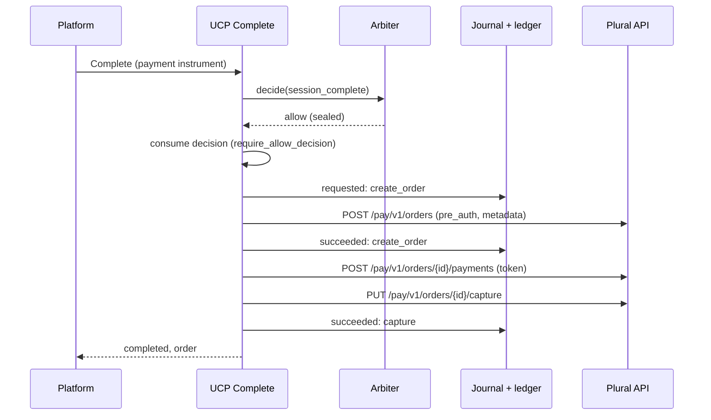

# Plural Executor

Canonical end-to-end flow: [OACP end-user flow](end-user-flow.md).

The Plural executor (`core/commerce/executors/plural.py`) is the only code that moves money for an
OACP checkout. It runs only after the commerce arbiter has issued an `allow` decision and that
decision has been consumed. It calls the Plural (Pine Labs) API directly with the merchant's
Plural credentials.

**No human legs.** Nothing in the executor waits for a person. A refusal is final for that
request; a new request gets a new decision.

## Decision: Direct Plural Execution

| | Chosen: direct Plural executor | Alternative: execution through Grantex Commerce V1 |
| --- | --- | --- |
| Who calls Plural | AgenticOrg, from the executor, with the merchant's Plural API credentials | Grantex, with AgenticOrg asking it to execute |
| Decision gate | The AgenticOrg arbiter decision is consumed (`require_allow_decision`) in the same database as the checkout session, before the first call | Grantex would have to accept and re-check the AgenticOrg decision, or run its own |
| Ledger | One ledger, in AgenticOrg, holding the decision, its consumption and every provider call | Two ledgers, joined by decision id |
| Failure modes | Plural unreachable means an unknown outcome on one call, recorded and never retried | Adds a Grantex outage and a second idempotency layer to every payment |
| Grantex role | Countersigns decisions and issues mandates; never executes a payment | Executes payments |

Direct execution was chosen: the arbiter decision, its single use and the provider call stay in
one system and one ledger, and Grantex keeps its role of signing and verifying evidence, never
moving money. The Grantex Commerce V1 execution path is not built. Choosing it later would mean a
new executor registered under another name. The arbiter, the decision guard and the journal
would stay as they are.

## Flag And Registration

| Flag | Default | Effect |
| --- | --- | --- |
| `PLURAL_PINE_LIVE_EXECUTION_ENABLED` | unset (off) | `true` registers the executor under the name `plural_pine` when the executors package loads. Unset or anything else means no executor is registered. |

With the flag off, a UCP Complete for a merchant whose `provider_policy.ucp.executor` is
`plural_pine` answers the business message `executor_unavailable` and the session stays
`ready_for_complete`. Nothing is decided or charged. The same flag already gates live
execution of the purchase handoff (`docs/oacp/purchase-mandate-handoff.md`). It is a raw
environment variable without the `AGENTICORG_` prefix, unchanged from that use.

A merchant opts in with `provider_policy.ucp.executor: "plural_pine"`, an enabled `plural_pine`
payment provider, and a `mandate_capability`. The handler allowance is
`mandate_capability.max_amount_minor_units` and its currency.

Credentials come from the environment:

- `PLURAL_PINE_CLIENT_ID` and `PLURAL_PINE_CLIENT_SECRET`
- `PLURAL_PINE_ENVIRONMENT`: `sandbox` (the default) or `production`
- `PLURAL_PINE_BASE_URL`: an optional https override
- `PLURAL_PINE_WEBHOOK_SECRET`: the base64 webhook secret

Without credentials, every execution is refused with `plural_credentials_missing` and no
call is made.

## What A Completion Does

1. **Gate.** `execute(session, decision)` needs a `ConsumedDecision`, and only
   `executors.consume_decision` can build one, after `require_allow_decision` has consumed an
   unexpired `allow` for the exact session payload hash. The executor checks again that the
   decision is a `session_complete` decision of this tenant, merchant and payload.
2. **Bounds, before any call.** Each of these must hold:
   - exactly one instrument, on the Plural handler (`plural_tokenized`);
   - the credential is a token (a PAN is refused);
   - the amount is the session total, at least 1;
   - the amount is in the allowance currency and within the allowance.
   A UPI AutoPay instrument also needs the server-side RBI AFA evidence reference
   (see [Mandates](mandates.md)). Every refusal is ledgered as `blocked` with its reason.
3. **Create order.** `merchant_order_reference` is derived from the session id and the decision
   id: `aoc-` plus 44 hex characters of their SHA-256. The order carries `pre_auth: true`.
   `purchase_details.merchant_metadata` carries:
   - `oacp_decision_id`
   - `oacp_checkout_session_id`
   - `oacp_payload_hash`
   - `oacp_intent_mandate_hash`, `oacp_cart_mandate_hash` and `oacp_payment_mandate_hash`

   The three mandate hashes come from the decision evidence: filled when the completion ran on
   server-verified Grantex mandates ([Mandates](mandates.md#grantex-mandates)), empty strings
   otherwise.
4. **Payment with the tokenised instrument.**
   - A Plural instrument token or network token goes as `CARD` with `card_token_details`.
   - A UPI AutoPay mandate goes as `UPI` with `upi_details` naming the mandate reference.

   If the response has a challenge URL, the result is `action_required`: a 3DS Action in
   2026-08-25, `continue_url` in 2026-04-08. Nothing is captured until Plural reports the
   outcome ([Reconciliation](#reconciliation)). A payment Plural reports as pending returns the
   session to `ready_for_complete` with `payment_pending`; it is reconciled the same way.
5. **Capture.** The capture amount is exactly the authorised amount. If the authorised amount
   differs from the session total, nothing is captured.

## Idempotency And The Journal

Every call writes to `commerce_payment_operations` (append-only, forced row-level security). A
`requested` row is written before the call, and the outcome row (`succeeded`, `failed` or
`unknown`) together with its ledger event after it, in one transaction:

- `commerce.plural.create_order`
- `commerce.plural.create_payment`
- `commerce.plural.capture`
- `commerce.plural.refund`

Each ledger row names the `decision_id`, the merchant reference, the amount and the mandate
hashes. The provider reference is stored only as a SHA-256.

The `requested` row is unique per merchant reference and operation. A second attempt with the
same decision is therefore refused before any HTTP call, and is ledgered as
`operation_already_requested`. `Request-ID` is a UUIDv5 of the reference and the operation.

Order creation is never retried. If Plural cannot be reached, the call's outcome is recorded as
`unknown` and the session returns to `ready_for_complete` with `payment_failed`. A new attempt
needs a new decision and therefore a new merchant reference.

## Refunds

Refunds are orchestrated on the order entity (`core/commerce/order_refunds.py`) and requested
with `POST /api/v1/commerce/runtime/ucp/orders/{order_id}/refunds`. That route is
tenant-admin only and takes `{amount, reason?, request_id?}`. A refund goes through these steps:

1. A fresh arbiter decision with action `refund` and rule `refund_within_captured`, on a payload
   naming:
   - the order, its session and the amount;
   - the captured and already-refunded amounts read from the journal.
2. Sealed. Then offered to Grantex for countersignature, after commit.
3. Consumed with `consume_decision(..., action="refund")`.
4. `executor.refund(...)`. It checks the bounds again before
   `POST /pay/v1/refunds/{plural_order_id}`:
   - the captured amount less every refund that was requested and has not failed (a pending
     or unknown refund still counts);
   - the order total;
   - the handler allowance recorded on the order at completion.
5. Appended to the order as a `refund` adjustment: `completed`, or `pending` while Plural
   reports the refund pending. The full order snapshot is then sent to every subscriber.

Partial refunds are allowed. A refund that would exceed the captured amount is refused by the
arbiter (`refund_exceeds_captured`) and makes no HTTP call.

## Webhooks

Plural's scheme is the one billing already verifies. The signature is HMAC-SHA256 over
`webhook-id.webhook-timestamp.body`, keyed with the base64-decoded secret, and the header
carries one or more `v1,<base64>` values. Both callers share it through
`core.billing.pinelabs_client.plural_signature_valid`. The executor adds a 5 minute timestamp
window.

The merchant's integration relays a Plural event to
`POST /api/v1/commerce/runtime/ucp/plural/events`. That route is tenant-admin; the tenant
comes from the authenticated caller. The body and the three Plural headers are forwarded
unchanged, so the relay cannot forge an event.

Each outcome is ledgered as `commerce.ucp.plural.event`:

- An event that fails verification is refused (`signature_invalid`, `timestamp_out_of_window`,
  `headers_missing`, `secret_missing`).
- A verified UPI AutoPay mandate outcome for one of AgenticOrg's mandate references records the
  RBI AFA evidence.
- A verified order outcome for an order this executor created reconciles the payment
  ([Reconciliation](#reconciliation)).
- Any other verified event is recorded as not applied.

No unauthenticated webhook route was added.

## Reconciliation

`PluralExecutor.reconcile`, from a verified order event (`data.order_id`,
`data.merchant_order_reference`, `data.status` or the first payment's status). The event must name
an order of this tenant: a `create_order` `succeeded` journal row with that Plural order id and an
`aoc-` merchant reference. Anything else changes nothing (`unknown_order`).

| Event status | Journal | Checkout |
| --- | --- | --- |
| `PROCESSED`, `CAPTURED` | A `capture` `succeeded` row (details `source: webhook`, the event SHA-256) unless one exists | The order is created as Complete would have (`completed`) |
| `AUTHORIZED` (after the buyer's 3-D Secure step, or a pending payment authorised later) | The authorised amount is captured with the same merchant reference and `Request-ID` scheme, unless a capture was already requested (the journal refuses a second one); an authorised amount that differs from the journal amount captures nothing | Completed when the capture succeeds |
| `FAILED`, `CANCELLED`, `DECLINED`, `REJECTED` | A `create_payment` `failed` row unless one exists | Back to `ready_for_complete`; the decision stays consumed, so the next Complete gets a new decision |
| Anything else | Nothing | Nothing (still pending) |

Every step is idempotent: a repeated or out-of-order event finds the phase already recorded and
the session already completed (`already_completed`), and makes no provider call. The capture
runs under the decision consumed at Complete; the session must still name that decision. The
checkout records what reconciliation needs (`state.execution`: the decision id, the executor and
the stored instruments, never a credential) when it moves to `complete_in_progress`. Each
reconciliation is ledgered as `commerce.ucp.checkout.reconciled`, and each journal row as its
`commerce.plural.<operation>` event. The route answers `payment: {journal, session}`.

## HTTP Safety

- Async `httpx` over the DNS-pinning egress transport (`build_pinned_async_transport`).
- The URL is checked first with `validate_public_url_async` (https only).
- 20 s timeout, no redirects, 256 KiB response cap.
- Secrets never appear in `repr`, logs or ledger rows.

## Testing

| Test | What it covers |
| --- | --- |
| `tests/unit/test_plural_executor_g55.py` | Fake Plural API (MockTransport): no decision or a wrong decision means no HTTP call; each bound; replayed decisions; 3DS; declines; capture bounds; refunds bounded by the capture; webhook signature, headers and timestamp window; flag registration. |
| `tests/integration/test_plural_executor_postgres.py` | UCP Complete end to end on Postgres with the same fake: ledger order, journal rows, decision consumed before the first call, refused and replayed decisions making no call, flag off, refunds, UPI AutoPay with AFA, append-only and forced RLS. |
| `tests/integration/test_plural_reconciliation_postgres.py` | Webhook reconciliation on Postgres with the fake: capture after 3-D Secure exactly once across redelivered and out-of-order events, a pending payment captured at the provider, a failed 3-D Secure, an event for an unknown order. |
| `tests/integration/test_plural_executor_sandbox.py` | The wire format against the Plural sandbox. Skipped unless `PLURAL_PINE_CLIENT_ID` and `PLURAL_PINE_CLIENT_SECRET` are set and the environment is `sandbox`. The payment step also needs `PLURAL_PINE_SANDBOX_INSTRUMENT_TOKEN`. |

The request and response field names follow the Plural API v1 reference. Only the sandbox module
exercises them against Plural itself.

## Residual Gaps

- **Plural event field names.** Reconciliation reads `order_id`, `merchant_order_reference` and
  `status` from the event `data` (or `data.order`). They follow the Plural API v1 reference and
  are exercised only against the fake transport until the sandbox confirms them.
- **Per-merchant credentials.** Credentials are read from the environment, so there is one
  Plural account per deployment. Per-merchant credentials, resolved from the provider's
  `credential_ref` through the vault, are a follow-up.
- **Normalised provider record.** It still states `agenticorg_executes_payment: false`. That
  field describes the configured custody; whether AgenticOrg executes is governed by this flag
  and the merchant's `executor` setting.
