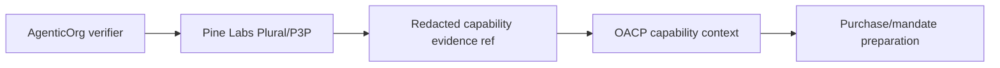

# Plural/Pine P3P Capability Verifier Guide

Canonical end-to-end flow: [OACP end-user flow](end-user-flow.md).

AgenticOrg verifies provider-owned Pine Labs Plural/P3P capability metadata without storing raw payment secrets in OACP artifacts.

Merchants configure payment provider metadata in `/dashboard/commerce-runtime`. Supported config types are `plural_pine`, `bank`, `fintech_rail`, `custom_provider`, and `none`. Only the Plural/Pine verifier has a runtime capability path today. Bank-owned and other provider-owned rails stay metadata-only until their adapters and provider approvals are implemented.

## Endpoint

`POST /api/v1/commerce/runtime/providers/plural-pine/mandate-capability/verify`

## Evidence Flow

## Results

The verifier can return available capability evidence, missing-env evidence, non-sandbox blocked evidence, or provider error evidence. Each result is public-safe and redacted.

## Evidence For Grantex

With `AGENTICORG_GRANTEX_MANDATE_CAPABILITY_EVIDENCE_ENABLED=true` (default off), the Grantex C6Z
authority request (`POST /api/v1/commerce/runtime/authority/grantex/request`) carries the latest
stored verifier result of the merchant as the top-level member `mandate_capability_evidence`.
The object (`core/commerce/mandate_capability_evidence.py`, schema
`oacp.mandate_capability_evidence.v1`) is closed and holds no secrets:

| Member | From |
| --- | --- |
| `evidence_id`, `result_status`, `provider_environment`, `external_validation_performed`, `redacted_evidence_ref`, `expires_at` | The verifier result |
| `verified_at` | The verifier's `checked_at` (UTC, milliseconds) |
| `rails`, `caps`, `token_types` | The merchant's `provider_policy.ucp.mandate_capability`: `plural` (cap `max_amount_minor_units`, token `plural_pine_token`); `card_network_token` when card instruments are offered (same cap, token `network_token`; a PAN is never accepted); `upi_autopay` with a complete UPI AutoPay block (the mandate limit, INR, token `upi_mandate_token`) |
| `evidence_hash` | Lowercase hex SHA-256 of the RFC 8785 form of the redacted verifier result |
| `tenant_id`, `merchant_id` | The packet's scope; a mismatch refuses the request |

Nothing is sent, so Grantex marks the capability `unverified`, when:

- there is no stored result;
- the result is more than 6 hours old, expired or in the future;
- the environment is neither `sandbox` nor `production`;
- the merchant has no cap or currency.

An `available` result makes the Grantex `mandate_capability` artifact `verified`, which the
Grantex UCP profile needs before it emits checkout. Turn the flag on only after the Grantex
release that accepts the member.

## Boundary

Capability evidence is not mandate creation, payment capture, checkout creation, or order success.
The verifier never moves money, whatever the flags say.

Payment execution is a separate component: the [Plural executor](plural-executor.md). It runs
only while `PLURAL_PINE_LIVE_EXECUTION_ENABLED=true` and only on a consumed arbiter `allow`
decision. The merchant's `mandate_capability`, the configuration this verifier's evidence
describes, sets the executor's allowance:

- `max_amount_minor_units` is the most one payment may charge;
- `currency` is the currency it charges in;
- with a complete `upi_autopay` block, UPI AutoPay e-mandates are offered
  ([Mandates](mandates.md)).

Grantex may verify or sign non-sensitive evidence refs. It does not execute provider rails;
the decision to execute directly from AgenticOrg rather than through Grantex Commerce V1 is
recorded in [Plural executor](plural-executor.md#decision-direct-plural-execution).
