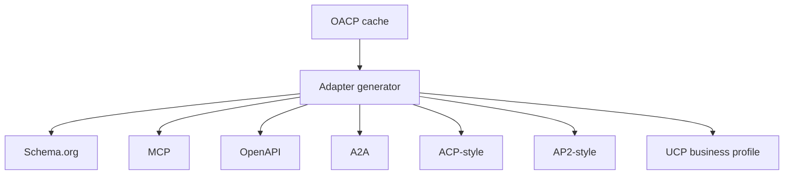

# Protocol Adapter Consumption Guide

Canonical end-to-end flow: [OACP end-user flow](end-user-flow.md).

AgenticOrg consumes Grantex `protocol_adapter` artifacts and generates buyer-safe protocol payloads.

## Adapter Matrix

| Adapter | Consumer | Runtime rule |
| --- | --- | --- |
| Schema.org | Search and product discovery clients | Product/Offer data must cite OACP source/freshness. |
| UCP | UCP platforms | `ucp_business_profile` is the merchant's published UCP business profile in spec shape (only served capabilities); generated only for a published merchant. The public profile and catalog are in [UCP business profile](ucp-profile.md). |
| ACP-style (`acp_style_commerce_interaction_profile`) | Commerce client previews | Compatibility mapping of the interaction modes; does not create checkout/payment. The ACP feed and checkout sessions themselves are served routes, see [ACP feed and sessions](acp-feed-and-sessions.md). |
| AP2-style (`ap2_style_mandate_payment_evidence_profile`) | Mandate/evidence clients | Compatibility mapping of the provider evidence a mandate needs; does not create mandate/payment. A UCP checkout carries AP2 in spec shape when the `ap2_mandate` extension is negotiated ([UCP checkout](ucp-checkout.md)). |
| A2A | Agent discovery | Agent card metadata only. |
| MCP | ChatGPT/Claude-style clients | Tool calls still hit AgenticOrg runtime checks. |
| OpenAPI | Gemini/Perplexity-style clients | Buyer-safe request/response schema only. |

UCP checkout sessions, carts and orders are not adapter payloads: they are served by the UCP REST
binding behind `AGENTICORG_UCP_CHECKOUT_ENABLED` ([UCP checkout, cart and order](ucp-checkout.md)).
ACP checkout sessions are served behind `AGENTICORG_ACP_CHECKOUT_ENABLED` and the ACP feed behind
`AGENTICORG_ACP_FEED_ENABLED` ([ACP feed and sessions](acp-feed-and-sessions.md)). The adapter
response carries `allowed_to_execute: false` and `no_payment_execution: true`.

## Unsupported Fields

If a field would imply order, checkout, payment, mandate, refund, return, shipment, or provider execution, omit it or mark it unsupported.
