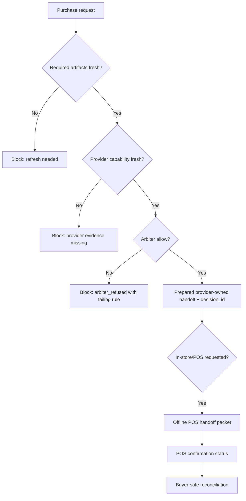

# Purchase And Mandate Handoff Guide

Canonical end-to-end flow: [OACP end-user flow](end-user-flow.md).

Purchase requests are commitment-bound. AgenticOrg prepares handoff or returns a blocker; it must not fake payment/order success.

## Endpoint

`POST /api/v1/commerce/runtime/purchase/prepare`

Offline POS Bridge endpoints:

- `GET /api/v1/commerce/runtime/pos/offline/readiness`
- `POST /api/v1/commerce/runtime/pos/offline/handoffs`
- `POST /api/v1/commerce/runtime/pos/offline/confirmations`
- `POST /api/v1/commerce/runtime/pos/offline/simulator/confirm`

## Arbiter Decision

Every call is decided by the commerce arbiter ([arbiter and ledger](arbiter-ledger.md)) and the
decision is sealed to the ledger. The request carries the buyer's evidence in `buyer_authority`
(`mandate_ref`, `mandate_hash`, `mandate_expires_at`, `consent_ref`, `consent_status`,
`passport_ref`, `passport_max_amount_minor_units`, `passport_currency`, `passport_expires_at`);
the merchant's limits come from its config (`provider_policy.arbiter`).

- A refusal returns `status: prepared_handoff_blocked_arbiter_refused` (or the preparation's own
  blocker when no handoff could be prepared) with `blocker.code = arbiter_refused` and the
  `failing_rule`.
- An allow returns `arbiter_decision.decision_id` and `payload_hash`. Live provider execution
  needs a second call for the same handoff with `decision_id` (consumed once, within 10 minutes)
  and `PLURAL_PINE_LIVE_EXECUTION_ENABLED=true`. A different payload is refused
  `decision_payload_mismatch`; a reused decision `decision_consumed`.
- `live_execution_approved` is deprecated: it is accepted for one release and ignored (the
  response lists it in `deprecated_fields_ignored`).

## UCP Session Complete

A UCP checkout ([UCP checkout, cart and order](ucp-checkout.md)) uses the same arbiter with action
`session_complete`. The decision binds the session payload (session id and revision, totals, line
items, fulfillment selections, and each payment instrument's handler, type and credential
SHA-256). `buyer_authority` travels in the vendor member `ai.agenticorg.commerce` of the complete
body; `{"decide_only": true}` returns the decision without executing and a later Complete may
present its `decision_id`. Execution happens only through a registered executor, which receives a
decision consumed by `require_allow_decision`; with `AGENTICORG_UCP_CHECKOUT_ENABLED` off the
routes are 404, and with it on but no executor registered (this release) Complete answers
`executor_unavailable` without deciding.

## Required Fresh Inputs

- Catalog snapshot.
- Price snapshot.
- Inventory snapshot.
- Policy scope.
- Mandate capability when the action needs it.
- Protocol adapter context.
- Buyer/seller/tenant/merchant scope.

## Safe Output

Return product, variant, source refs, freshness, idempotency key, provider evidence ref, and next human/system steps. Do not return checkout/payment URLs or success claims unless an approved external execution path later confirms them.

## Offline POS Output

The POS handoff packet includes tenant, merchant, seller agent, store/POS location, buyer session, product/variant, quantity, displayed price, catalog/price/inventory artifact refs, freshness timestamps, expiry window, risk tier, allowed action labels, blocked action labels, and non-sensitive evidence refs.

Confirmation intake accepts `accepted`, `price_changed`, `out_of_stock`, `expired`, `needs_staff_review`, `unsupported`, `payment_pending`, `payment_confirmed`, `payment_failed`, and `receipt_available`. `payment_confirmed` and `receipt_available` require verified POS/provider callback evidence and are not accepted from the local simulator.
