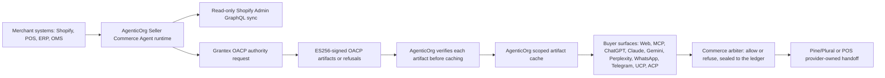

# OACP Runtime Launch Closure PRD

Status date: 2026-10-20 (previous status: 2026-06-30)

This is the canonical AgenticOrg closure PRD for turning OACP from audit-chain plumbing into a Shopify merchant commerce runtime. Older C6/C6W/C6X/C6Y reports are historical implementation context and are superseded by this document plus the runtime docs in this folder.

## Status On 2026-10-20

| Area | On `main` | In AgenticOrg production |
| --- | --- | --- |
| Shopify runtime (config, onboarding, read-only sync, Grantex authority request, cache, buyer answers, bridges, purchase preparation, Offline POS) | Yes | Yes (deployed before this closure program) |
| Artifact verification before caching (ES256 detached JWS, JWKS, scope, TTL, Token Status List; strict in production) | Yes | Not yet deployed |
| Commerce arbiter, ledger, ledger routes, offline export verifier, Grantex countersignature and witness | Yes | Not yet deployed |
| UCP business profile, catalog and locations | Yes, `AGENTICORG_UCP_PROFILE_ENABLED` default off | Not yet deployed |
| UCP checkout, cart, order and order webhooks | Yes, `AGENTICORG_UCP_CHECKOUT_ENABLED` default off | Not yet deployed |
| ACP product feed and checkout sessions | Yes, `AGENTICORG_ACP_FEED_ENABLED` / `AGENTICORG_ACP_CHECKOUT_ENABLED` default off | Not yet deployed |
| UCP checkout tools in `agenticorg-mcp-server` 5.1.0 | Yes, registered only when the merchant profile lists checkout | Package not yet published |
| Grantex mandates verified on UCP and ACP Complete | Yes, `AGENTICORG_GRANTEX_MANDATES_ENABLED` default off | Not yet deployed |
| Plural executor (capture, refunds, webhook reconciliation), UPI AutoPay with RBI AFA, tracking, source precedence | Yes, `PLURAL_PINE_LIVE_EXECUTION_ENABLED` default off | Not yet deployed |
| Inbound agent request signatures (RFC 9421: TAP, Web Bot Auth), signed buyer connector, scheme token binding | Yes, `AGENTICORG_HTTPSIG_VERIFY_MODE=log` by default, outbound signing off | Not yet deployed |

On the Grantex side, production runs the OACP signing, persistence, status list, ledger, protocol,
mandate and network identity releases, issues artifacts under its first OACP issuer key
(`oacp-20261020-12b09be0ba65bd14`) and serves its public Token Status List
(`OACP_STATUS_LIST_PUBLIC_ENABLED=true`). Those are the prerequisites for strict artifact
verification in AgenticOrg production; the deploy order is in the
[runtime operations runbook](runtime-operations-runbook.md#deploy-order-for-strict-oacp-verification)
and every flag's turn-on order and rollback in the
[launch and rollback runbook](explainers/launch-rollback-runbook.md).

## Corrected Ownership



| Owner | Owns | Must not own |
| --- | --- | --- |
| AgenticOrg | Seller Commerce Agent runtime, buyer agents, channel bridges, Shopify/WooCommerce/ERP connector runtime, artifact verification and cache, buyer conversations, public catalog pages, the commerce arbiter and ledger, UCP and ACP surfaces, provider-owned payment/POS handoff orchestration. | Grantex authority decisions, POS payment capture, merchant system truth. |
| Grantex | Trust, protocol, policy, OACP artifact authority and signing keys, Token Status List, arbiter-decision countersignature, ledger witness, adapter governance, AgenticOrg tenant allowlist. | Shopify credentials, merchant connector runtime, buyer-channel hot path, payment/POS execution. |
| Merchant systems | Product, variant, price, inventory, status, fulfillment, POS, and order source of record. | OACP trust authority. |
| Provider rails | Pine Labs Plural/P3P, bank, payment, and POS execution. | AgenticOrg/Grantex artifact truth. |

## Hard Truth Inventory

Implemented in repo (`main`):

- Merchant commerce config API/UI for tenant, merchant, seller-agent scoped source connectors, buyer channels, payment providers, public publishing, and Offline POS metadata.
- Seller Commerce Agent onboarding packets.
- Shopify direct token and OAuth credential storage through encrypted tenant connector config.
- Real Shopify Admin GraphQL read-only product, variant, image, price, currency, inventory snapshot, status, and timestamp sync.
- Shopify product webhook HMAC verification and stale/cache-refresh marking.
- Grantex authority payload and `POST /v1/commerce/oacp/c6z/authority-requests` client path.
- 11-family OACP cache intake that verifies each artifact (ES256 detached JWS against the pinned Grantex JWKS, scope, TTL, Token Status List) and, in strict runtimes, stores nothing from an issuance with any failure; Grantex replay refresh (`POST /artifacts/refresh`).
- Buyer Q&A from cache, protocol adapters, MCP seller facts, OpenAPI/A2A metadata, public catalog publishing, Schema.org JSON-LD, sitemap, and llms.txt helpers.
- WhatsApp and Telegram webhook verification plus outbound path when credentials are configured.
- Pine/Plural capability verification, prepared provider handoff or exact credential blocker, and non-executing purchase preparation.
- Commerce arbiter: a deterministic `allow` / `refuse` decision on every purchase handoff, POS handoff and checkout Complete, consumed once by `decision_id`; no path waits for a person.
- Commerce ledger: an HMAC-signed `audit_log` row for every commerce write; hash-chained when audit-chain sealing is on; ledger routes, operator decisions, review manifests, retention and an export that `scripts/verify_ledger.py` verifies offline.
- Offline POS handoff packet (stored only against a consumed `allow` decision), signed callback verification, replay-safe semantics, simulator confirmation, and staff-review fallback.
- UCP business profile, catalog, locations, checkout sessions, carts, orders and signed order webhooks, and ACP feed and checkout sessions, each behind its own flag (default off).
- Grantex mandates verified on Complete, the Plural executor (capture, refunds, webhook reconciliation), UPI AutoPay with RBI AFA, refund orchestration, Shopify tracking normalisation and per-fact source precedence, behind flags that default to off.
- Redacted local evidence runner: `python scripts/oacp_runtime_launch_check.py`.

Not proven without external credentials/approvals:

- A fresh live Shopify dev-store run in this branch.
- A deployed Grantex tenant/service-token mapping for the target merchant.
- Pine/Plural sandbox credential success against provider infrastructure.
- Public listing approvals for ChatGPT/Gemini/WhatsApp/Telegram, and Google Merchant Center or agent-platform onboarding for UCP and ACP.
- Production/sandbox smoke after merge and deploy approval.

## Runtime Closure Checklist

| Requirement | AgenticOrg closure path | Status |
| --- | --- | --- |
| Merchant onboarding packet | `POST /api/v1/commerce/runtime/seller-agents/onboarding-packets` and merchant config sync. | Implemented |
| Shopify credential custody | `POST /seller-agents/connectors/shopify/credentials`, encrypted `ConnectorConfig`. | Implemented |
| Shopify read-only sync | `ShopifyAdminGraphQLClient.fetch_products`. | Implemented, env-gated live test |
| Shopify webhook stale marking | `POST /shopify/webhooks/product-update`. | Implemented |
| Grantex authority request | `request_grantex_authority_artifacts`. | Implemented |
| Artifact cache | `cache_grantex_artifacts`, `DurableOacpArtifactCacheRepository`, verifier `OacpGrantexArtifactVerifier`. | Implemented; strict in strict runtimes |
| Buyer answer from cache | `answer_product_question_from_cache`, `/buyer-sessions/ask`. | Implemented |
| Protocol adapters | `/protocol-adapters`: Schema.org, UCP business profile (spec shape), ACP-style and AP2-style compatibility mappings, A2A, MCP, OpenAPI. | Implemented |
| Commerce arbiter and ledger | `core/commerce/arbiter.py`, `core/commerce/ledger.py`, `/api/v1/commerce/runtime/ledger/*`, `scripts/verify_ledger.py`. | Implemented |
| UCP profile, catalog, locations | `/.well-known/ucp`, `/ucp/catalog/*`, `/ucp/locations/*`. | Implemented, `AGENTICORG_UCP_PROFILE_ENABLED` |
| UCP checkout, cart, order | `/ucp/checkout-sessions`, `/ucp/carts`, `/ucp/orders`. | Implemented, `AGENTICORG_UCP_CHECKOUT_ENABLED`; completes only with the Plural executor on |
| ACP feed and checkout | `/api/v1/commerce/runtime/acp/feed`, `/acp/checkout_sessions`. | Implemented, `AGENTICORG_ACP_FEED_ENABLED` / `AGENTICORG_ACP_CHECKOUT_ENABLED`; completes only with the Plural executor on |
| Public catalog publishing | Public seller/catalog/product/schema/sitemap/llms routes. | Implemented, merchant enabled only |
| MCP seller facts and UCP checkout tools | `mcp-server` `seller.*` tools; UCP checkout tools (5.1.0) when the profile lists checkout. | Implemented |
| ChatGPT/Claude | MCP package and app/operator docs. | Repo-ready, external listing approval needed |
| Gemini | OpenAPI/function schema, A2A agent-card route, UCP profile. | Implemented, external setup needed |
| Perplexity/search | Crawlable pages, Schema.org, sitemap, llms.txt. | Implemented when publishing enabled |
| WhatsApp | Meta verify token, X-Hub-Signature-256, outbound Business Cloud API path. | Implemented, credentials needed |
| Telegram | Secret token verification and sendMessage path. | Implemented, credentials needed |
| Pine/Plural | Sandbox verifier, prepared handoff/blocker, and the Plural executor for UCP and ACP Complete and refunds. | Implemented; executor behind `PLURAL_PINE_LIVE_EXECUTION_ENABLED`; sandbox end-to-end run pending provider credentials |
| Mandates | Grantex Intent, Cart and Payment mandates requested and verified locally on Complete. | Implemented, `AGENTICORG_GRANTEX_MANDATES_ENABLED` |
| Google Merchant Center | `docs/runbooks/oacp-google-merchant-center-onboarding.md`. | Runbook |
| Offline POS | Signed callback enforcement when secret exists; unsigned does not confirm paid/order; packet stored only against an `allow` decision. | Implemented |
| Evidence | Redacted JSON/MD evidence generated by launch runner. | Implemented |

## Evidence Command

```bash
OACP_LAUNCH_WRITE_EVIDENCE=true python scripts/oacp_runtime_launch_check.py
```

Outputs:

- `docs/reports/oacp-runtime-launch-evidence.local.json`
- `docs/reports/oacp-runtime-launch-evidence.local.md`

The runner uses local non-live fixtures unless `OACP_LAUNCH_EXTERNAL_CHECKS=true` and Shopify/Grantex/Plural credentials are configured. Local artifacts are signed with a throwaway ES256 key and checked by the real verifier; that proves the verifier path, not Grantex issuance. External blockers are recorded with exact missing env vars or redacted error refs.

## Validation Commands

```bash
python -m pytest tests/unit/test_oacp_c6z_runtime_vertical.py tests/unit/test_oacp_artifact_jws_profile.py tests/unit/test_oacp_public_publishing.py tests/unit/test_commerce_buyer_session.py tests/unit/test_commerce_buyer_discovery.py tests/unit/test_commerce_arbiter.py --no-cov
python -m pytest tests/unit/test_ucp_*.py tests/unit/test_acp_*.py tests/regression/test_ucp_*.py tests/regression/test_acp_routes_20261020.py tests/regression/test_commerce_ledger_20261020.py tests/regression/test_commerce_ledger_g14_g16_20261020.py --no-cov
python -m pytest tests/integration/test_c6z_external_integrations.py --no-cov
AGENTICORG_DB_URL=<postgres url> python -m pytest tests/integration/test_commerce_arbiter_ledger_postgres.py tests/integration/test_ucp_checkout_postgres.py tests/integration/test_acp_checkout_postgres.py --no-cov
python -m ruff check core/commerce api/v1/commerce_runtime.py api/v1/commerce_ledger.py api/v1/commerce_ucp.py api/v1/commerce_acp.py scripts/oacp_runtime_launch_check.py scripts/verify_ledger.py
npm --prefix ui test
npm --prefix mcp-server test
git diff --check origin/main...HEAD
```

## Launch Readiness Rule

Launch-ready means one real Shopify merchant or dev store completes onboarding, credential storage, read-only sync, Grantex authority issuance/refusal, verified caching, buyer answer, public catalog generation when enabled, protocol adapter output, MCP seller facts, Pine/Plural capability success or exact credential blocker, an arbiter decision sealed to the ledger for the purchase handoff, and POS signed callback smoke with redacted evidence. A UCP or ACP launch additionally needs an attested serving host, a published profile, the staging flag order in the launch and rollback runbook, and Grantex mandates plus the Plural executor (with the sandbox run) before any Complete can succeed. Anything less is repo-ready or sandbox-ready, not launch-complete.
