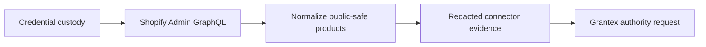

# Shopify Connector Setup Guide

Canonical end-to-end flow: [OACP end-user flow](end-user-flow.md).

## Runtime Endpoints

| Endpoint | Purpose |
| --- | --- |
| `PUT /api/v1/commerce/runtime/merchant-configs/{merchant_id}` | Save the merchant/store source connector and publishing/channel/provider preferences. |
| `GET /api/v1/commerce/runtime/merchant-configs/{merchant_id}` | Load merchant config for edit/update. |
| `POST /api/v1/commerce/runtime/seller-agents/connectors/shopify/credentials` | Store merchant-scoped Shopify credentials. |
| `GET /api/v1/commerce/runtime/seller-agents/connectors/shopify/status` | Confirm credential metadata without exposing secrets. |
| `POST /api/v1/commerce/runtime/seller-agents/shopify/sync` | Run read-only source sync. |
| `POST /api/v1/commerce/runtime/merchant-configs/{merchant_id}/catalog/shopify` | Merchant setup: store the merchant's own custom-app Admin API token (and optional webhook signing secret), validate it with one read and sync. |
| `POST /api/v1/webhooks/shopify/{tenant_id}/{path_token}` | Public product webhook for one merchant: the path token names the merchant, `X-Shopify-Hmac-Sha256` must verify with that merchant's stored webhook secret and `X-Shopify-Shop-Domain` must be its shop. Every refusal is the same 401. |
| `POST /api/v1/commerce/runtime/shopify/webhooks/product-update` | Signed-in replay of a delivery: verified with the stored webhook secret of the merchant that owns the shop. |

## Credentials are per merchant

Every sync, refresh and webhook uses the merchant's own stored credentials. A tenant without a stored
Shopify connector is refused with `blocked_missing_shopify_credentials`; the deployment's
`SHOPIFY_SHOP_DOMAIN`, `SHOPIFY_ADMIN_ACCESS_TOKEN` and `SHOPIFY_API_VERSION` are read only for the one
tenant named in `AGENTICORG_SHOPIFY_ENV_OPERATOR_TENANT_ID` (the platform operator's own store, empty by
default), and only when the onboarding packet names that same shop domain. Stored credentials for a
different store than the packet names are refused with `blocked_shop_domain_mismatch`.
`SHOPIFY_WEBHOOK_SECRET` is no longer read: each merchant's webhook secret is stored, encrypted, with its
connector, and the webhook address carries a path token derived from `AGENTICORG_SECRET_KEY`
(redacted in access logs).

## Secret Handling

Do not show Shopify tokens in UI, docs, logs, OACP artifacts, cache records, or error messages. The UI test verifies credential submission without rendering secrets.

Credential fields live in the Shopify credential route or approved custody system. Merchant commerce config stores only metadata such as `credential_custody` and `credential_ref`.

## Sync Diagram

## Blockers

- Missing credential.
- Invalid Shopify domain.
- Credential validation failure.
- HMAC secret missing for webhook intake.
- Source evidence contains private or executable fields.
