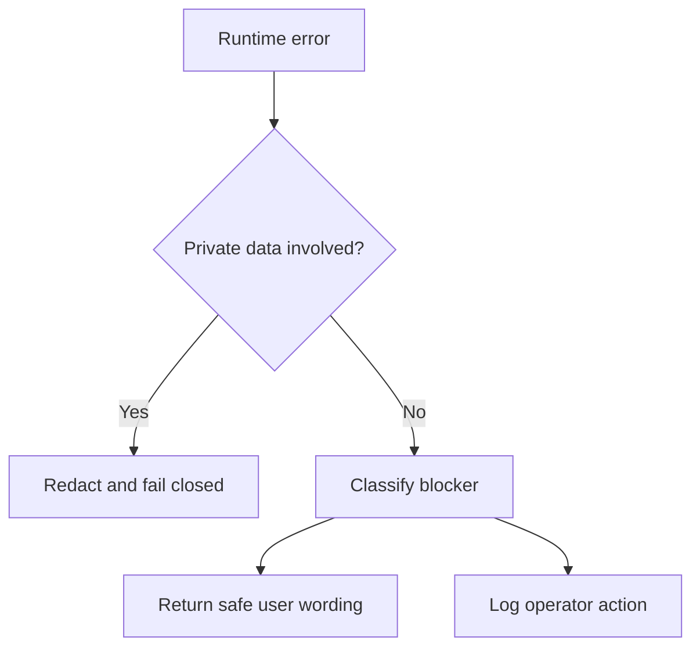

# OACP Troubleshooting

Canonical end-to-end flow: [OACP end-user flow](end-user-flow.md).

| Symptom | Likely cause | Action |
| --- | --- | --- |
| Shopify sync blocked | Missing credential, invalid domain, decrypt failure, or read validation failure. | Reconnect Shopify and confirm status endpoint hides secrets. |
| Grantex authority returns 202 | Connector evidence missing. | Run Shopify sync and resubmit authority request. |
| Grantex authority returns 422 | Stale, private, executable, or invalid scope request. | Inspect requested artifact families and source observed time. |
| Artifact cache returns 422 `artifact_verification_refused` | Strict verification refused at least one artifact, so nothing from the issuance was cached. `refusals[].refusal_code` names the step: `signature_missing_or_placeholder` or `detached_jws_verification_failed` (unsigned, legacy template or tampered artifact; Grantex has not deployed the ES256 signing release, or the envelope or payload changed in transit), `payload_hash_mismatch` (payload changed), `issuer_key_untrusted` (issuer not the configured `AGENTICORG_GRANTEX_ISSUER`, kid not in the Grantex JWKS, or JWKS unreachable), `artifact_expired_or_stale` / `artifact_ttl_exceeds_default` / `artifact_scope_mismatch`, `artifact_revoked` / `artifact_suspended`, `revocation_status_unavailable` (status list unreachable, invalid, or not served by the Grantex issuer). | Fix the cause and re-request authority. Check the issuer and `GRANTEX_BASE_URL` settings and that the Grantex JWKS lists an `oacp-` key. Do not set `AGENTICORG_OACP_VERIFY_STRICT=false` in production except as a recorded, temporary operator decision while Grantex deploys its signing release. |
| Artifacts cached but `verification.refused` is not empty | Log-only mode (non-strict runtime, or `AGENTICORG_OACP_VERIFY_STRICT=false`). The refused artifacts were cached without a `verifier_result_ref` and the `oacp_artifact_verification_irregularity` warning was logged. | Treat as an irregularity: those records cannot back a final commitment. Refresh once Grantex issues verifiable artifacts. |
| Buyer answer, adapters or purchase preparation blocked with `artifact_unverified_legacy` or `artifact_unverified` | The cache row was written before verification existed (stamped `:verified` ref) or in log-only mode (no ref); strict runtimes do not use it. | `POST /api/v1/commerce/runtime/artifacts/refresh` for the merchant and seller agent to re-fetch the scope from Grantex replay and cache it verified. |
| Buyer answer missing | Cache lacks valid catalog/price/inventory artifacts. | Refresh Grantex artifacts and cache. |
| Source label missing | UI or bridge dropped cache metadata. | Fix bridge response mapping before public use. |
| WhatsApp/Telegram blocked | Webhook secret missing or invalid. | Configure secrets and rerun webhook smoke. |
| Purchase prepare blocked | Fresh artifact or provider capability evidence missing. | Refresh source artifacts and run Plural/Pine verifier. |
| POS handoff blocked | Purchase preparation did not produce a prepared handoff, artifact refs are missing, or POS location metadata is incomplete. | Refresh artifacts, verify buyer/session scope, and check POS readiness endpoint. |
| POS simulator reports accepted | Local test handoff only. | Tell buyer staff must confirm final price and payment at the store. Do not claim purchase completion. |
| POS callback says payment confirmed but is unverified | Missing, stale, or mismatched POS HMAC signature, or missing provider evidence ref. | Reject the callback when the signing secret is configured; otherwise downgrade to staff review and investigate callback verification. |
| User asks for paid-state proof | Unsupported from OACP cache. | Return safe wording: no payment/order was created. |

## Failure/Refusal Flow

