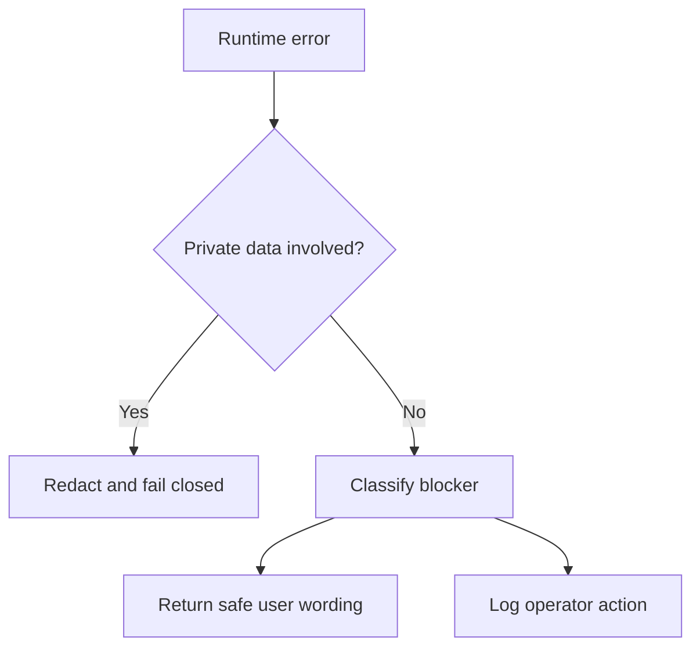

# OACP Troubleshooting

Canonical end-to-end flow: [OACP end-user flow](end-user-flow.md).

| Symptom | Likely cause | Action |
| --- | --- | --- |
| Every purchase or POS handoff refused with `failing_rule: buyer_authority_verified` | Strict runtime: buyer mandate, consent and passport references in the request body are caller-asserted, and no server-side verification of them exists on `main` (status 2026-10-20). | Expected in strict runtimes. To accept caller-asserted authority as a recorded operator decision, set `AGENTICORG_ARBITER_REQUIRE_VERIFIED_AUTHORITY=false`; decisions then record `buyer_authority_source: caller_asserted`. |
| Executing call refused `grantex_grant_missing` | The allow decision has no verified Grantex countersignature: `grantex_countersignature.status` on the deciding call was `unavailable` (Grantex unreachable, `GRANTEX_COMMERCE_BASE_URL`/`GRANTEX_COMMERCE_INTERNAL_TOKEN` unset, tenant not in Grantex's service tenant allowlist), `invalid` (grant did not verify or bind the decision; logged as `commerce_arbiter_grant_irregularity`) or `skipped` (no `buyer_agent_id`). | Fix the cause and ask for a new decision (repeat the call without `decision_id`). Nothing retries by itself. As a recorded operator decision during a Grantex outage, `AGENTICORG_ARBITER_REQUIRE_GRANTEX_GRANT=false`. |
| `grantex_countersignature.status: conflict` | Grantex already holds another body for this `decision_id`. | Treat as an irregularity; decision ids are never reused. Ask for a new decision. |
| `scripts/verify_ledger.py` reports a break | `sequence_gap`, `previous_link`, `link_hash` (rows removed, reordered or edited), `truncated` (rows cut from the end; an anchor or witnessed head is newer than the export), `anchor_mismatch`, `witness_countersignature`. | Treat as an irregularity. Re-export from the database and compare; run the in-platform verification (`docs/operations/audit-chain.md`). A row signature is checked only with `--audit-secret-env`. |
| `audit_chain_witness_irregularity` logged with `WITNESS_FORK` | Grantex already witnessed another hash at that chain sequence: the chain changed after it was witnessed. | Irregularity. The fork evidence is in `audit_chain_witness_checkpoints` (`status = fork`); verify the chain and escalate. |
| Retention task deletes nothing | `AGENTICORG_OACP_RETENTION_APPLY_ENABLED` off, no `approve_future_retention_review` disposition past its `retain_until`, or a legal hold, block, reject or defer decision applies. | Check `GET /api/v1/commerce/runtime/ledger/retention/due`. |
| Shopify sync blocked | Missing credential, invalid domain, decrypt failure, or read validation failure. | Reconnect Shopify and confirm status endpoint hides secrets. |
| Grantex authority returns 202 | Connector evidence missing. | Run Shopify sync and resubmit authority request. |
| Grantex authority returns 422 | Stale, private, executable, or invalid scope request. | Inspect requested artifact families and source observed time. |
| Artifact cache returns 422 `artifact_verification_refused` | Strict verification refused at least one artifact, so nothing from the issuance was cached. `refusals[].refusal_code` names the step: `signature_missing_or_placeholder` or `detached_jws_verification_failed` (unsigned, legacy template or tampered artifact; the Grantex environment is not running the ES256 signing release, or the envelope or payload changed in transit), `payload_hash_mismatch` (payload changed), `issuer_key_untrusted` (issuer not the configured `AGENTICORG_GRANTEX_ISSUER`, kid not in the Grantex JWKS, or JWKS unreachable), `artifact_expired_or_stale` / `artifact_ttl_exceeds_default` / `artifact_scope_mismatch`, `artifact_revoked` / `artifact_suspended`, `revocation_status_unavailable` (status list unreachable, invalid, or not served by the Grantex issuer). | Fix the cause and re-request authority. Check the issuer and `GRANTEX_BASE_URL` settings and that the Grantex JWKS lists an `oacp-` key. Do not set `AGENTICORG_OACP_VERIFY_STRICT=false` in production except as a recorded, temporary operator decision while the Grantex side is fixed. Grantex production has the signing release, an `oacp-` key and its public status list as of 2026-10-20. |
| Artifacts cached but `verification.refused` is not empty | Log-only mode (non-strict runtime, or `AGENTICORG_OACP_VERIFY_STRICT=false`). The refused artifacts were cached without a `verifier_result_ref` and the `oacp_artifact_verification_irregularity` warning was logged. | Treat as an irregularity: those records cannot back a final commitment. Refresh once Grantex issues verifiable artifacts. |
| Buyer answer, adapters or purchase preparation blocked with `artifact_unverified_legacy` or `artifact_unverified` | The cache row was written before verification existed (stamped `:verified` ref) or in log-only mode (no ref); strict runtimes do not use it. | `POST /api/v1/commerce/runtime/artifacts/refresh` for the merchant and seller agent to re-fetch the scope from Grantex replay and cache it verified. |
| Buyer answer missing | Cache lacks valid catalog/price/inventory artifacts. | Refresh Grantex artifacts and cache. |
| Source label missing | UI or bridge dropped cache metadata. | Fix bridge response mapping before public use. |
| WhatsApp/Telegram blocked | Webhook secret missing or invalid. | Configure secrets and rerun webhook smoke. |
| Purchase prepare blocked | Fresh artifact or provider capability evidence missing. | Refresh source artifacts and run Plural/Pine verifier. |
| POS handoff blocked | Purchase preparation did not produce a prepared handoff, artifact refs are missing, or POS location metadata is incomplete. | Refresh artifacts, verify buyer/session scope, and check POS readiness endpoint. |
| POS simulator reports accepted | Local test handoff only. | Tell buyer staff must confirm final price and payment at the store. Do not claim purchase completion. |
| POS callback says payment confirmed but is unverified | Missing, stale, or mismatched POS HMAC signature, or missing provider evidence ref. | Reject the callback when the signing secret is configured; otherwise downgrade to staff review and investigate callback verification. |
| User asks for paid-state proof | Unsupported from OACP cache. | Return safe wording: no payment/order was created. |
| `/.well-known/ucp` answers 404 | `AGENTICORG_UCP_PROFILE_ENABLED` off; the `Host` is not a verified serving host; the merchant is not published or has no active signing key; or no verified, fresh `public_discovery_state` artifact allows publication for that host. | `GET /api/v1/commerce/runtime/merchant-configs/{merchant_id}/ucp` shows the serving host, attestation, keys and publication state; see [UCP profile](ucp-profile.md). |
| `/ucp/checkout-sessions`, `/ucp/carts` or `/ucp/orders` answer 404 | `AGENTICORG_UCP_CHECKOUT_ENABLED` off, or the host or merchant does not belong to the platform API key's tenant. | Turn the flag on in staging first; check the platform's API key tenant and the merchant's publication. |
| UCP Complete answers `executor_unavailable` | No executor is registered; none is on `main` (status 2026-10-20). The session stays `ready_for_complete`. | Expected. Do not describe the session as an order or as paid. |
| UCP create answers 200 with `capabilities_incompatible` | The platform profile in `UCP-Agent` and the merchant profile share no root capability at the same release. | Check the platform profile's capabilities and `version`; see [UCP checkout](ucp-checkout.md#negotiation). |
| ACP route answers an `Error` with `missing_api_version`, `idempotency_key_required` or 422 `idempotency_conflict` | Missing `API-Version: 2026-04-17`, missing `Idempotency-Key` on a POST, or the same key reused with another body. | Fix the client headers; see [ACP feed and sessions](acp-feed-and-sessions.md). |
| ACP requests refused 401 `invalid_signature` | `AGENTICORG_ACP_SIGNATURE_MODE=enforce`, and ACP publishes no signing algorithm, so no platform verifier is registered and every request is refused. | Set the mode back to `log` (the default). |
| ACP feed answers 409 `feed_unavailable:...` | Verified, fresh catalog, price or inventory artifacts are missing for the merchant. | Refresh Grantex artifacts (`POST /artifacts/refresh`), then retry. |

## Failure/Refusal Flow

