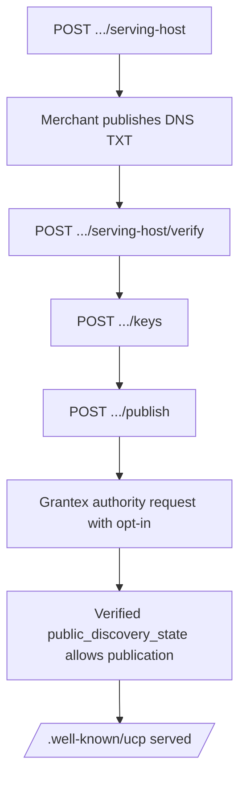

# UCP Business Profile, Catalog and Locations

Canonical end-to-end flow: [OACP end-user flow](end-user-flow.md).

AgenticOrg serves a merchant's Universal Commerce Protocol (UCP) business
profile at `https://<merchant serving host>/.well-known/ucp`, plus the public
catalog and location reads it advertises. Everything is rendered from the
merchant config and from verified OACP artifacts; nothing is fetched from
Grantex on a public request.

Releases: `2026-04-08` (the release Google's Merchant Center guides and the
official conformance suite target) and `2026-08-25`.

## What is served

| Route (at the serving host root) | UCP name | Release | Notes |
| --- | --- | --- | --- |
| `GET /.well-known/ucp` | business profile | newest configured | `Cache-Control: public, max-age=300`, strong `ETag`, `304` on `If-None-Match`, no redirect |
| `GET /.well-known/ucp/{version}` | leaf profile | each older configured release | listed in `ucp.supported_versions`; no `supported_versions` of its own |
| `POST /ucp/catalog/search` | `dev.ucp.shopping.catalog.search` | both | query, `filters.categories`, `filters.price` (in `context.currency`), cursor pagination (max 50) |
| `POST /ucp/catalog/lookup` | `dev.ucp.shopping.catalog.lookup` | both | product id, variant id or SKU (max 50 ids); `inputs[]` with `exact` / `featured` |
| `POST /ucp/locations/search` | `dev.ucp.common.location.search` | 2026-08-25 | query, `filters.hours.open_at`, `filters.amenities` |
| `POST /ucp/locations/lookup` | `dev.ucp.common.location.lookup` | 2026-08-25 | store ids |

The profile's REST service is `https://<host>/ucp` (no trailing slash). Only
capabilities that are actually served are listed: catalog search and lookup
always (while the profile is served), location search and lookup in
2026-08-25 when the merchant has at least one enabled POS store. Checkout,
cart and order register later behind `AGENTICORG_UCP_CHECKOUT_ENABLED`.
`payment_handlers` is present and empty until a handler registers. Every
`dev.ucp.*` entry carries `version` equal to `ucp.version`.

Signing keys: 2026-04-08 publishes `signing_keys[]` with `keys[]` as a mirror
(same `kid`s); 2026-08-25 publishes `keys[]` only.

The request's release comes from the `version` parameter of the `UCP-Agent`
header (`profile="https://agent.example/profile.json"; version="2026-04-08"`);
without one, the newest configured release answers. An unserved release is
`422 version_unsupported`; a malformed header `400 invalid_profile_url`. Every
response echoes `ucp.version` and the active capability. Fetching the
platform profile to read its version is not done yet (it comes with the
transaction surfaces).

## When a profile is served

All of these must hold, otherwise every route answers `404`:

1. `AGENTICORG_UCP_PROFILE_ENABLED=true`.
2. The `Host` header names a host whose DNS attestation is recorded in the
   merchant config (no IP literal, no single-label host). No path or query
   parameter selects a merchant.
3. The merchant opted in (operator `publish`).
4. The merchant has an active ES256 signing key.
5. A verified (ES256, Phase 1), fresh and unrevoked `public_discovery_state`
   artifact from Grantex allows publication for that host and that
   attestation reference.

## Operator flow

All routes are under `/api/v1/commerce/runtime/merchant-configs/{merchant_id}/ucp`
and need `commerce.merchant_config.write` (or tenant admin). Each writes the
commerce ledger. Pass `seller_agent_id` in the body when the merchant has
several seller agents.



1. `POST .../serving-host` `{"host": "shop.merchant.example"}` returns the
   challenge: TXT record `_agenticorg-ucp.shop.merchant.example` with value
   `agenticorg-ucp-verify=<random>`.
2. `POST .../serving-host/verify` looks the record up with async DNS (5 s).
   On a match it stores the attestation (`method: dns_txt`, record name,
   SHA-256 of the value, `verified_at`, `verified_by`, an opaque `ref`) and
   indexes the host for public lookup. A host already indexed by another
   tenant is refused (`host_bound_to_another_tenant`). Changing the host
   withdraws the publication until it is published again.
3. `POST .../keys` creates the merchant's signing key if it has none (merchants
   onboarded before the flag); `POST .../keys/rotate` rotates.
4. `POST .../publish` (optional `{"namespace": "example.merchant.shop.store"}`)
   checks the namespace and records the opt-in. Refusals: `serving_host_not_attested`,
   `signing_key_missing`, `namespace_not_authority_bound`,
   `vendor_entry_outside_namespace`. `POST .../unpublish` withdraws it.
5. The next `POST /api/v1/commerce/runtime/authority/grantex/request` carries
   `public_discovery_requested: true`, `no_public_discovery_enablement: false`,
   `serving_host` and `namespace_attestation_ref`. When Grantex issues an
   enabled `public_discovery_state` artifact, cache or refresh the artifacts
   (`/artifacts/cache`, `/artifacts/refresh`); the profile is served from then on.
   A later disabled artifact withdraws it.

`GET .../ucp` shows the state without key material: `ready_to_serve` (steps 1-4),
`public_discovery_opt_in`, `public_discovery_allowed` and the capabilities that
would be served.

## Namespace authority binding

A vendor (non-`dev.ucp.*`) capability, service or payment handler is listed
only when its `schema` URL is `https`, has no userinfo, and its host's labels,
reversed, equal the name or are a label-aligned prefix of it (UCP overview,
Authority Binding; 2026-04-08 also binds `spec`). The Public Suffix List is not
consulted. `com.example.pay` binds to `pay.example.com` or `example.com`;
`com.example.pay` from `cdn.example.com` does not. `dev.ucp.*` entries must
point at `ucp.dev`.

The merchant namespace is the attested host reversed
(`shop.merchant.example` -> `example.merchant.shop`) or a label-aligned
extension of it. A vendor entry that claims the attested host's authority is
listed only inside that namespace, and `publish` refuses while any registered
one sits outside it.

## Signing keys

`core/commerce/merchant_keys.py`: one ES256 (P-256) key pair per merchant
config. The private key (PKCS#8) is stored encrypted for the tenant with the
same envelope as other tenant secrets (BYOK KEK, else platform KEK, else the
legacy vault key); the public JWK carries `kid` (RFC 7638 thumbprint), `use:
sig`, `alg: ES256`. Keys are created at onboarding while the profile flag is on,
or by the operator action; never on a read. A rotated-out key stays published
for `AGENTICORG_UCP_KEY_ROTATION_GRACE_DAYS` (at least 7). Signatures are raw
`r||s` (64 bytes) for RFC 9421 and detached JWS.

The keys live in the merchant config's server-managed UCP state
(`public_publishing.ucp`); a merchant-config upsert never accepts or replaces
that state, and API responses omit the ciphertext.

## Catalog

Products come from the merchant's synced Shopify evidence, served only while
the scope holds verified, fresh, buyer-agnostic `merchant_capability`,
`seller_agent_capability`, `catalog_snapshot`, `price` and `inventory`
artifacts (unverified or legacy-stamped records never count, whatever
`AGENTICORG_OACP_VERIFY_STRICT` says). Otherwise the response is HTTP 200 with
no products and an `unrecoverable` `catalog_unavailable` message.

Prices are integer minor units of the ISO 4217 currency (exponent 0, 2, 3 or 4),
converted from decimal text without floating point. Draft and archived
products are not listed. Ids are opaque: products use the redacted product
ref, variants `shopify_variant:<digest>:redacted` (the `item.id` cart and
checkout will accept).

2026-08-25 catalog responses carry `policies[]`, mapped by
`core/commerce/ucp/policies.py` from the verified OACP `policy` artifact:
return and warranty terms to `dev.ucp.shopping.policy.return` / `.warranty`;
fulfillment, cancellation and support terms to `<merchant namespace>.policy.*`.
The policy text is captured when the artifact is verified and cached (profile
flag on) and used only while that artifact is still a fresh verified record.

## Locations (2026-08-25)

Locations are the merchant's enabled POS stores. A store may carry a
`location` block in the merchant config:

```json
{"store_id": "store_pune_1", "display_name": "Merchant Example Pune", "city": "Pune", "country_code": "IN",
 "location": {"timezone": "Asia/Kolkata",
              "address": {"street_address": "1 Example Road", "postal_code": "411001"},
              "geo": {"latitude": 18.52, "longitude": 73.85},
              "hours": [{"day": "monday", "opens": "10:00", "closes": "20:00"}],
              "exception_hours": [{"valid_from": "2026-12-25", "valid_through": "2026-12-25", "title": "Closed"}]}}
```

Saving the config validates it: IANA timezone required with hours, `HH:MM`,
`opens != closes`, `valid_from <= valid_through`, no intersecting non-identical
exception ranges, a full closure alone for its bounds. `open_at` is evaluated
on the location's local clock (zoneinfo): `closes` before `opens` runs into the
next day, `00:00`-`23:59` is the whole day, an exception replaces the regular
schedule and takes over at local midnight, DST gap labels match no instant and
both fold instants get the same answer. A location with no schedule never
matches `open_at`. `distance`, `serves` and `filters.items` cannot be evaluated
and are rejected (`unsupported_filter`) rather than ignored.

## Hosting and deployment

- Route the merchant host to the API service with the `Host` header intact and
  without rewriting `/.well-known/ucp` or `/ucp/*`. The routes are exempt from
  tenant authentication; rate limits are per client IP (`ucp-discovery` 600/min,
  `ucp-catalog-read` 120/min) and degrade open if Redis is down.
- The host index lives in the tenant catalogue (`tenants.settings.ucp_serving_hosts`);
  lookups are cached in-process for 60 s.

## Registering a surface

Transaction surfaces add their capability to the process-wide registry at
import time:

```python
from core.commerce.ucp.registry import UcpCapabilityRegistration, ucp_registry

ucp_registry.register_capability(
    UcpCapabilityRegistration(
        name="dev.ucp.shopping.checkout",
        service="dev.ucp.shopping",
        spec_urls={"2026-04-08": "https://ucp.dev/2026-04-08/specification/checkout"},
        schema_urls={"2026-04-08": "https://ucp.dev/2026-04-08/schemas/shopping/checkout.json"},
        served=lambda ctx: settings.ucp_checkout_enabled,
    )
)
```

Services (`UcpServiceRegistration`, one per transport) and payment handlers
(`UcpPaymentHandlerRegistration`) register the same way. A service is listed
only while a capability bound to it is served; an extension whose parents are
all absent is dropped.

## Conformance

The official suite (`Universal-Commerce-Protocol/conformance`, 2026-04-08,
`ucp-sdk` 0.4.6) passes `test_discovery` against a local server;
`test_discovery_urls` is skipped upstream; the checkout, cart, order and
webhook tests do not apply until the transaction surfaces ship. Emitted
documents are validated in tests against the published UCP JSON Schemas
(`tests/fixtures/ucp_schemas`).

## Rollback

Set `AGENTICORG_UCP_PROFILE_ENABLED=false`: every route answers 404 at once
(cached profiles expire within 5 minutes). For one merchant, `POST .../unpublish`.
